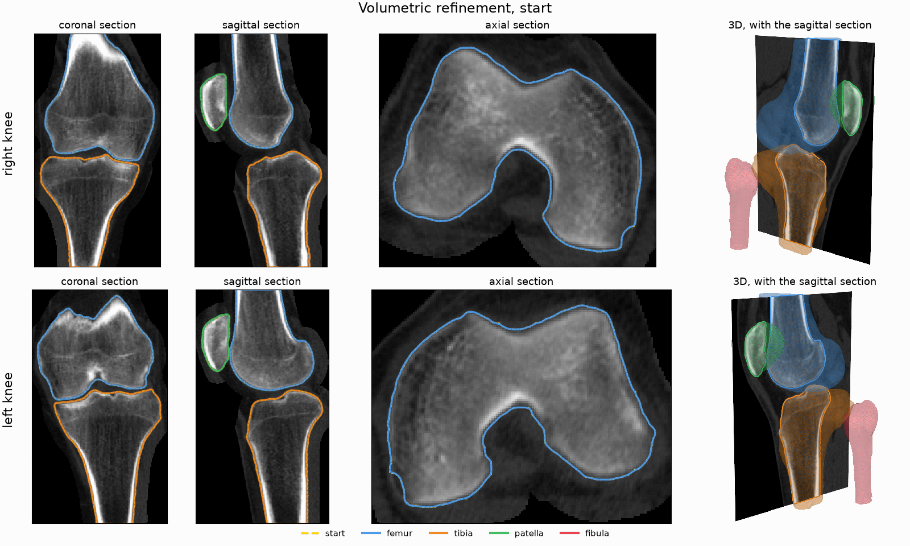

# cortical-bone-mapping-rs

Cortical bone mapping (CBM) in Rust, with Python bindings: model-based
measurement of cortical thickness, and automatic segmentation of the
periosteal and endosteal surfaces, from CT and HR-pQCT images.

**Documentation: [njneeteson.github.io/cortical-bone-mapping-rs](https://njneeteson.github.io/cortical-bone-mapping-rs/)**



*Refinement of all eight bones of a clinical CT of both knees, from a rough
automatic segmentation (yellow dashed) to the fitted periosteal surfaces,
one frame per move.*

At every vertex of the bone's outer surface, CBM samples a density profile
along the inward normal and fits a blurred three-level step model (soft
tissue, cortex, trabecular bone). This package implements

* the original method of Treece et al. (2010), one fit per profile;
* the global **multigrid** and spatially **regularised** fits of our 2025
  paper (Neeteson & Boyd), with a much faster solver;
* a **volumetric model** that fits every voxel of a band around the surface
  with one PSF for the scan, a **curvature penalty** on the fitted surfaces,
  and **segmentation refinement**, which moves a rough segmentation onto
  the fitted periosteum (extensions).

## Install

```bash
pip install ./python          # builds the Rust extension (needs a Rust toolchain)
```

## Usage

```python
import cortical_bone_mapping_rs as cbm

# from the image alone: a convex-hull start, refined
start = cbm.hull_segmentation(image)
options = cbm.Options.preset("radius_tibia", rho_c="estimate")
rr = cbm.refine_segmentation(image, start, options=options, method="volumetric")
rr.periosteal_mask, rr.endosteal_mask, rr.cortical_mask
rr.result.thickness                       # mm, per surface node

# or thickness on a given segmentation
res = cbm.cortical_bone_mapping(image, mask, spacing=(0.0607,) * 3, method="regularized")
res.save_vtk("thickness.vtk")
```

The [user guide](https://njneeteson.github.io/cortical-bone-mapping-rs/) covers
choosing a method, parameters for HR-pQCT and clinical CT, scans with several
bones, and the Rust API.

## Results at a glance

From the [examples](docs/examples.md) and [benchmarks](docs/benchmarks.md):

* On phantoms of the distal radius and tibia at HR-pQCT resolution, every
  method refines an automatic start; the volumetric model has the lowest
  thickness error (26–34 µm), about 6 times less than the local fit.
* On a clinical CT of both knees, the regularised and volumetric fits refine
  all eight bones to convergence; the local fit converges on none.
* Against the original Python implementation (Bonelab) on the same
  profiles: 145–408 times faster for the local fit, 10–27 times for
  multigrid, 3–8 times for the regularised fit, with lower error for every
  global method. At 134 000 nodes the 1D methods take 2–17 s and
  0.1–0.8 GB.

## References

> N. J. Neeteson, S. K. Boyd, *Advancing Cortical Bone Mapping with global
> optimization*, Computers in Biology and Medicine, 2025,
> [doi:10.1016/j.compbiomed.2025.110636](https://doi.org/10.1016/j.compbiomed.2025.110636)

> G. M. Treece, A. H. Gee, P. M. Mayhew, K. E. S. Poole, *High resolution
> cortical bone thickness measurement from clinical CT data*, Medical Image
> Analysis 14(3):276–290, 2010.

> G. M. Treece, A. H. Gee, *Cortical Bone Mapping: Measurement and
> Statistical Analysis of Localised Skeletal Changes*, Curr. Osteoporos.
> Rep. 16:617–625, 2018,
> [doi:10.1007/s11914-018-0475-3](https://doi.org/10.1007/s11914-018-0475-3)

## Development

```bash
cargo test --workspace && cargo clippy --all-targets -- -D warnings
cd python && maturin develop --release && pytest tests
nox -s docs                                    # the documentation site, docs/_build/html
cd examples && python phantoms.py          # phantom results and figures
python knee.py DICOM_DIR                       # clinical CT (the image is not public)
python benchmarks.py BONELAB_DIR               # benchmarks
```

## License

MIT. If you use this software, please cite the papers above and this
implementation (see [CITATION.cff](CITATION.cff)).
