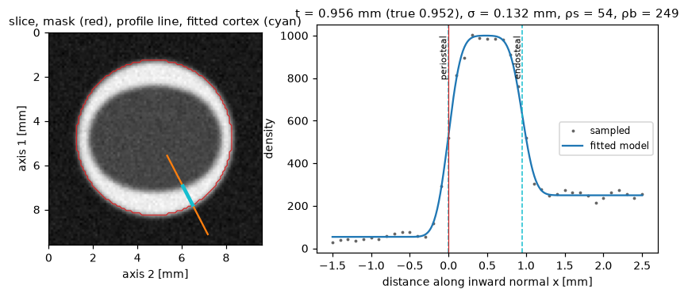

# cortical-bone-mapping-rs

Cortical bone mapping (CBM) in Rust, with Python bindings: model-based
measurement of cortical thickness, and automatic segmentation of the
periosteal and endosteal surfaces, from CT and HR-pQCT images.

CBM samples a density profile along the inward normal at every vertex of
the bone's outer surface and fits a blurred three-level step model (soft
tissue, cortex, trabecular bone). At every surface point the result is the
cortical **thickness** `t`, the position `m` of the cortical mid-line, the
blur `σ`, and the soft-tissue and trabecular densities `ρs`, `ρb`; the
cortical density `ρc` is fixed or estimated from the image.



This crate implements

* the original method of Treece et al. (2010) (one fit per node), with fixed,
  PSF-based or estimated blur;
* the global **multigrid** and spatially **regularised** fits of Neeteson &
  Boyd (2025), with a much faster solver;
* two extensions: a **curvature penalty** on the fitted surfaces, and
  **segmentation refinement**, which moves a rough periosteal segmentation
  onto the fitted periosteum until it stops moving.


*Refinement on a phantom whose input mask is dilated by 0.45 mm with 7-lobed
bumps. Left, a slice with the segmentation (red) and the true periosteum
(green, dashed); right, the surface coloured by its distance from the truth.*

## Install

```bash
pip install ./python          # builds the Rust extension (needs a Rust toolchain)
```

## Usage

From the image alone, an automatic segmentation and a thickness map
(see [docs/segmentation.md](docs/segmentation.md)):

```python
import cortical_bone_mapping_rs as cbm

start = cbm.hull_segmentation(image)             # threshold 320 + per-slice convex hull
options = cbm.Options.preset("radius_tibia", rho_c="estimate")
rr = cbm.refine_segmentation(image, start, options=options,
                             curvature="change", curvature_weight=1.0)
rr.periosteal_mask, rr.endosteal_mask, rr.cortical_mask
rr.result.thickness
```

Thickness on a given segmentation (1 inside the periosteal surface):

```python
res = cbm.cortical_bone_mapping(
    image, mask, spacing=(0.0607, 0.0607, 0.0607),  # array-axis order (z, y, x)
    method="regularized",           # "local" | "multigrid" | "regularized"
    normal_constraint="in_plane",   # transverse-plane normals for radius/tibia
    sub_mask=None,                  # optionally restrict where thickness is reported
)
res.points, res.normals          # (N, 3) surface nodes and inward normals
res.thickness, res.center        # (N,) fitted t and m
res.sigma, res.rho_s, res.rho_b  # other fitted parameters
res.periosteal_points, res.endosteal_points
res.save_vtk("thickness.vtk")    # or res.to_pyvista()
peri, endo, cortex = res.masks(image.shape)
```

Every option (`help(cbm.Options)`) can be passed as a keyword or through an
`Options` object:

```python
# Treece-style fixed blur, estimated as an axial PSF
cbm.cortical_bone_mapping(image, mask, spacing, sigma="estimate_psf", psf_model="axial", psf_axis=0)

# multigrid with control-point spacings in mm
cbm.cortical_bone_mapping(image, mask, spacing, method="multigrid", multigrid_spacings=(4, 2, 1))

# curvature penalty, alone or with the smoothing term
cbm.cortical_bone_mapping(image, mask, spacing, method="regularized",
                          reg_lambda=0.0, curvature="change", curvature_weight=1.0)
```

Images may be `float32/64`, `int8/16/32` or `uint8/16/32` and are not copied.
Also available: `cbm.buie_segmentation` (Buie et al. 2007, implemented from
the paper), and phantoms with exact ground truth: `cbm.Phantom` (smooth
shells), `cbm.BonePhantom` (realistic long bones, optionally with a
neighbouring fibula/ulna and cortical breaks) and `cbm.JointPhantom` (the
contact region of a knee).

From Rust:

```rust
use cortical_bone_mapping::{run, Options, Site};

let opts = Options::preset(Site::RadiusTibia, 0.0607);
let res = run(image.view(), mask.view(), None::<ndarray::ArrayView3<u8>>, &opts)?;
let t = res.thickness();
```

`cargo run --release --example phantom` runs every method on a phantom,
`--example refine` shows refinement, and `--example benchmark` reports
timings and peak memory.

## Parameters

`cbm.Options.preset("radius_tibia")` and `preset("knee")` give the parameter
sets of Table 1 of Neeteson & Boyd (2025): Taubin smoothing (100 iterations,
pass-band 0.1 or 0.01), sampling 5 mm outside and 15 mm inside, profile
smoothing σ = 3 samples, normals in the transverse plane (radius & tibia) or
along the scan axis (knee), `λ = 1`, `σ_reg = 1.942 mm` (32 voxels), 500 or
1000 regularisation neighbours, multigrid spacings from 128 or 256 down to
16 voxels. Array axis 0 is the scan axis; overrides are keywords. The plain
defaults use the same model guesses and bounds with generic sampling (2 mm
outside, 4 mm inside).

**Cortical density.** `ρc` is never fitted. Give it (`rho_c=1000`, Table 1),
estimate it from the image (`rho_c="estimate"`), or take each node's profile
maximum (`rho_c="profile_max"`, what the original Python implementation does
when no density is given). On realistic phantoms the estimate is the most
robust: the per-node maximum overestimates thin-cortex thickness by ~0.2 mm.
See [method](docs/method.md#cortical-density).

## Results at a glance

* **Accuracy.** On smooth phantoms the spatially constrained methods reduce
  thickness error 1.5–5× relative to the local fit
  ([examples](docs/examples.md)).
* **Automatic segmentation.** On realistic phantoms, hull → CBM matches Buie
  where Buie is right, corrects its −0.13 mm thickness bias on a thin porous
  cortex (cortex Dice 0.82 → 0.93), and does not leak through cortical
  breaks. Nearby bones within the sampling range, touching bones and the knee
  joint remain hard ([segmentation](docs/segmentation.md)).
* **Speed and memory.** Against the original Python implementation (Bonelab)
  on the same profiles, the local fit is ~420× faster, multigrid ~45× and the
  regularised fit ~10–20× (against a converged solve), with equal or better
  accuracy; 134k nodes take 2–22 s and 0.1–0.75 GB
  ([performance](docs/performance.md)).


## Documentation

* **[docs/method.md](docs/method.md)**: the model, every method and the
  solver, cortical density, the extensions, the starting segmentations, the
  memory/performance design, and the deliberate differences from the
  original implementations.
* **[docs/examples.md](docs/examples.md)**: accuracy of every method on
  smooth phantoms, noise sweeps, the curvature penalty, and refinement.
* **[docs/segmentation.md](docs/segmentation.md)**: automatic segmentation
  from the image alone; Buie's method as implemented; the experiment on
  realistic phantoms.
* **[docs/performance.md](docs/performance.md)**: run time and memory, and
  comparisons with the original Python implementation and with SciPy.

## Features

* **Methods**: `local` (Treece et al.), `multigrid` and `regularized`
  (Neeteson & Boyd), the latter optionally with the curvature penalty
  (`"change"`: curvature added by the fit; `"excess"`: curvature above a
  threshold), or with the curvature penalty alone.
* **Blur**: free, fixed, from a Gaussian PSF (direction-dependent), or a PSF
  estimated from the data (isotropic, axial or anisotropic).
* **Fast and frugal**: bounded Levenberg–Marquardt with analytic Jacobians
  per node; matrix-free Gauss–Newton/PCG with a work budget for the global
  fits; multithreaded; the image read in place; `f32` profiles and compact
  sparse operators.
* **Reproducible**: results are bitwise identical across runs and thread
  counts.
* **Tested**: analytic gradients against finite differences; the local fit
  against SciPy `least_squares`; every method for accuracy on phantoms with
  known geometry (one built independently with SciPy); property tests;
  refinement convergence; Buie's steps against brute force.

## References

> G. M. Treece, A. H. Gee, P. M. Mayhew, K. E. S. Poole, *High resolution
> cortical bone thickness measurement from clinical CT data*, Medical Image
> Analysis 14(3):276–290, 2010.

> G. M. Treece, A. H. Gee, *Cortical Bone Mapping: Measurement and
> Statistical Analysis of Localised Skeletal Changes*, Curr. Osteoporos.
> Rep. 16:617–625, 2018,
> [doi:10.1007/s11914-018-0475-3](https://doi.org/10.1007/s11914-018-0475-3)

> N. J. Neeteson, S. K. Boyd, *Advancing Cortical Bone Mapping with global
> optimization*, Computers in Biology and Medicine, 2025,
> [doi:10.1016/j.compbiomed.2025.110636](https://doi.org/10.1016/j.compbiomed.2025.110636)

> H. R. Buie, G. M. Campbell, R. J. Klinck, J. A. MacNeil, S. K. Boyd,
> *Automatic segmentation of cortical and trabecular compartments based on a
> dual threshold technique for in vivo micro-CT bone analysis*, Bone
> 41:505–515, 2007,
> [doi:10.1016/j.bone.2007.07.007](https://doi.org/10.1016/j.bone.2007.07.007)

## Development

```bash
cargo test --workspace && cargo clippy --all-targets -- -D warnings
cd python && maturin develop --release && pytest tests
python docs/scripts/make_figures.py                 # docs/images
python docs/scripts/segmentation_experiment.py      # docs/segmentation.md results (~50 min)
cargo run --release --example benchmark -p cortical-bone-mapping -- --json docs/benchmark_results.json
python docs/scripts/compare_scipy.py
python docs/scripts/compare_bonelab.py /path/to/Bonelab
```

## License

MIT. If you use this software, please cite the papers above and this
implementation (see [CITATION.cff](CITATION.cff)).
