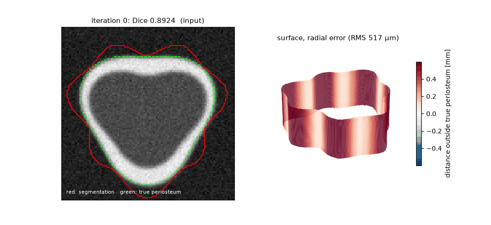

# cortical-bone-mapping-rs

Cortical bone mapping (CBM) in Rust, with Python bindings: model-based
measurement of cortical thickness from CT and HR-pQCT images, after

> G. M. Treece, A. H. Gee, P. M. Mayhew, K. E. S. Poole, *High resolution
> cortical bone thickness measurement from clinical CT data*, Medical Image
> Analysis 14(3):276–290, 2010; and G. M. Treece, A. H. Gee, *Cortical Bone
> Mapping: Measurement and Statistical Analysis of Localised Skeletal
> Changes*, Curr. Osteoporos. Rep. 16:617–625, 2018,
> [doi:10.1007/s11914-018-0475-3](https://doi.org/10.1007/s11914-018-0475-3)

with the global multigrid and spatially regularised fits of

> N. J. Neeteson, S. K. Boyd, *Advancing Cortical Bone Mapping with global
> optimization*, Computers in Biology and Medicine, 2025,
> [doi:10.1016/j.compbiomed.2025.110636](https://doi.org/10.1016/j.compbiomed.2025.110636)

and two extensions: a **curvature penalty** on the fitted surfaces, and
**model-driven segmentation refinement** that snaps a poor periosteal
segmentation onto the fitted periosteal surface.



*Segmentation refinement on a phantom: the input mask is dilated by 0.45 mm
with 7-lobed bumps. Left, a slice with the segmentation (red) and the true
periosteum (green, dashed). Right, the surface coloured by its distance from
the true periosteum.*

Given a grey-scale image and a binary segmentation of the bone (1 inside the
periosteal surface), CBM samples a density profile along the inward normal
at every vertex of the outer surface and fits a blurred three-level step
model. The result is, at every surface point, a normal and the fitted
parameters: cortical **thickness** `t`, the position `m` of the cortical
mid-line along the normal, the blur `σ`, and the soft-tissue and trabecular
densities `ρs`, `ρb`. The cortical density `ρc` is fixed.


Further documentation:

* **[docs/method.md](docs/method.md)**: the model, every method and solver,
  the extensions, the memory/performance design, and the deliberate
  differences from the reference implementations.
* **[docs/examples.md](docs/examples.md)**: accuracy of every method on
  phantoms, noise sweeps, the curvature penalty, and segmentation refinement.
* **[docs/performance.md](docs/performance.md)**: run time and memory, and
  comparisons with the Bonelab reference implementation and with SciPy.
* **[docs/buie.md](docs/buie.md)**: Buie's dual-threshold segmentation
  (implemented from the 2007 paper), and an experiment on realistic bone
  phantoms: CBM fitted to a Buie segmentation cuts the endosteal error of a
  thin porous cortex from 134 to 39 µm (cortex Dice 0.78 → 0.94).

## Features

* **Methods.**
  * `local`: an independent fit per node (Treece et al.).
  * `multigrid`: `m, t, σ` on control points, refined coarse to fine (Neeteson & Boyd).
  * `regularized`: per-node `m, t, σ` with spatial regularisation (Neeteson & Boyd).
* **Blur handling.** `σ` can be free, fixed, given by a Gaussian PSF
  (direction-dependent, as in Treece et al.), or estimated as a PSF from the
  data (isotropic, axial or anisotropic).
* **Curvature penalty (new).** Penalises curvature that the fit adds to the
  periosteal and endosteal surfaces (`"change"`, which leaves bone shape and
  uniform offsets free), or absolute curvature above a threshold
  (`"excess"`). It uses a scale-controlled point-cloud Laplacian or the
  cotangent Laplacian, and can be used alone or with the Neeteson term.
* **Buie dual threshold.** Segmentation after Buie et al. (2007), usable as
  the starting segmentation (`cbm.buie_segmentation`).
* **Realistic phantoms.** `cbm.BonePhantom` has an irregular, axially
  varying shape and thickness, trabeculae, cortical pores and an
  endocortical transition zone, with exact ground truth along any line.
* **Segmentation refinement (new).** An under-relaxed fixed-point iteration
  that moves the surface to the fitted periosteal edge and refits until it
  stabilises. It returns refined periosteal, endosteal and cortical masks.
* **Fast and frugal.**
  * Bounded Levenberg–Marquardt with analytic Jacobians for the local fits.
  * Matrix-free Gauss–Newton / PCG for the global fits.
  * Multithreaded, with the image read in place in its own dtype.
  * `f32` profiles, and compact sparse operators built without temporary
    copies.
  * Against the Bonelab reference implementation on the same profiles: the
    local fit is ~440× faster, multigrid ~50× and regularised ~12× against
    Bonelab's defaults, which stop early (~10–20× against a converged
    Bonelab solve), with equal or better accuracy. The regularised fit
    is ~70× faster than a converged SciPy L-BFGS-B solve of the same
    objective and reaches the same optimum (see
    [performance](docs/performance.md)).
* **Reproducible.** Results are bitwise identical across runs and thread counts.
* **Tested.**
  * Analytic gradients are checked against finite differences.
  * The local fit is compared with SciPy `least_squares`.
  * Every method is tested for accuracy on phantoms with known geometry,
    including one built independently with SciPy.
  * Property tests and refinement convergence tests.

## Install

```bash
pip install ./python          # builds the Rust extension (needs a Rust toolchain)
```

## Python

```python
import cortical_bone_mapping_rs as cbm

res = cbm.cortical_bone_mapping(
    image, mask, spacing=(0.0607, 0.0607, 0.0607),  # array-axis order (z, y, x)
    method="regularized",           # "local" | "multigrid" | "regularized"
    normal_constraint="in_plane",   # e.g. transverse-plane normals for radius/tibia
    sub_mask=None,                  # optionally restrict where thickness is reported
)
res.points, res.normals          # (N, 3) surface nodes and inward normals
res.thickness, res.center        # (N,) fitted t and m
res.sigma, res.rho_s, res.rho_b  # other fitted parameters
res.periosteal_points, res.endosteal_points
res.save_vtk("thickness.vtk")    # or res.to_pyvista()
peri, endo, cortex = res.masks(image.shape)
```

Every option (see `help(cbm.Options)`) can be passed as a keyword or through
an `Options` object. Some examples:

```python
# Treece-style fixed blur estimated as an axial PSF
cbm.cortical_bone_mapping(image, mask, spacing, sigma="estimate_psf", psf_model="axial", psf_axis=0)

# multigrid with control-point spacings in mm
cbm.cortical_bone_mapping(image, mask, spacing, method="multigrid", multigrid_spacings=(4, 2, 1))

# curvature penalty, alone or with the Neeteson term
cbm.cortical_bone_mapping(image, mask, spacing, method="regularized",
                          reg_lambda=0.0, curvature="change", curvature_weight=1.0,
                          curvature_scale=0.25)

# refine a poor segmentation
rr = cbm.refine_segmentation(image, bad_mask, spacing, method="regularized", relaxation=0.5)
rr.periosteal_mask, rr.endosteal_mask, rr.cortical_mask, rr.history
```

Images may be `float32/64`, `int8/16/32` or `uint8/16/32` and are not copied.
Synthetic phantoms with known cortical geometry are available as
`cbm.Phantom`.

## Rust

```rust
use cortical_bone_mapping::{run, Geometry, Method, NormalConstraint, Options, SamplingOptions};

let opts = Options {
    geometry: Geometry::new([0.0607; 3]),
    sampling: SamplingOptions { normal_constraint: NormalConstraint::InPlane(0), ..Default::default() },
    method: Method::regularized(),
    ..Default::default()
};
let res = run(image.view(), mask.view(), None::<ndarray::ArrayView3<u8>>, &opts)?;
let t = res.thickness();
```

Run `cargo run --release --example phantom` for all methods on a phantom,
`--example refine` for segmentation refinement, and `--example benchmark`
for timings with peak memory.

## Accuracy at a glance

On a 0.1 mm cylinder phantom (thickness 0.8 ± 0.3 mm, PSF 0.12 mm, noise
σ = 120 on a 50/1000/250 density scale), as thickness RMSE:


## Defaults

The model defaults (initial guesses and bounds, `ρc = 1000`,
residual boost 10, regularisation `λ = 1`, `σ_reg = 1.924 mm`, 500
neighbours, multigrid spacings of 128/64/32/16 voxels of 60.7 µm) follow
Table 6.1 of Neeteson & Boyd for the radius and tibia. Sampling defaults
(2 mm outside, 4 mm inside, one voxel spacing) are generic. All lengths are
in the units of `spacing`.

## Development

```bash
cargo test --workspace && cargo clippy --all-targets -- -D warnings
cd python && maturin develop --release && pytest tests
python docs/scripts/make_figures.py           # docs/images
cargo run --release --example benchmark -p cortical-bone-mapping -- --json docs/benchmark_results.json
python docs/scripts/compare_bonelab.py /path/to/Bonelab
python docs/scripts/compare_scipy.py
```

## License

MIT. If you use this software, please cite the papers above and this
implementation (see [CITATION.cff](CITATION.cff)).
