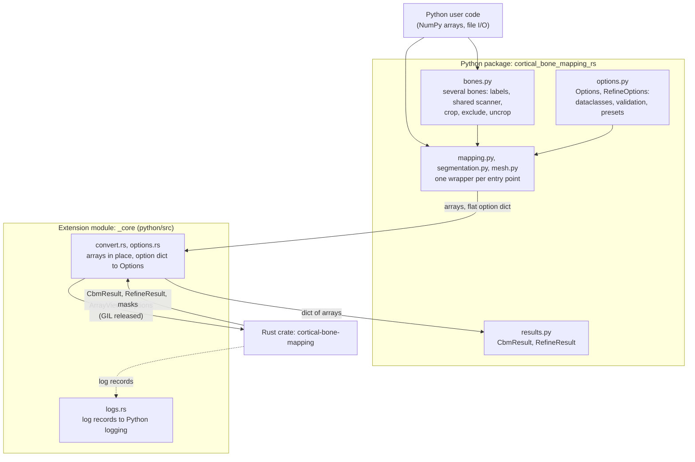
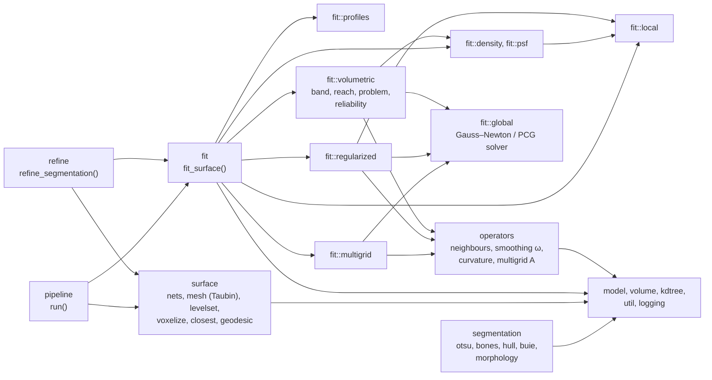
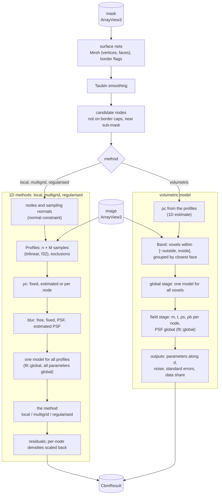
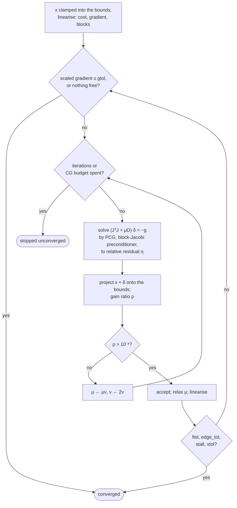
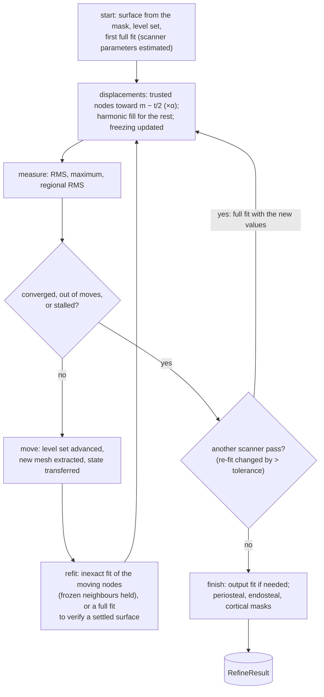
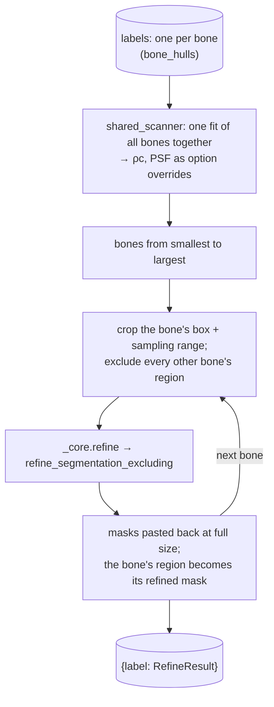

# Architecture

How the code is organised, how the modules call each other, and what data
flows between them. Each module's own documentation (`cargo doc`, or the
source) gives its equations and references; this page connects them.

## Layers



| layer | does | does not |
|---|---|---|
| Python package | validates options, offers presets, orchestrates several bones (crop, exclude, shared scanner) | compute anything per node or voxel |
| `_core` | converts arrays without copying, converts options, releases the GIL, forwards logs | hold state between calls |
| crate | every computation, multithreaded with rayon | read or write image files |

Images of any common numeric type are read in place; masks are `uint8`.
Coordinates are physical and in array-axis order everywhere: voxel
`(i, j, k)` is at `origin + (i, j, k) * spacing`.

## Crate modules



| module | role |
|---|---|
| `pipeline` | `run()`: mask → surface → candidate nodes → `fit_surface` |
| `surface` | surface nets (`nets`), the mesh and its Taubin smoothing (`mesh`), the level set of refinement (`levelset`), rasterising a mesh to a mask (`voxelize`), closest points and surface distances |
| `fit` | `fit_surface`: the stages common to every method, then the method |
| `fit::profiles` | sampling the image along each node's inward normal |
| `fit::density`, `fit::psf` | the cortical density `ρc` and the blur (fixed, a PSF, or estimated) |
| `fit::local` | one bounded Levenberg–Marquardt fit per profile |
| `fit::global` | the Gauss–Newton / conjugate-gradient solver shared by the global methods, behind the `LeastSquares` trait |
| `fit::multigrid`, `fit::regularized` | the 1D global methods: problems for `fit::global` |
| `fit::volumetric` | the volumetric model: its voxel band, its problem for `fit::global`, its reliability outputs |
| `operators` | sparse operators on the nodes: neighbourhoods, the smoothing `ω`, curvature penalties, multigrid interpolation |
| `refine` | segmentation refinement: the move–refit loop, freezing, scanner parameters, trust and stall diagnosis |
| `segmentation` | starting segmentations: Otsu thresholds, bone labels, hulls, Buie's method, morphology |
| `phantoms` | synthetic images with known truth, for the tests |
| `model`, `volume`, `kdtree`, `util`, `logging` | the profile model, image geometry and sampling, neighbour queries, numerics, logging |

## Data flow of a fit: `run()`



What each stage produces, and roughly what it costs:

| stage | output | size |
|---|---|---|
| surface nets | `Mesh` | one vertex per grid cell the boundary crosses (about one per boundary voxel); two triangles per vertex |
| profiles (1D) | `Profiles` | `n × M` `f32`, `M = (outside + inside) / resolution + 1` |
| band (volumetric) | `Band` | 24 bytes per voxel within `[−outside, inside]` of the surface |
| smoothing operator `ω` | `SmoothingOperator` | 8 bytes per neighbour per node (`reg_neighbours`) |
| solver state | variables, gradient, blocks | tens of doubles per node |
| result | `CbmResult` | 5 parameters, residual, point and normal per node; the surface |

## The global solver

Every global fit, the one-model initialisations, multigrid, regularised and
volumetric, is a `LeastSquares` problem for `fit::global::minimise`. The
problem supplies the cost, the gradient, Gauss–Newton blocks and products;
the solver never forms the Hessian.



The cost of a solve is dominated by the Gauss–Newton products inside PCG,
one per CG iteration: for the 1D methods, a pass over the nodes' 5 × 5
blocks plus the operators; for the volumetric model, a pass over the faces'
blocks (the voxels are visited only when the blocks are formed, once per
outer iteration).

## Refinement: `refine_segmentation()`



The state carried from fit to fit (`refine::state::NodeState`) is per
surface vertex: warm-start parameters (with `m` shifted by the move), how
long the node has been still, whether it is frozen or held. When the level
set extracts a new mesh, every new vertex takes the state of the nearest
moved old vertex.

The scanner parameters (`ρc`, and the volumetric model's PSF) are held
through a pass and re-fitted between passes (`refine::scanner`): every fit
inside a pass uses the same values, so the edges do not shift because the
blur did.

## Several bones: `refine_bones()` (Python)



The bones of one scan share its blur and apparent cortical density, so those
are estimated once on all of them and held in each bone's refinement. A
bone's surface can never move into another's region (zero weight for
profile samples there, and a hard constraint on the surface).

## Threads, memory and determinism

- Parallel loops use rayon's global pool, or a pool of `threads` workers if
  that option is set. The bindings release the GIL for the whole call.
- Every sum over nodes or faces runs in fixed-size chunks in a fixed order,
  so results are bitwise identical across runs and thread counts.
- Memory scales with the number of nodes (profiles, operators, solver
  state) and, for the volumetric model, with the band's voxels. Refinement
  adds a level-set grid over the bone's box. Cropping each bone
  (`refine_bones`) keeps the image and the masks small.

## Logging

Every stage logs through the [`log`](https://docs.rs/log) facade (module
`cortical_bone_mapping::logging`), and the Python package forwards the
records to Python's `logging`:

```python
import cortical_bone_mapping_rs as cbm
cbm.log_to("run.log", level="DEBUG")  # or configure logging.getLogger("cortical_bone_mapping")
```

| level | what |
|---|---|
| INFO | one line per call (fit, refinement, segmentation step) and its outcome |
| DEBUG | each stage when it starts and when it ends (sizes, duration), the options in use, every solver iteration and why the solve stopped, every refinement move and fit |
| TRACE | details within stages, e.g. every conjugate-gradient solve |
| WARNING | an unconverged solve, a refinement that did not converge, an estimate that fell back |

A stage logs when it starts, so the log of a run that stalls shows which
stage it is in. Logger names follow the Rust modules
(`cortical_bone_mapping.fit.volumetric.reliability`, …), so one part can be
followed alone. Nothing is logged inside per-node or per-voxel loops.
