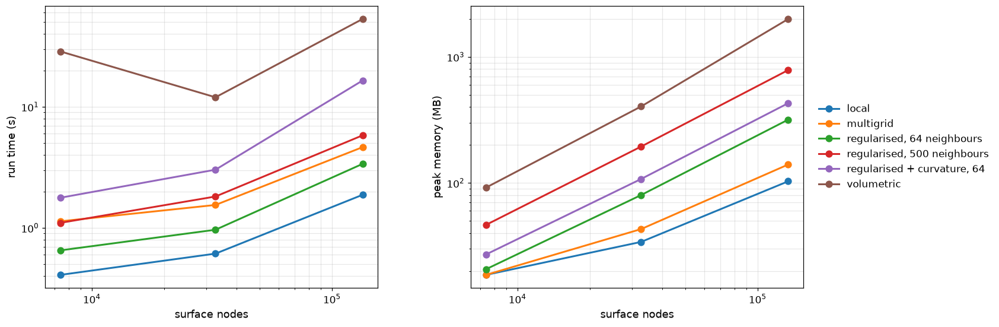
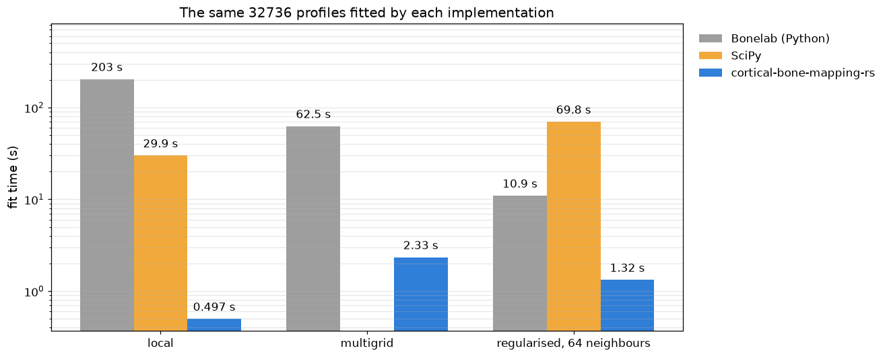

# Benchmarks

Run time and memory of every method, and the same problems solved by the
original Python implementation (Bonelab) and by SciPy.

| | |
|---|---|
| machine | AMD Ryzen 7 9700X, 8 cores / 16 threads, 62 GB, Windows 11 |
| build | release, all threads |
| phantom | cylinder at HR-pQCT resolution: 60.7 µm voxels, outer radius 8 mm, cortex 1.2 ± 0.5 mm, PSF 0.1 mm, noise σ = 60 |
| sizes | 8, 32 and 128 slices: 7 392, 32 736 and 134 112 surface nodes |
| profiles | 1 mm outside to 3 mm inside, 67 samples, normals in the slice plane |
| Bonelab | commit `e0cf8e4` of [Bonelab](https://github.com/Bonelab/Bonelab) |

## Scaling

Time of the whole pipeline (surface, sampling, initial and final fits) and
peak heap memory above the input image and mask, counted by the allocator.



*Run time (left) and peak memory (right) against the number of surface
nodes, both on log scales, for every method. "64" and "500" are the
regularised fit's neighbours (`reg_neighbours`).*

Run time:

| method | 7 392 nodes | 32 736 nodes | 134 112 nodes |
|---|---:|---:|---:|
| local | 0.41 s | 0.61 s | 1.88 s |
| multigrid | 1.13 s | 1.55 s | 4.64 s |
| regularised, 64 neighbours | 0.65 s | 0.97 s | 3.38 s |
| regularised, 500 neighbours | 1.10 s | 1.82 s | 5.81 s |
| regularised + curvature, 64 neighbours | 1.77 s | 3.03 s | 16.50 s |
| volumetric | 28.70 s | 11.99 s | 53.18 s |

Peak memory:

| method | 7 392 nodes | 32 736 nodes | 134 112 nodes |
|---|---:|---:|---:|
| local | 19 MB | 34 MB | 103 MB |
| multigrid | 19 MB | 43 MB | 140 MB |
| regularised, 64 neighbours | 21 MB | 80 MB | 318 MB |
| regularised, 500 neighbours | 46 MB | 194 MB | 786 MB |
| regularised + curvature, 64 neighbours | 27 MB | 107 MB | 429 MB |
| volumetric | 92 MB | 404 MB | 1997 MB |

Thickness RMSE against the phantom's truth:

| method | 7 392 nodes | 32 736 nodes | 134 112 nodes |
|---|---:|---:|---:|
| local | 19.8 µm | 19.3 µm | 19.1 µm |
| multigrid | 8.9 µm | 11.8 µm | 12.6 µm |
| regularised, 64 neighbours | 15.2 µm | 15.3 µm | 15.2 µm |
| regularised, 500 neighbours | 13.9 µm | 14.2 µm | 14.1 µm |
| regularised + curvature, 64 neighbours | 7.8 µm | 7.8 µm | 7.6 µm |
| volumetric | 31.6 µm | 8.2 µm | 6.6 µm |

- The 1D methods scale close to linearly: 2–17 s and 0.1–0.8 GB at 134 000
  nodes.
- Memory of the regularised fit is mostly the smoothing operator, 8 bytes
  per neighbour: 64 neighbours need 40% of the memory of 500 for nearly the
  same error.
- On the 32- and 128-slice slabs the volumetric model takes 7–9 times the
  time and 2–2.5 times the memory of the regularised fit with 500
  neighbours, and is the most accurate on the longest (6.6 µm).
- On the 8-slice slab (0.5 mm long) the volumetric model is slow and
  inaccurate: most of its band voxels are closest to the cut ends, where the
  model does not hold. Real scans are far longer (168 slices for a standard
  HR-pQCT stack).

## Against Bonelab and SciPy

All three fit the same profiles, sampled once by this package. Times are
for the fit only.

- **Bonelab**: its `LocalTreeceMinimization`,
  `GlobalControlPointTreeceMinimization` and
  `GlobalRegularizationTreeceMinimization` classes with the parameters of
  Table 1 of our 2025 paper. Its local fit is timed on 400 nodes and scaled
  to all of them.
- **SciPy**: the same objective written with NumPy and solved with
  `scipy.optimize.least_squares` (local; timed on 1000 nodes and scaled) and
  L-BFGS-B with an analytic gradient run to convergence (regularised).



*Fit time of the same 32 736 profiles by Bonelab, SciPy and this package
(log scale). SciPy has no multigrid implementation here.*

| method | nodes | Bonelab | this package | speed-up | Bonelab RMSE | this package RMSE |
|---|---:|---:|---:|---:|---:|---:|
| local | 7 392 | 52.8 s | 0.36 s | 145× | 20.1 µm | 19.8 µm |
| multigrid | 7 392 | 16.8 s | 1.74 s | 10× | 14.1 µm | 8.9 µm |
| regularised, 64 | 7 392 | 4.5 s | 0.77 s | 6× | 18.6 µm | 15.2 µm |
| regularised, 500 | 7 392 | 4.6 s | 1.68 s | 3× | 17.7 µm | 13.9 µm |
| local | 32 736 | 203.1 s | 0.50 s | 408× | 18.5 µm | 19.3 µm |
| multigrid | 32 736 | 62.5 s | 2.33 s | 27× | 16.0 µm | 11.8 µm |
| regularised, 64 | 32 736 | 10.9 s | 1.32 s | 8× | 18.7 µm | 15.3 µm |

| method | nodes | SciPy | this package | speed-up | final cost, SciPy / this package |
|---|---:|---:|---:|---:|---|
| local | 7 392 | 6.9 s | 0.41 s | 17× | |
| regularised, 64 | 7 392 | 10.0 s | 0.61 s | 17× | 2920.54528 / 2920.54527 |
| local | 32 736 | 29.9 s | 0.60 s | 50× | |
| regularised, 64 | 32 736 | 69.8 s | 0.98 s | 71× | 2842.38576 / 2842.38571 |

- Against Bonelab: 145–408 times faster for the local fit, 10–27 times for
  multigrid and 3–8 times for the regularised fit, with lower thickness
  error for every global method.
- Bonelab's regularised fit is fast because its L-BFGS-B stops early
  (18.7 µm); run to convergence in SciPy, the same problem takes 70 s and
  reaches the same cost as this package to seven digits, 17–71 times more
  slowly.

## On real data

Refinement of all eight bones of the [clinical CT of both
knees](examples.md#clinical-knee-ct) (0.65 mm voxels, 13 000–93 000 nodes
per bone), from the automatic start:

| | local | multigrid | regularised | volumetric |
|---|---:|---:|---:|---:|
| run time, all bones | 1.7 min | 7.5 min | 8.9 min | 12.1 min |
| bones converged | 0 of 8 | 2 of 8 | 8 of 8 | 8 of 8 |

## Reproducing

```bash
pip install ./python[docs]
git clone https://github.com/Bonelab/Bonelab /path/to/Bonelab && pip install tqdm
cd docs/scripts
python benchmarks.py /path/to/Bonelab     # docs/results/benchmarks.json, docs/images/benchmark_*
```

Run on an otherwise idle machine; times vary with the processor.
