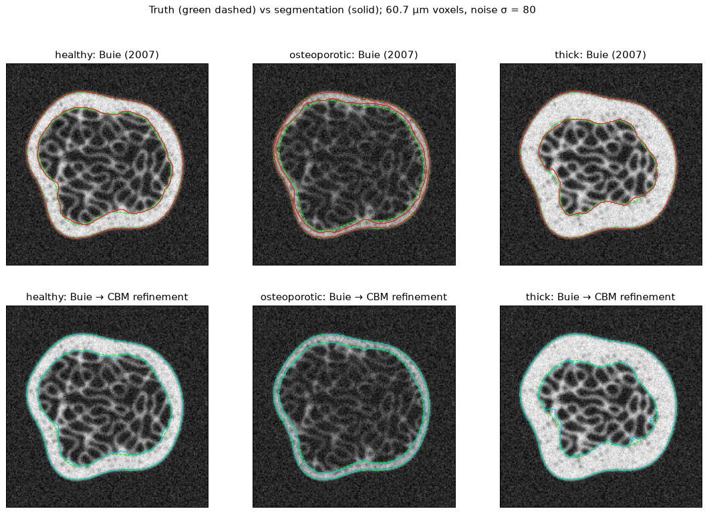

# Buie's dual threshold, and correcting it with CBM

Standard HR-pQCT analysis segments the cortex with the dual-threshold method
of Buie et al. (2007), or the Burghardt et al. (2010) variant, and then
corrects the segmentation by hand. This page describes the implementation
of the dual threshold in this crate, and an experiment asking whether
cortical bone mapping can automate the correction.

## Implementation

`cbm.buie_segmentation(image)` (Rust: `segmentation::buie`) follows Fig. 1
and the Methods of

> H. R. Buie, G. M. Campbell, R. J. Klinck, J. A. MacNeil, S. K. Boyd,
> *Automatic segmentation of cortical and trabecular compartments based on a
> dual threshold technique for in vivo micro-CT bone analysis*, Bone
> 41:505–515, 2007, doi:10.1016/j.bone.2007.07.007

| Fig. 1 step | paper | here |
|---|---|---|
| 2 threshold | user input 1 | `image ≥ periosteal_threshold` |
| 3 median | kernel (3,3,1) | binary majority, `[1, 3, 3]` (array order z, y, x) |
| 4 dilate | kernel (15,15,1) | ellipsoidal footprint (as `vtkImageDilateErode3D`), exact distance transform |
| 5 connectivity | select non-bone black region | background components touching the in-plane image border; bone = the rest |
| 6 erode | (15,15,1) | → periosteal mask |
| 7 threshold | user input 2 | `image < endosteal_threshold` |
| 8 mask | with step 1 region → marrow cavities | marrow = below T2 inside the periosteal mask |
| 9 dilate | (10,10,1) | dilate the marrow |
| 10 connectivity | select outer white region | non-marrow components touching the in-plane border |
| 11 erode | (10,10,1) | erode the marrow |
| 12 Gaussian smooth | σ = 3, support (3,3,1) | σ = 3 voxels, kernel radius ⌊σ·support⌋ = 9 in-plane, 3 along z (VTK semantics) |
| 13 threshold | by lower = 100 | marrow where the smoothed 0/127 mask ≤ 100 |
| 14 mask | combine | cortex = periosteal ∧ ¬marrow, trabecular = periosteal ∧ marrow |

Also from the paper:

* **Pre-processing.** Keep only the largest bone component (removes the
  fibula/ulna; `largest_bone_only`).
* **Padding.** Pad the data in-plane by the dilation radius, so that dilation
  cannot clip at the image edge (the paper's Discussion).
* **Connectivity.** Optionally 2D (per slice), which the paper reports is
  usually identical and faster (`connectivity_2d`).

Interpretations where the paper is silent:

* **Mask values.** The paper does not state them; 0/127 (Scanco) is assumed
  for step 13. This matters. Smoothing with σ = 3 and re-thresholding at
  100/127 moves the endosteal boundary into the cortex by about
  Φ⁻¹(100/127)·σ ≈ 0.8σ ≈ 2.4 voxels on a straight edge (2.1 voxels
  measured on a test ring). With 0/255 masks it would move ~0.8 voxels the
  other way.
* **Footprint shape.** Dilation/erosion footprints are ellipsoidal, as in VTK
  (the paper's implementation).
* **Thresholds.** These are inputs in image units. The paper used native
  scanner units (human XtremeCT: 3000 / 5000). The default 450 / 320 mg HA/cm³
  is the common choice for density-calibrated HR-pQCT (Burghardt et al. 2010).

### Differences from Bonelab's `autocontour.py`

Bonelab's VTK implementation differs from the paper:

* Gaussian σ = 0.8 instead of 3, which reduces the step-13 shift to ~0.6
  voxels;
* *largest*-component instead of *outer*-region connectivity in steps 5 and
  10;
* no largest-bone pre-processing, no padding, and no 2D option.

The σ difference alone changes Ct.Th by roughly 1.8 voxels.

## Experiment: can CBM correct a Buie segmentation?

`python docs/scripts/buie_experiment.py`.

The phantoms are realistic bone (`cbm.BonePhantom`) at 60.7 µm voxels,
200×200 in-plane, 40 slices, with noise σ = 80 on a 0–1000 density scale. They
have:

* an irregular, axially varying periosteal shape and thickness;
* a trabecular network;
* cortical pores;
* an endocortical transition zone: porosity rising and trabecular BV/TV rising
  towards the endosteum.

The true endosteal surface is the smooth surface beneath the transition zone.

Three scenarios:

| | thickness | BV/TV (deep / at endosteum) | porosity (bulk / extra at endosteum) | bone density |
|---|---|---|---|---|
| healthy | 0.9 mm | 0.20 / 0.40 | 0.03 / 0.15 | 1000 |
| osteoporotic | 0.45 mm | 0.12 / 0.35 | 0.06 / 0.35 | 800 |
| thick | 1.5 mm | 0.28 / 0.50 | 0.02 / 0.10 | 1000 |

Three pipelines, all starting from the image alone:

* **Buie**: paper parameters, 450/320.
* **Buie → CBM**: the regularised fit (Table 6.1 parameters) on Buie's
  periosteal surface; the cortex is the region between the fitted periosteal
  and endosteal surfaces.
* **Buie → CBM refinement**: the same, after snapping the periosteal surface
  to the fitted edge.

Metrics cover interior slices only. Boundary distances are mean symmetric
in-plane distances. Ct.Th is cortical area / periosteal perimeter per slice,
the semi-derived definition of the paper's patient analysis.

| scenario | pipeline | periosteum Dice | cortex Dice | periosteal dist. | endosteal dist. | Ct.Th [mm] (true) |
|---|---|---:|---:|---:|---:|---|
| healthy | Buie | 0.9964 | 0.957 | 17 µm | 61 µm | 1.072 (1.087) |
| healthy | Buie → CBM | 0.9978 | 0.966 | 11 µm | 53 µm | 1.101 |
| healthy | Buie → CBM refinement | 0.9983 | **0.969** | 8 µm | **50 µm** | 1.103 |
| osteoporotic | Buie | 0.9956 | 0.783 | 21 µm | 134 µm | 0.377 (0.574) |
| osteoporotic | Buie → CBM | 0.9962 | **0.937** | 18 µm | **39 µm** | 0.538 |
| osteoporotic | Buie → CBM refinement | 0.9963 | 0.936 | 18 µm | 39 µm | 0.535 |
| thick | Buie | 0.9963 | 0.974 | 18 µm | **67 µm** | 1.704 (1.674) |
| thick | Buie → CBM | 0.9983 | 0.973 | 8 µm | 79 µm | 1.718 |
| thick | Buie → CBM refinement | 0.9986 | **0.975** | 7 µm | 76 µm | 1.723 |

Observations:

* **Periosteum.** Buie is already good (Dice ≈ 0.996, ~20 µm). Refinement
  halves the boundary error in the healthy and thick cases and converges in 1–2
  iterations.
* **Endosteum, thin porous cortex.** This is where CBM matters. Buie's
  endosteal threshold classifies the porous inner cortex as marrow:
  cortex Dice 0.78, Ct.Th −34%. CBM places the endosteal edge by fitting the
  whole profile: cortex Dice 0.94, endosteal error 134 → 39 µm, Ct.Th −7%.
  This is the kind of error that is otherwise corrected by hand.
* **Endosteum, thick cortex with a dense transition zone.** CBM is no
  better than Buie: 76 vs 67 µm, with a +0.05 mm per-node thickness bias. A
  few profiles fit the edge to dense trabeculae beyond the true endosteum
  (visible as small spikes in the figure). Possible remedies: a larger
  residual boost, a stronger or curvature regularisation, or trusting fits
  only where they agree with the threshold-based edge.
* **Caveats.**
  * Phantoms are not bone: the "true" endosteum of real trabecularised cortex
    is itself a definition.
  * CBM here knows the true cortical density (`ρc`); on real data `ρc` must be
    chosen, and `t` scales roughly as `1/ρc` (Neeteson & Boyd, Fig. 6.1).
  * These results are on synthetic data only, pending real HR-pQCT data.
