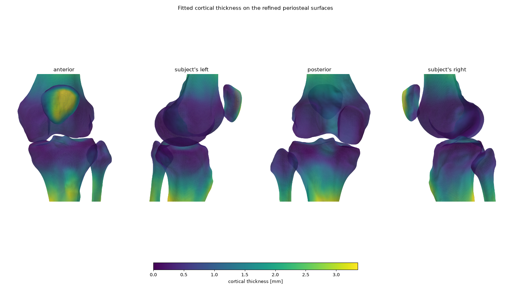

# Real data: a clinical knee CT

This is real data, not a phantom: a clinical CT of a knee, used with the
subject's permission. The image is not part of the repository. It is
non-calibrated (Hounsfield units), so there is no fixed bone threshold, and
it holds four bones: femur, tibia, patella and fibula. Each is segmented and
mapped separately, from the image alone.

| | |
|---|---|
| scanner | GE Revolution GSI, 140 kVp |
| voxels | 0.65 × 0.65 mm in-plane, 0.625 mm slices |
| region | the right knee, 300 slices (187 mm) |

How the pipeline got to this point, and why each step is there, is in
[refinement_experiments.md](refinement_experiments.md).

**What the analysis sees.** The only cut made to the image is `--crop`, which
keeps one knee with all its soft tissue. Each bone is fitted on a box around
its starting segmentation, padded by the profile lengths (4 mm outside plus
8 mm inside) and 2 more voxels, so every profile and every move stays within
image data. Blanking the soft tissue is done only when drawing the figures.

## Commands

Every step is a library call. The script reads the DICOM series, crops to
one knee, and draws the figures:

```bash
python docs/scripts/ct_example.py /path/to/DICOM --crop :,:,0:256 \
    --landmark femur=250,240,123 --landmark tibia=60,250,110 \
    --landmark patella=211,167,114 --landmark fibula=60,296,43 \
    --figures docs/images/knee_ct
```

which runs

```python
thr = cbm.otsu_thresholds(image, floor=-500)[0]                       # 267 HU
labels, names, _ = cbm.separate_bones(image, thr, landmarks, spacing, origin)
low = cbm.soft_tissue_threshold(image, thr, floor=-500)              # 146 HU
labels = cbm.grow_bones(image, labels, low)                          # hysteresis
starts = cbm.bone_hulls(labels, spacing, closing_radius=4.0)          # local convex hulls
results = cbm.refine_bones(image, starts, spacing, options=OPTIONS, refine=REFINE,
                           names=names, origin=origin)                # other bones excluded
```

with, for clinical CT,

```python
OPTIONS = cbm.Options(outside=4, inside=8, resolution=0.25, method="regularized",
                      reg_sigma=3, reg_neighbours=500, global_params=(),  # per-node densities
                      rho_c="estimate", ...)                               # bounds in HU
REFINE = cbm.RefineOptions(refine_iterations=150, level_set=True, freeze=True)
```

1. **Threshold.** On a non-calibrated CT, the histogram of the body (the
   voxels above −500 HU) has a fat peak (about −105 HU) and a soft-tissue
   peak (about 55 HU). Bone forms no peak, only a long tail up to about
   1650 HU. The two-class Otsu threshold of that histogram, 267 HU, separates
   soft tissue from bone. A known threshold in image units can be given
   instead (`--threshold 300`).

   

2. **Bones.** `label_bones` takes the connected components above the
   threshold and numbers them by volume (1 = the largest), discarding
   anything under 2 cm³. The landmarks are optional; each is a voxel inside a
   bone. With them, `separate_bones` names the bones and checks that no two
   landmarks fall on the same component. If two do, the threshold has
   joined two bones, and it is raised within that component until they
   split. Here the four bones were separate at 267 HU:

   | bone | name | thresholded volume |
   |---|---|---|
   | 1 | femur | 144 cm³ |
   | 2 | tibia | 81 cm³ |
   | 3 | patella | 19 cm³ |
   | 4 | fibula | 12 cm³ |

   **Hysteresis.** At 267 HU, thin cortices that partial volume pushes below
   the threshold drop out: the anterior proximal tibia, the lateral femoral
   condylar rim, and parts of the tibial plateau. Over stretches longer than
   the closing can bridge, the start then cuts through the bone, and
   refinement cannot recover bone up to a centimetre outside it. Longer
   outside profiles (8 mm) did not help either; see below. So each bone is
   grown (`grow_bones`) into the voxels connected to it above a low
   threshold. That threshold is taken from the histogram
   (`soft_tissue_threshold`): the soft-tissue peak (57 HU) plus 4 standard
   deviations of soft tissue (22 HU, from the peak's lower half-width), which
   gives 146 HU. The bones are still told apart at 267 HU: a voxel that
   several bones can reach goes to the one that reaches it first.
   `--hysteresis off` turns it off, and `--hysteresis 150` gives a value.

3. **Starting segmentations.** `bone_hulls(..., closing_radius=4)` closes each
   bone on its own, with a ball of radius 4 mm:
   1. dilate;
   2. fill the voids that do not reach the outside, and the holes of every
      slice in all three orientations;
   3. erode.

   This "local convex hull" fills concavities narrower than about 8 mm:
   pits, small cortical gaps, and the marrow wherever the trabecular density
   falls below the threshold. Wider concavities, such as the femoral
   intercondylar notch (about 20 mm), stay open. A per-slice convex hull
   bridges the notch, and refinement cannot recover from that (see the
   experiments). Where two bones' starts overlap, each voxel goes to the
   nearer bone and a gap is kept between them, so that every bone is its own
   closed surface.
4. **Refinement.** `refine_bones` refines one bone at a time, from the
   smallest to the largest, each with its own initialisation and its own
   cortical density estimate. Per bone:
   - **Per-node densities.** The soft-tissue and trabecular densities are
     regularised fields over the surface, like `m`, `t` and `σ`. In a knee
     the trabecular density ranges from about 70 HU (fatty marrow) to about
     500 HU (epiphyses), and a single global value pulls the surface into
     the bone.
   - **Remeshing.** The surface is carried as a level set and remeshed every
     iteration.
   - **Inexact inner fits.** They stop once the fitted edges have settled to
     a tenth of the last move.
   - **Regional convergence.** Regions that have stopped moving are frozen
     and no longer refitted.
   - **The finish.** A bone has converged when a full fit of its whole
     surface moves it by less than 0.1 voxel RMS, and by less than 0.2 voxel
     RMS in every region.
   - **Other bones excluded.** The other bones' regions are excluded while a
     bone is refined. Profile samples inside them get zero weight, so a
     femoral profile that crosses the joint does not fit the tibia. No
     surface is ever moved into another bone. That is a hard constraint: the
     level set keeps those voxels outside.

## Results


*Sections through the knee: the starting segmentations (yellow, dashed), and
the refined periosteal (solid) and fitted endosteal (dotted) surfaces of each
bone. Everything more than 10 mm from the starting segmentations is blanked
in the figures (display only).*


*Refinement, one move per frame (coronal and sagittal sections).*



*Fitted cortical thickness on the refined periosteal surfaces.*

| bone | nodes | moves | converged | `ρc` (HU) | thickness, median (5–95%) | time |
|---|---:|---:|---|---:|---|---:|
| patella | 13 384 | 5 | yes | 1380 | 1.18 mm (0.30–3.47) | 8 s |
| fibula | 16 679 | 5 | yes | 1463 | 0.88 mm (0.32–2.79) | 9 s |
| tibia | 65 263 | 7 | yes | 1492 | 0.91 mm (0.15–3.19) | 69 s |
| femur | 82 323 | 5 | yes | 1535 | 0.53 mm (0.21–2.55) | 52 s |

The whole knee takes 138 s. The first version of this pipeline
(per-slice convex hulls, global densities, the same mesh nodes moved every
iteration) took about 19 minutes, and its femur never converged. It folded
over the notch.

* **All four bones converge** in 5–7 moves, and their surfaces follow the
  periosteum, the femoral notch included.
* **Hysteresis halves the missed bone.** This is the volume of bone (above
  146 HU, connected to a bone) more than 1 mm outside the refined surfaces:

  | | femur | tibia | patella | fibula | time |
  |---|---:|---:|---:|---:|---:|
  | without hysteresis | 5.1 cm³ | 8.4 | 1.8 | 0.8 | 162 s |
  | with hysteresis (150 HU) | 2.2 | 3.5 | 1.2 | 0.5 | 139 s |
  | 8 mm outside profiles, no hysteresis | 4.9 | 7.4 | 1.4 | 0.8 | 158 s |
  | both | 2.1 | 3.7 | 1.2 | 0.5 | 170 s |

  Longer outside profiles do little on their own. Where the start cut
  through the bone, it lies inside trabecular bone, so the outer part of a
  profile shows bone, the faint cortex and then soft tissue. That is not
  the soft-tissue-then-cortex step the model expects, and seeing further
  does not produce an outward move. What remains after hysteresis is mostly
  the blurred edge itself: the 146 HU surface lies 1–2 voxels outside the
  fitted periosteum all round. The one clear gap left is the lateral tip of
  the patella.
* **A second pass over the bones** (`rounds=2`), each excluding the others'
  refined regions, changes no bone by more than 0.7% of its voxels. On this
  knee the bones do not affect each other's fits once they are excluded.
* **The thickness pattern** is what one expects:
  - thin (≲ 0.5 mm) subchondral and metaphyseal shells over the epiphyses;
  - a thick anterior patella (up to about 3.5 mm);
  - diaphyseal cortices of 2–3.5 mm at the cut ends of the femur, tibia and
    fibula.
* **`ρc`** is estimated per bone, at 1380–1530 HU, from the thick
  diaphyseal cortex where there is one. It is an apparent density at this
  resolution. The thickness depends on it strongly. With `ρc` fixed at
  1000 HU instead, the median thicknesses are 50–70% larger, and the
  periosteum lies 0.2–0.3 mm further out, on the steepest rise of the
  profiles (see the sweep in
  [refinement_experiments.md](refinement_experiments.md#7-the-whole-knee-missed-bone-other-bones-cortical-density)).
  Which value is right needs a density reference or more data.
* **The inside profiles can stop at half the bone's width** (`--half-width`).
  That stops profiles at thin tips and plates from running out through the
  far side. On this knee it affects under 2% of the nodes, all on the
  patella and the fibula, and it changes no result.

There is no ground truth here: the thickness of a cortex thinner than the
in-plane resolution (0.65 mm) is a model-based estimate (Treece et al. 2010),
not a measurement that can be checked against the image by eye. In convex
regions the refined surfaces sit about 0.5 mm (0.7 voxel) inside the 267 HU
isosurface. For a cortex thinner than the blur that is what the model
predicts, but how far depends on `ρc`. That remains an open question (see
[refinement_experiments.md](refinement_experiments.md#open-questions)).
