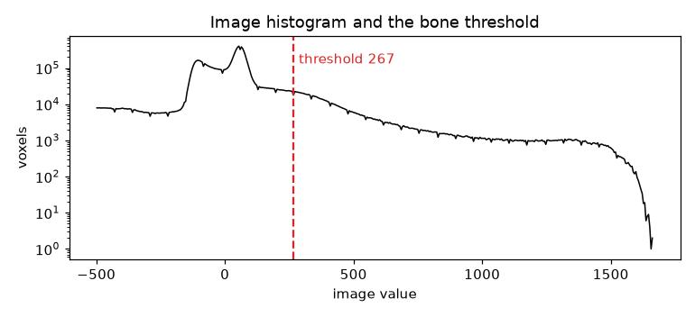
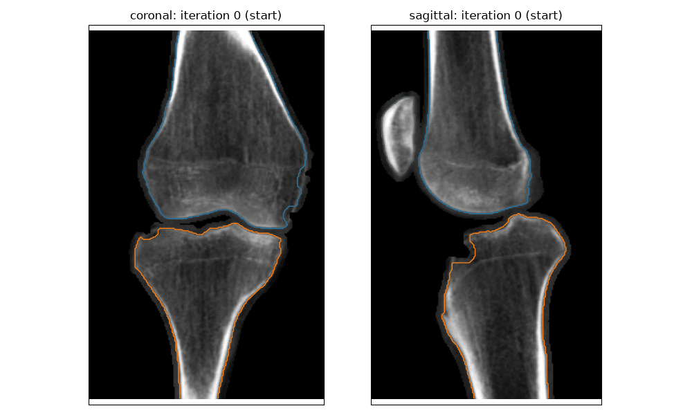
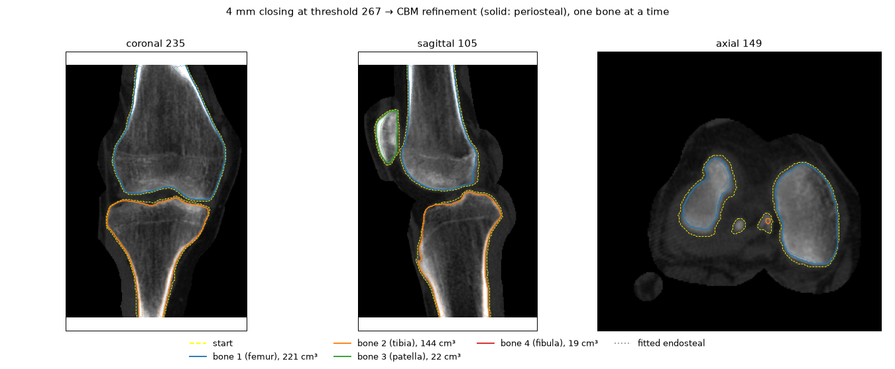

# Clinical knee CT

This page tests the whole pipeline on real data: a clinical CT of a knee,
used with the subject's permission (the image is not part of the
repository). The scan is not density-calibrated, so there is no fixed bone
threshold, and it contains four bones (femur, tibia, patella and fibula),
which are segmented and mapped from the image alone.
[refinement_experiments.md](refinement_experiments.md) describes how the
pipeline reached its present form.

| | |
|---|---|
| scanner | GE Revolution GSI, 140 kVp |
| voxels | 0.65 × 0.65 mm in-plane, 0.625 mm slices |
| region | the right knee, 300 slices (187 mm) |

## Methods

Every step is a library call; the script only reads the DICOM series, crops
it to one knee and draws the figures:

```bash
python docs/scripts/ct_example.py /path/to/DICOM --crop :,:,0:256 \
    --landmark femur=250,240,123 --landmark tibia=60,250,110 \
    --landmark patella=211,167,114 --landmark fibula=60,296,43 \
    --figures docs/images/knee_ct
```

```python
thr = cbm.otsu_thresholds(image, floor=-500)[0]                       # 267 HU
labels, names, _ = cbm.separate_bones(image, thr, landmarks, spacing, origin)
low = cbm.soft_tissue_threshold(image, thr, floor=-500)              # 146 HU
labels = cbm.grow_bones(image, labels, low)                          # hysteresis
starts = cbm.bone_hulls(labels, spacing, closing_radius=4.0)          # local convex hulls
results = cbm.refine_bones(image, starts, spacing, options=OPTIONS, refine=REFINE,
                           names=names, origin=origin)                # other bones excluded

OPTIONS = cbm.Options(outside=4, inside=8, resolution=0.25, method="regularized",
                      reg_sigma=3, reg_neighbours=500, global_params=(),  # per-node densities
                      rho_c="estimate", ...)                               # bounds in HU
REFINE = cbm.RefineOptions(refine_iterations=150)  # level set and freezing are the defaults
```

The only cut made to the image is the crop, which keeps one knee with all its
soft tissue. Each bone is fitted on a box around its starting segmentation,
padded by the profile lengths and two voxels, so that every profile and every
move stays within image data. Soft tissue is blanked only in the figures.

**Threshold.** The histogram of the body (voxels above −500 HU) has a fat
peak at about −105 HU and a soft-tissue peak at about 55 HU; bone forms only
a long tail up to about 1650 HU. The two-class Otsu threshold of that
histogram, 267 HU, separates soft tissue from bone. A known threshold can be
given instead (`--threshold`).



**Bones.** `label_bones` takes the connected components above the threshold,
numbers them by volume and discards anything under 2 cm³. The optional
landmarks (one voxel inside each bone) let `separate_bones` name the bones
and check that no two landmarks share a component; if they do, the
threshold is raised within that component until it splits. Here the four
bones were separate at 267 HU, with thresholded volumes of 144 (femur), 81
(tibia), 19 (patella) and 12 cm³ (fibula).

At 267 HU, partial volume pushes thin cortices below the threshold: the
anterior proximal tibia, the lateral femoral condylar rim and parts of the
tibial plateau. Where such a gap is longer than the closing below can
bridge, the start cuts through the bone and refinement cannot recover it.
Each bone is therefore grown (`grow_bones`) into the voxels connected to it
above a lower threshold, the soft-tissue peak (57 HU) plus four standard
deviations of soft tissue (22 HU, from the peak's lower half-width): 146 HU.
A voxel that several bones reach goes to the one that reaches it first.

**Starting segmentations.** `bone_hulls(..., closing_radius=4)` closes each
bone on its own with a ball of radius 4 mm: dilation, filling of enclosed
voids and of the holes of every slice in all three orientations, then
erosion. This fills concavities narrower than about 8 mm (pits, small
cortical gaps, and marrow where the trabecular density falls below the
threshold) and keeps wider ones open, such as the 20 mm femoral
intercondylar notch, which a per-slice convex hull would bridge. Where two
bones' starts overlap, each voxel goes to the nearer bone and a gap is kept
between them.

**Refinement.** `refine_bones` first estimates the scanner's parameters once
for all four bones together (`cbm.shared_scanner`): the cortical density
`ρc` and, for the volumetric model, the PSF. The bones share the scanner, so
they share both, and the joint estimate sees more thick cortex than any one
bone. It then refines one bone at a time, smallest first, each with its own
initialisation and with the shared values held. The
soft-tissue and trabecular densities are regularised per-node fields: in a
knee the trabecular density ranges from about 70 HU (fatty marrow) to about
500 HU (epiphyses), and a single global value pulls the surface into the
bone. The surface is carried as a level set and remeshed every iteration;
inner fits stop once the fitted edges have settled to a tenth of the last
move; regions that have stopped moving are frozen. A bone has converged when
a full fit moves its surface by less than 0.1 voxel RMS overall and 0.2
voxel RMS in every region. The other bones are excluded: profile samples
inside them get zero weight, and the level set never moves a surface into
them.

**Volumetric model.** With `--method volumetric` the inner fit is the
[volumetric model](method.md#volumetric-model) with its defaults, its PSF
and `ρc` shared by the bones as above.

## Results


*Sections through the knee: the starting segmentations (yellow, dashed), and
the refined periosteal (solid) and fitted endosteal (dotted) surfaces of each
bone. Everything more than 10 mm from the starting segmentations is blanked
in the figures (display only).*



*Refinement, one move per frame (coronal and sagittal sections).*


*Fitted cortical thickness on the refined periosteal surfaces.*

| bone | nodes | moves | converged | thickness, median (5–95%) | time |
|---|---:|---:|---|---|---:|
| patella | 13 266 | 5 | yes | 1.07 mm (0.29–3.10) | 15 s |
| fibula | 16 638 | 5 | yes | 0.86 mm (0.31–2.73) | 14 s |
| tibia | 65 346 | 6 | yes | 0.90 mm (0.15–3.17) | 78 s |
| femur | 82 339 | 5 | yes | 0.55 mm (0.21–2.60) | 59 s |

The shared `ρc` is 1500 HU. All four bones converge in 5–6 moves (166 s of
refinement for the knee), and their surfaces follow the periosteum,
including the femoral notch. The first version of this pipeline (per-slice
convex hulls, global densities, the same mesh nodes moved every iteration)
took about 19 minutes, never converged on the femur and folded over the
notch.

The thickness pattern is as expected: thin (≲ 0.5 mm) subchondral and
metaphyseal shells over the epiphyses, a thick anterior patella (up to about
3.5 mm), and diaphyseal cortices of 2–3.5 mm at the cut ends of the femur,
tibia and fibula.

**Missed bone.** The volume of bone (above 146 HU, connected to a bone) more
than 1 mm outside the refined surfaces:

| | femur | tibia | patella | fibula | time |
|---|---:|---:|---:|---:|---:|
| without hysteresis | 5.1 cm³ | 8.4 | 1.8 | 0.8 | 162 s |
| with hysteresis (150 HU) | 2.2 | 3.5 | 1.2 | 0.5 | 139 s |
| 8 mm outside profiles, no hysteresis | 4.9 | 7.4 | 1.4 | 0.8 | 158 s |
| both | 2.1 | 3.7 | 1.2 | 0.5 | 170 s |

Hysteresis halves the missed bone; longer outside profiles do little. Where
the start cut through the bone it lies in trabecular bone, so the outer part
of a profile shows bone, the faint cortex and then soft tissue, which is not
the step the model expects. Most of what remains is the blurred edge itself:
the 146 HU surface lies 1–2 voxels outside the fitted periosteum all round.
The one clear gap left is the lateral tip of the patella.

**Other settings.** A second pass over the bones (`rounds=2`), each excluding
the others' refined regions, changes no bone by more than 0.7% of its
voxels. Stopping the inside profiles at half the bone's width
(`--half-width`), so that profiles at thin tips do not run out through the
far side, affects under 2% of the nodes (on the patella and fibula) and no
result.

**Cortical density.** `ρc` is estimated once for the knee from the bones'
thick diaphyseal cortex: 1500 HU, an apparent density at this resolution
(each bone's own estimate was 1380–1535 HU). Thickness
depends on it strongly: with `ρc` fixed at 1000 HU the median thicknesses
are 50–70% larger and the periosteum lies 0.2–0.3 mm further out, on the
steepest rise of the profiles (see the sweep in
[refinement_experiments.md](refinement_experiments.md#7-the-whole-knee-missed-bone-other-bones-cortical-density)).
Which value is right needs a density reference.

**Volumetric model.** The scan's PSF, fitted to all four bones together, is
0.64 mm in-plane and 0.78 mm along the axis. Refinement with the volumetric
model converges on every bone:

| bone | moves | converged | thickness, median (5–95%) | time |
|---|---:|---|---|---:|
| patella | 6 | yes | 0.82 mm (0.12–2.76) | 37 s |
| fibula | 4 | yes | 0.77 mm (0.25–2.70) | 18 s |
| tibia | 7 | yes | 0.73 mm (0.13–3.12) | 106 s |
| femur | 5 | yes | 0.50 mm (0.18–2.57) | 91 s |

That is 252 s of refinement, against 9.2 hours without convergence for the
earlier volumetric default, whose edges were regularised by the curvature
penalty alone and whose `ρc` came from its own voxels
([volumetric_refinement.md](volumetric_refinement.md)). The cortex is
thinner than the regularised fit's on every bone, by 0.05–0.25 mm in median,
and the surfaces are otherwise the same
([volumetric_validation.md](volumetric_validation.md#clinical-knee)).



*As above, with the volumetric model.*

## Limitations

There is no ground truth: the thickness of a cortex thinner than the
in-plane resolution (0.65 mm) is a model-based estimate (Treece et al. 2010),
not something that can be checked against the image by eye. In convex
regions the refined surfaces sit about 0.5 mm (0.7 voxel) inside the 267 HU
isosurface. For a cortex thinner than the blur that is what the model
predicts, but the distance depends on `ρc`, which remains open (see
[refinement_experiments.md](refinement_experiments.md#discussion)).
