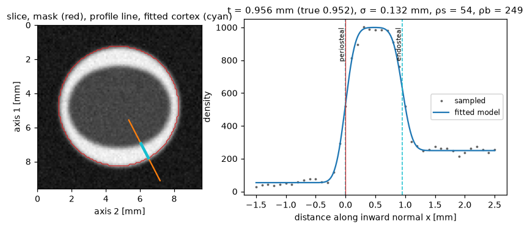
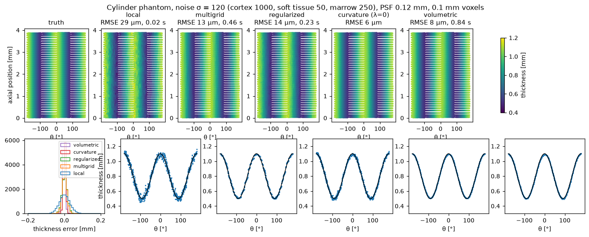
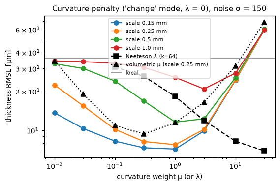
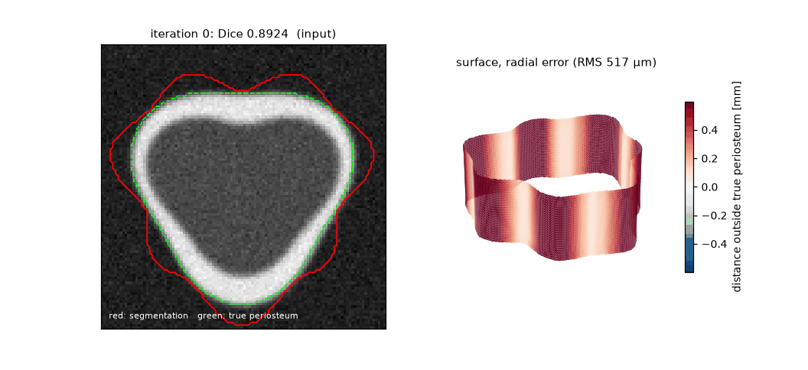
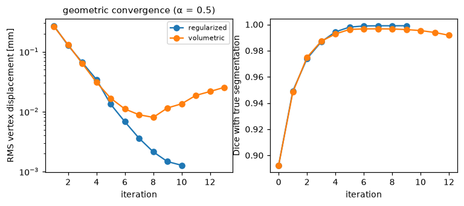

# Examples on smooth phantoms

These examples check each method on a simple phantom with known geometry,
where differences between methods are easy to see.
[segmentation.md](segmentation.md) tests the automatic pipeline on realistic
phantoms (trabeculae, porosity, neighbouring bones, cortical breaks, a knee),
and [volumetric_validation.md](volumetric_validation.md) the volumetric model
at the anatomical sites.

## Phantom and settings

The phantom (`cbm.Phantom`) is a cylinder along array axis 0 with 0.1 mm
voxels, outer radius 3.5 mm and cortical thickness `t(θ) = 0.8 + 0.3 cos 2θ`
mm. Soft tissue, cortex and marrow have densities 50, 1000 and 250; the
image is integrated over voxels, blurred with a 0.12 mm Gaussian PSF and
given Gaussian noise. Profiles run from 1.5 mm outside to 2.5 mm inside, with
normals in the transverse plane.

The methods: multigrid with control-point spacings of 4, 2 and 1 mm;
regularised with `λ = 1`, `σ_reg = 1 mm` and 64 neighbours; the curvature
penalty alone (`"change"`, `λ = 0`, `μ = 1`, scale 0.25 mm); and the
[volumetric model](method.md#volumetric-model) with its defaults and the same
density smoothing, its axial blur tied to the in-plane one (on a shaft every
normal is in-plane). All figures are made by
[`scripts/make_figures.py`](scripts/make_figures.py).

## One profile



A slice with the mask contour (red), one sampling line (orange) and the
fitted cortex (cyan), and the sampled profile with the fitted model and
edges. The node (`x = 0`) sits on the smoothed mask surface; the fit places
the edges independently of it.

## Methods at noise σ = 120



Top: thickness unrolled around the circumference (θ) and along the axis.
Bottom: thickness against θ at the middle slice, with the truth (line), and
the error histograms. The local fit is unbiased but noisy (29 µm RMSE).
Every spatially constrained method removes most of the noise while following
the true thickness variation: multigrid 13 µm, regularised 14 µm, the
volumetric model 8 µm and the curvature penalty alone 6 µm.

## Accuracy against noise


The local fit's RMSE grows roughly linearly with noise; the constrained
methods' much more slowly. Multigrid has a floor of about 12 µm even at low
noise, because interpolating from control points 1 mm apart slightly
flattens the thickness pattern. The 1D methods share a bias of about +3 µm
(3% of a voxel) whatever the method, so it comes from profile sampling and
partial volume rather than the fit. The volumetric model, which uses the
voxels themselves, has a small negative bias instead (−2 to −4 µm), and its
RMSE grows only from 8 to 11 µm over the whole noise range.

## Curvature penalty



Thickness RMSE against the curvature weight `μ` for several Laplacian
scales (curvature penalty alone, `λ = 0`), against the smoothing weight `λ`,
and against the volumetric model's curvature weight, at noise σ = 150 (local
fit: 36 µm).

Small Laplacian scales (0.15–0.25 mm, 1.5–2.5 voxels) reach about 7 µm at
`μ ≈ 0.3–1`. Larger scales are weaker against node-scale noise and, at large
weights, flatten the cos 2θ pattern, which has curvature too; every scale
degrades beyond `μ ≈ 3`. On this smooth phantom the smoothing penalty
reaches the same accuracy at large `λ` (30). The volumetric model behaves
like the 1D penalty at its scale, with its best value, about 10 µm, at its
default `μ = 0.3`.

So the curvature penalty does not win on raw accuracy on smooth anatomy. Its
advantages are that its scale is explicit and physical, that it acts on the
fitted surfaces (so the periosteal and endosteal surfaces can be penalised
separately), and that its `"excess"` mode leaves curvature below a threshold
untouched. Which penalty suits real bone, with genuinely sharp features,
needs real data.

## Segmentation refinement





A tibia-like phantom with a three-lobed outer surface,
`R(θ) = 4 + 0.5 cos 3θ` mm, starts from a segmentation dilated by 0.45 mm
with 7-lobed bumps of 0.35 mm, and is refined with `α = 0.5`. With the
regularised inner fit the RMS displacement halves every iteration, as
expected for an under-relaxed fixed-point iteration, and the Dice
coefficient with the true segmentation approaches 1 (0.999).

With the volumetric inner fit (orange) the first eight moves are the same,
but the moves then stop shrinking at about 0.01 mm (a tenth of a voxel) and
grow again, and the Dice coefficient, after peaking at 0.997, drifts to 0.992
by the twelfth move. Full fits at every move behave the same, so the inexact
inner fits are not the cause. A likely one is that the volumetric fit is not
exactly shift-equivariant: a profile's fit moves exactly with the surface it
is sampled from, while the volumetric fit regroups the voxels by their
closest face whenever the surface moves. Refinement with it converges at the
default tolerance, but not at the 0.002 mm used here.

In practice the starting segmentation comes from the image
(`cbm.hull_segmentation`, see [segmentation.md](segmentation.md)). To run
the example:

```python
import cortical_bone_mapping_rs as cbm

ph = cbm.Phantom(mask_offset=0.35, mask_bump=0.25)
image, bad = ph.generate()
rr = cbm.refine_segmentation(image, bad, ph.spacing, normal_constraint="in_plane",
                             method="regularized", reg_neighbours=64, reg_sigma=1.0,
                             keep_history=True)
print(rr.converged, [round(h["rms_displacement"], 4) for h in rr.history])
```
