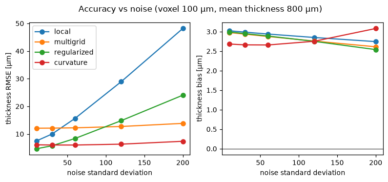

# Examples

All figures are produced by [`scripts/make_figures.py`](scripts/make_figures.py)
from synthetic phantoms (`cbm.Phantom`) with known geometry. The default
phantom is a cylinder along array axis 0 with 0.1 mm voxels, outer radius
3.5 mm and cortical thickness `t(θ) = 0.8 + 0.3 cos 2θ` mm. Densities are 50
(soft tissue), 1000 (cortex) and 250 (marrow), integrated over voxels, blurred
with a 0.12 mm Gaussian PSF and given Gaussian noise. Profiles run from 1.5 mm
outside to 2.5 mm inside, with normals constrained to the transverse plane.

## One profile


A slice with the mask contour (red), one sampling line (orange) and the
fitted cortex (cyan). The sampled profile is shown with the fitted model and
the fitted periosteal and endosteal edges. The node (`x = 0`) sits on the
smoothed mask surface; the fit places the edges independently of it.

## Methods on a noisy phantom


Top: thickness unrolled around the circumference (θ) and along the axis, for
the truth and each method. Bottom: thickness against θ at the middle slice
(dots) with the truth (line), and error histograms. Noise σ = 120.
Multigrid uses control-point spacings of 4/2/1 mm; regularised uses `λ = 1`,
`σ_reg = 1 mm`, 64 neighbours; curvature uses the `"change"` penalty alone
(`λ = 0`, `μ = 1`, scale 0.25 mm).

The local method is unbiased but noisy. Every spatially constrained method
removes most of the noise while following the true thickness variation.

## Accuracy against noise



RMSE grows roughly linearly with noise for the local method and much more
slowly for the constrained methods. Multigrid has a floor of about 12 µm,
even at low noise: interpolating from control points at a 1 mm spacing
slightly flattens the true thickness pattern. All methods share a small
positive bias of about 3 µm (3% of a voxel), which is independent of the
method and so comes from the sampling and partial-volume geometry, not the
fit.

## Curvature penalty


Thickness RMSE against the curvature weight `μ` for several Laplacian
scales (curvature penalty only, `λ = 0`), compared with the spatial
smoothing penalty against `λ`, at noise σ = 150 (local fit: 36 µm).

* Small Laplacian scales (0.15–0.25 mm, 1.5–2.5 voxels) reach ~7 µm at
  `μ ≈ 0.3–1`.
* Larger scales are weaker against node-scale noise and, at large weights,
  flatten the true cos 2θ thickness pattern, which has curvature too. Every
  scale degrades beyond `μ ≈ 3`.
* On this very smooth phantom the smoothing penalty reaches the same accuracy
  (~7 µm) at large `λ` (30); with k = 64 at 0.1 mm node spacing its operator
  only spans ~0.45 mm.

The curvature penalty's advantages are therefore not raw accuracy on smooth
anatomy but:

* its scale is explicit and physical;
* it acts on the fitted *surfaces*, so the endosteal and periosteal surfaces
  can be penalised separately;
* the `"excess"` mode can leave curvature below a threshold untouched.

Which penalty is preferable on real bone (with genuinely sharp features)
needs testing on data.

## Segmentation refinement


A tibia-like phantom: a three-lobed outer surface with
`R(θ) = 4 + 0.5 cos 3θ` mm. The input segmentation is dilated by 0.45 mm and
has 7-lobed bumps of 0.35 mm. Refinement uses the regularised method with
`α = 0.5`. The RMS displacement halves every iteration, as expected for an
under-relaxed fixed-point iteration, and the Dice coefficient with the true
segmentation approaches 1.

Run it yourself:

```python
import cortical_bone_mapping_rs as cbm

ph = cbm.Phantom(mask_offset=0.35, mask_bump=0.25)
image, bad = ph.generate()
rr = cbm.refine_segmentation(image, bad, ph.spacing, normal_constraint="in_plane",
                             method="regularized", reg_neighbours=64, reg_sigma=1.0,
                             keep_history=True)
print(rr.converged, [round(h["rms_displacement"], 4) for h in rr.history])
```
