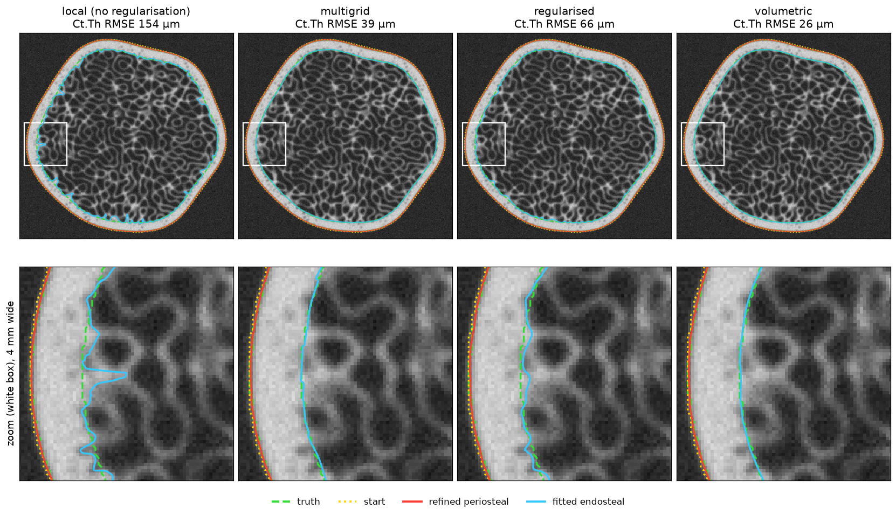
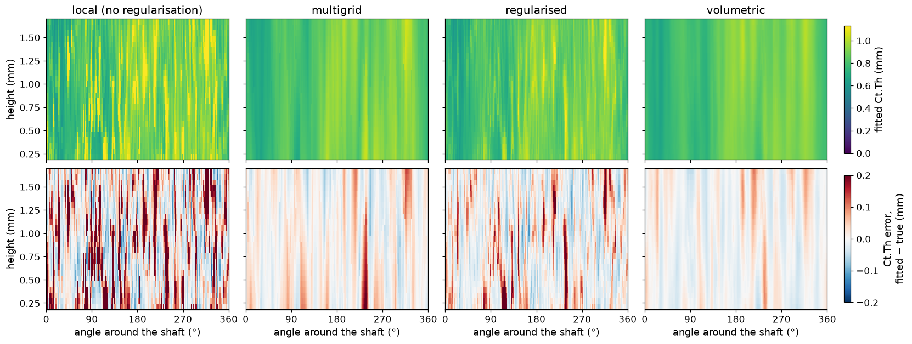
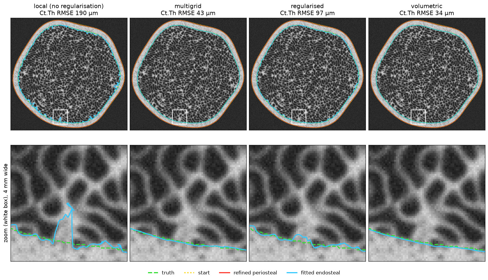
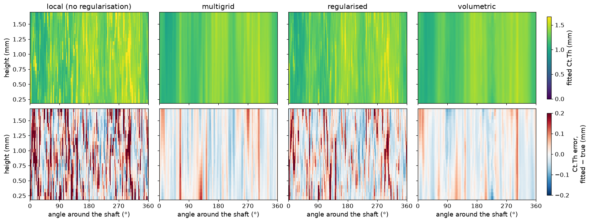
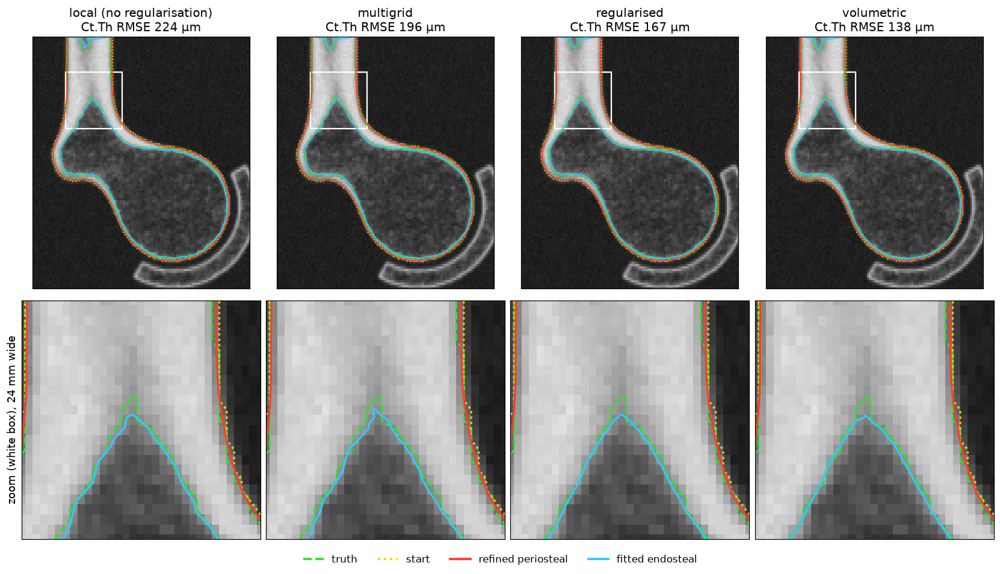
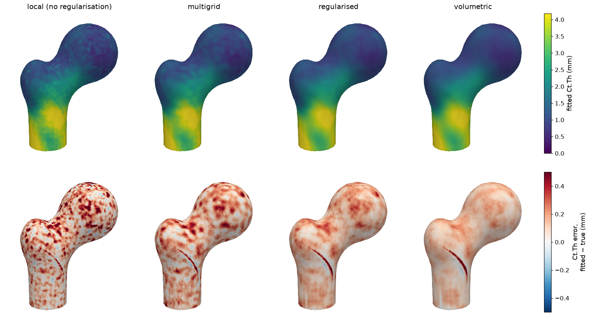
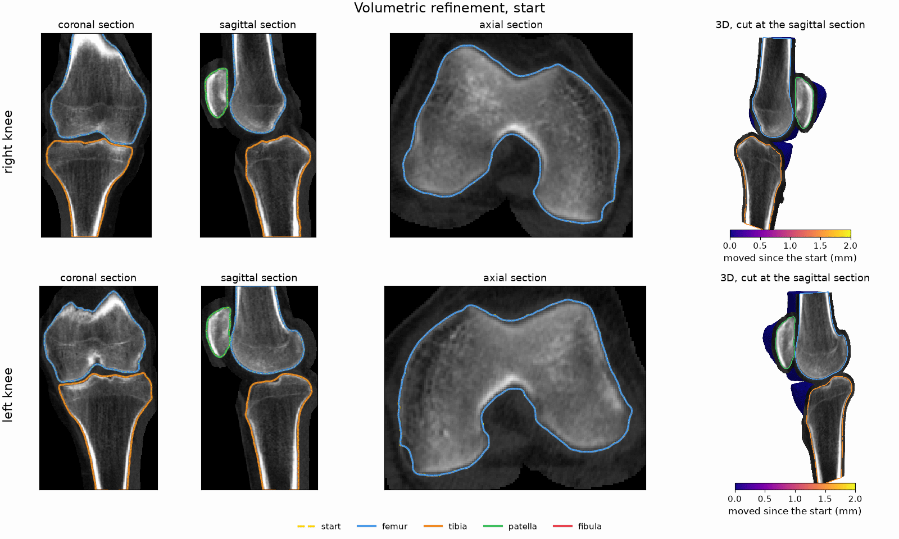
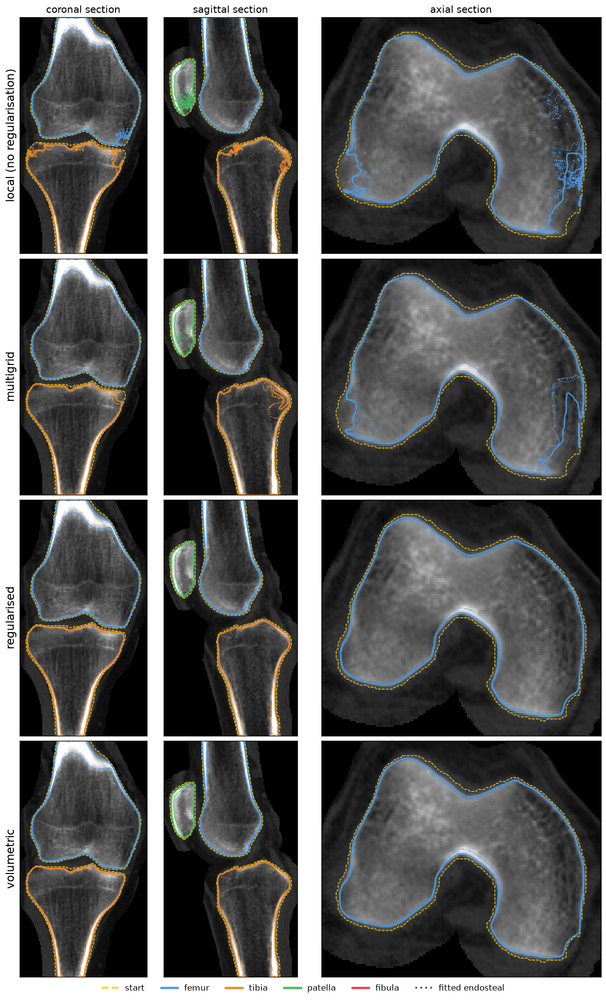
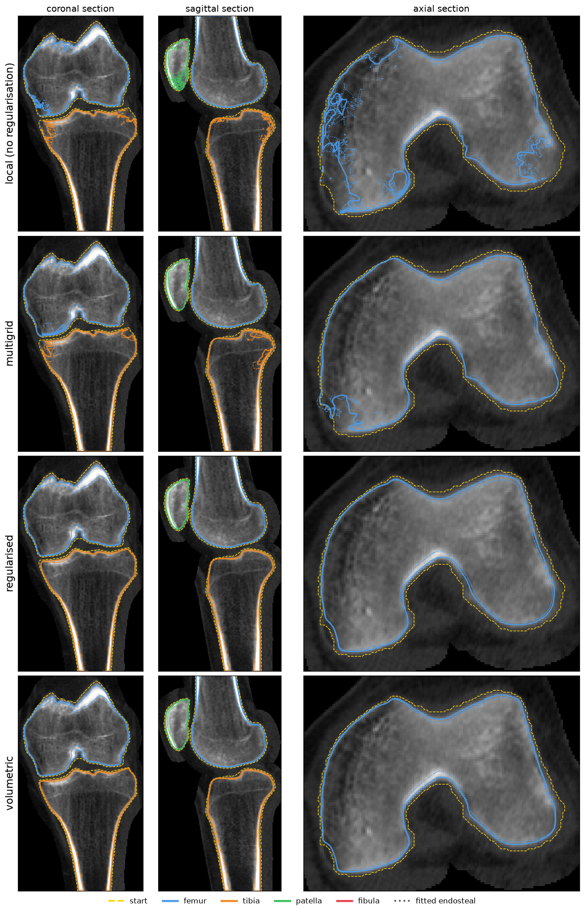
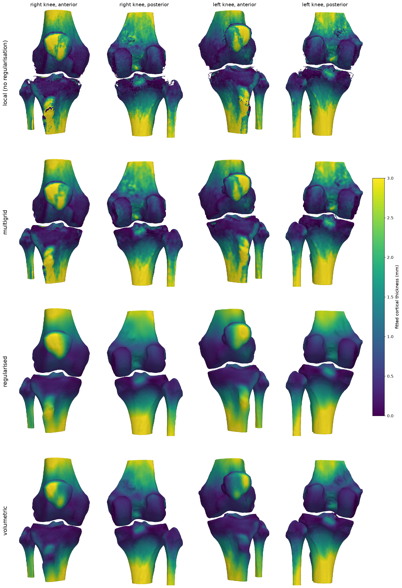

# Examples

Every method refining an automatic segmentation, on phantoms with exact
ground truth and on a clinical CT of both knees. All methods start from the
same segmentation and use the same options apart from the method.

| method | in the figures |
|---|---|
| local | one fit per profile, no regularisation (Treece et al. 2010) |
| multigrid | control points, coarse to fine (Neeteson & Boyd 2025) |
| regularised | spatially regularised fit (Neeteson & Boyd 2025) |
| volumetric | volumetric model, the voxels of a band around the surface |

## Phantoms

Phantoms from `cbm.site_phantom`, with parameters from the literature:

| phantom | scanner | voxels (mm) | PSF σ (mm) | noise σ | cortex (mm) | start |
|---|---|---|---|---:|---|---|
| distal radius | HR-pQCT | 0.061 | 0.08 | 40 | 0.85 mean, 0.2 min, porous; ulna 3 mm away | `hull_segmentation` |
| distal tibia | HR-pQCT | 0.061 | 0.08 | 40 | 1.3 mean, 0.2 min, porous; fibula 3 mm away | `hull_segmentation` |
| proximal femur | clinical CT | 0.75 × 0.75 × 1.0 | 0.5–0.6 | 30 | 0.3–3.5; acetabulum next to the head | `bone_hulls`, 4 mm closing |

Errors are measured along each node's sampling line against the exact
crossings of the true surfaces. The end slices of the shafts (where the
image cuts the bone) are left out.

### Distal radius



*Distal radius phantom, middle axial slice. Each column is one method.
Green dashed: true periosteal and endosteal surfaces. Yellow dotted: the
starting segmentation (convex hull). Red: refined periosteal surface. Blue:
fitted endosteal surface. Bottom row: the 4 mm white box, enlarged, placed
where the local fit's endosteum is farthest from the truth.*



*Distal radius phantom, the whole surface unrolled: angle around the shaft
(horizontal) by height (vertical), in 2° bins. Top: fitted cortical
thickness. Bottom: thickness error, fitted minus true (red: too thick,
blue: too thin).*

| method | moves | converged | time (s) | Ct.Th bias (µm) | Ct.Th RMSE (µm) | periosteum RMSE (µm) | cortex Dice |
|---|---:|---|---:|---:|---:|---:|---:|
| local | 5 | yes | 19 | +47 | 154 | 9 | 0.948 |
| multigrid | 4 | yes | 20 | +10 | 39 | 7 | 0.981 |
| regularised | 5 | yes | 27 | +12 | 66 | 10 | 0.967 |
| volumetric | 4 | yes | 86 | +2 | 26 | 5 | 0.986 |

### Distal tibia



*Distal tibia phantom, middle axial slice; colours and zoom as for the
radius.*



*Distal tibia phantom, unrolled as for the radius. Top: fitted thickness.
Bottom: error, fitted minus true.*

| method | moves | converged | time (s) | Ct.Th bias (µm) | Ct.Th RMSE (µm) | periosteum RMSE (µm) | cortex Dice |
|---|---:|---|---:|---:|---:|---:|---:|
| local | 6 | yes | 67 | +48 | 190 | 14 | 0.957 |
| multigrid | 5 | yes | 66 | −5 | 43 | 8 | 0.985 |
| regularised | 6 | yes | 84 | +13 | 97 | 14 | 0.970 |
| volumetric | 6 | yes | 343 | −5 | 34 | 7 | 0.987 |

### Proximal femur



*Proximal femur phantom at clinical resolution, middle coronal slice
(femoral head, neck and shaft; the acetabulum curves around the head). Colours as
for the radius. Bottom row: the 24 mm white box, enlarged, placed where the local fit's
endosteum is farthest from the truth.*



*Proximal femur phantom, the refined surface seen from the front. Top:
fitted cortical thickness. Bottom: error, fitted minus true. The thin dark
red line where the neck meets the shaft, in every method, is a concave
crease, where the cortex is not locally flat as the model assumes.*

| method | moves | converged | time (s) | Ct.Th bias (µm) | Ct.Th RMSE (µm) | periosteum RMSE (µm) | cortex Dice |
|---|---:|---|---:|---:|---:|---:|---:|
| local | 2 | yes | 2 | +168 | 224 | 58 | 0.931 |
| multigrid | 2 | yes | 3 | +164 | 196 | 45 | 0.931 |
| regularised | 2 | yes | 3 | +149 | 167 | 46 | 0.935 |
| volumetric | 2 | yes | 8 | +125 | 138 | 39 | 0.941 |

### Takeaways

- Every method converges on every phantom from the automatic start.
- The volumetric model has the lowest thickness error at every site: 26–34 µm
  at HR-pQCT resolution, about 6 times less than the local fit.
- At HR-pQCT resolution multigrid is second (39–43 µm). The regularised fit
  (66–97 µm) smooths over only its 500 nearest nodes, about 0.8 mm at this
  node spacing.
- At clinical resolution every method overestimates the femur's cortex by
  0.13–0.17 mm, where the cortex is mostly thinner than the blur.
- The periosteum is placed within 5–14 µm (a quarter of a voxel) at
  HR-pQCT resolution and 39–58 µm at clinical resolution.

## Clinical knee CT

A clinical CT of both knees (GE Revolution GSI, 0.65 × 0.65 mm pixels,
0.625 mm slices, not density-calibrated), used with the subject's
permission; the image is not in the repository. The left knee had an injury
in which bone broke off the femur and the patella; the right knee is
uninjured. There is no ground truth.

| step | call | here |
|---|---|---|
| threshold | `otsu_thresholds(image, floor=-500)` | 271 HU |
| bones | `separate_bones` with a landmark in each bone | 8 bones |
| thin cortex | `grow_bones` above `soft_tissue_threshold` | 152 HU |
| start | `bone_hulls(closing_radius=4.0)` | one closed surface per bone |
| refinement | `refine_bones`, every other bone excluded | per method, below |

Shared by every method: profiles 4 mm out and 8 mm in at 0.25 mm,
per-node densities (`global_params=()`), `ρc` estimated once for all eight
bones (1488 HU), `reg_sigma` 3 mm over 500 neighbours (regularised,
volumetric), multigrid spacings 16, 8, 4 and 2 mm, at most 150 moves. The
volumetric model's PSF, fitted to all eight bones: 0.67 mm in-plane, 0.74 mm
along the scanner axis.

### Refinement



*Volumetric refinement of all eight bones, one frame per move. Each row is
one knee: coronal, sagittal and axial sections, and a 3D view from the
lateral side, cut at the sagittal section: the image of that plane, each
bone's section drawn on it, and the half of each bone towards the viewer,
semi-transparent. Yellow dashed: the starting segmentation. Solid: the
refined periosteal surface, coloured by bone. Soft tissue more than 10 mm
from the start is blanked in the sections (display only).*

### Final surfaces



*Right (uninjured) knee, the final surfaces of each method (rows).
Sections through the femur and patella, and axial through the femoral
condyles. Yellow dashed: start. Solid: refined periosteal surface. Dotted:
fitted endosteal surface. Coloured by bone.*



*Left (injured) knee, as above.*



*Fitted cortical thickness on the refined surfaces of each method (rows),
each knee from the front and the back, on one colour scale (0–3 mm).*

### Results

Moves until convergence; **not converged** means the refinement stopped
because it made no progress for five fits.

| bone | local | multigrid | regularised | volumetric |
|---|---|---|---|---|
| right femur | 14 **not converged** | 19 **not converged** | 5 | 5 |
| right tibia | 13 **not converged** | 11 **not converged** | 6 | 7 |
| right patella | 14 **not converged** | 19 **not converged** | 5 | 5 |
| right fibula | 13 **not converged** | 16 | 5 | 4 |
| left femur | 14 **not converged** | 17 **not converged** | 11 | 9 |
| left tibia | 14 **not converged** | 12 **not converged** | 11 | 10 |
| left patella | 13 **not converged** | 13 **not converged** | 5 | 5 |
| left fibula | 13 **not converged** | 5 | 4 | 4 |
| run time, all bones | 1.7 min | 7.5 min | 8.9 min | 12.1 min |

Bone outside the refined surface (cm³): the voxels of each bone's
thresholded and grown region more than 1 mm outside its refined periosteal
surface. Part of it is the blurred edge itself.

| bone | local | multigrid | regularised | volumetric |
|---|---:|---:|---:|---:|
| right femur | 4.8 | 4.3 | 1.9 | 1.6 |
| right tibia | 9.3 | 5.7 | 3.3 | 2.5 |
| right patella | 2.2 | 1.4 | 1.4 | 1.0 |
| right fibula | 1.6 | 0.6 | 0.5 | 0.2 |
| left femur | 7.1 | 4.4 | 3.4 | 2.6 |
| left tibia | 9.8 | 7.5 | 4.8 | 3.5 |
| left patella | 3.3 | 1.2 | 1.2 | 0.8 |
| left fibula | 1.6 | 0.7 | 0.7 | 0.5 |

Median fitted cortical thickness, mm (5th–95th percentile):

| bone | local | multigrid | regularised | volumetric |
|---|---|---|---|---|
| right femur | 0.54 (0.05–2.54) | 0.55 (0.11–2.54) | 0.55 (0.22–2.61) | 0.51 (0.19–2.60) |
| right tibia | 0.70 (0.05–3.33) | 0.86 (0.09–3.44) | 0.90 (0.15–3.19) | 0.74 (0.13–3.15) |
| right patella | 0.88 (0.05–3.40) | 0.96 (0.10–3.45) | 1.07 (0.29–3.13) | 0.85 (0.12–2.81) |
| right fibula | 0.83 (0.05–2.86) | 0.97 (0.24–2.85) | 0.87 (0.31–2.75) | 0.79 (0.26–2.74) |
| left femur | 0.56 (0.05–2.31) | 0.63 (0.10–2.33) | 0.61 (0.20–2.32) | 0.54 (0.17–2.30) |
| left tibia | 0.80 (0.05–3.32) | 0.86 (0.10–3.31) | 1.01 (0.16–3.22) | 0.79 (0.16–3.17) |
| left patella | 0.91 (0.05–3.38) | 0.85 (0.10–3.43) | 1.04 (0.23–2.94) | 0.78 (0.10–2.46) |
| left fibula | 0.83 (0.05–2.96) | 1.02 (0.21–3.04) | 0.95 (0.29–3.06) | 0.87 (0.24–2.88) |

### Takeaways

- Only the regularised and volumetric fits refine clinical CT: they converge
  on all eight bones, the local fit on none and multigrid on two.
- With the local fit the surface drifts into the bone where profiles have no
  clear edge, leaving up to 10 cm³ of bone outside a tibia.
- The volumetric model leaves the least bone outside on every bone,
  0.2–3.5 cm³ against 0.5–4.8 cm³ for the regularised fit.
- The injured left knee leaves more bone outside than the right with every
  method, and its femur and tibia need 1.5–2 times the moves.
- The thickness pattern is the same for every method: thin (≲ 0.5 mm)
  subchondral shells, a thick anterior patella and diaphyseal cortices of
  2–3.5 mm.

## Reproducing

```bash
pip install ./python[docs]
cd docs/scripts
python phantoms.py                     # docs/results/phantoms.json, docs/images/phantom_*
python knee.py /path/to/DICOM          # docs/results/knee.json, docs/images/knee_* (the CT is not public)
```

Each results file records the hash of the code and inputs that produced it;
`--redraw` redraws the figures from the last run only if that hash still
matches.
