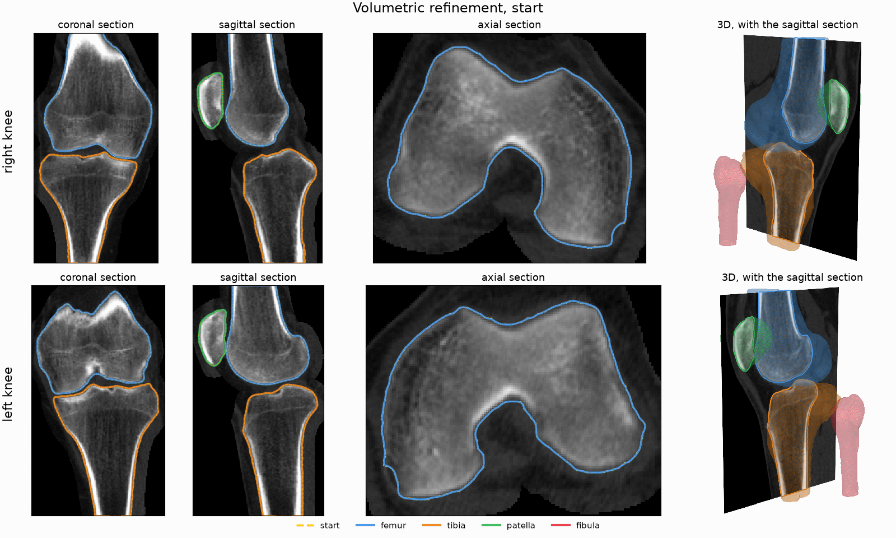

# cortical-bone-mapping-rs

Cortical bone mapping (CBM) in Rust, with Python bindings: model-based
measurement of cortical thickness, and automatic segmentation of the
periosteal and endosteal surfaces, from CT and HR-pQCT images.

At every vertex of the bone's outer surface, CBM samples a density profile
along the inward normal and fits a blurred three-level step model (soft
tissue, cortex, trabecular bone): the cortical thickness `t`, the position
`m` of the cortex, the blur `σ` and the soft-tissue and trabecular
densities.



*Refinement of all eight bones of a clinical CT of both knees, from a rough
automatic segmentation (yellow dashed) to the fitted periosteal surfaces,
one frame per move ([examples](examples.md#clinical-knee-ct)).*

| method | | |
|---|---|---|
| local | one fit per profile | Treece et al. 2010 |
| multigrid | control points, coarse to fine | Neeteson & Boyd 2025 |
| regularised | spatially regularised fit | Neeteson & Boyd 2025 |
| volumetric | every voxel of a band around the surface, one PSF per scan | extension |

Plus a curvature penalty on the fitted surfaces and segmentation refinement
(extensions).

```python
import cortical_bone_mapping_rs as cbm

start = cbm.hull_segmentation(image)                        # from the image alone
options = cbm.Options.preset("radius_tibia", rho_c="estimate")
rr = cbm.refine_segmentation(image, start, options=options, method="volumetric")
rr.result.thickness                                         # mm, per surface node
rr.periosteal_mask, rr.endosteal_mask, rr.cortical_mask
```

## Where to start

- [Installation](guide/install.md), then the [quick start](guide/quickstart.md).
- [Choosing a method](guide/methods.md) and [scanners and
  parameters](guide/scanners.md).
- [Automatic segmentation](guide/refinement.md), and [several
  bones](guide/several_bones.md) in one scan.
- [Examples](examples.md): every method on phantoms and on a clinical CT of
  both knees. [Benchmarks](benchmarks.md): run time and memory.
- [Method](method.md), [architecture](architecture.md) (how the code fits
  together) and the [API reference](api.md).

```{toctree}
:hidden:
:caption: User guide

guide/install
guide/quickstart
guide/methods
guide/scanners
guide/refinement
guide/several_bones
guide/results
guide/rust
```

```{toctree}
:hidden:
:caption: Results

examples
benchmarks
```

```{toctree}
:hidden:
:caption: Reference

method
architecture
api
```

## Citing

If you use this software, please cite our paper and this implementation
(see `CITATION.cff` in the repository):

> N. J. Neeteson, S. K. Boyd, *Advancing Cortical Bone Mapping with global
> optimization*, Computers in Biology and Medicine, 2025,
> [doi:10.1016/j.compbiomed.2025.110636](https://doi.org/10.1016/j.compbiomed.2025.110636)

and the original method:

> G. M. Treece, A. H. Gee, P. M. Mayhew, K. E. S. Poole, *High resolution
> cortical bone thickness measurement from clinical CT data*, Medical Image
> Analysis 14(3):276–290, 2010.
