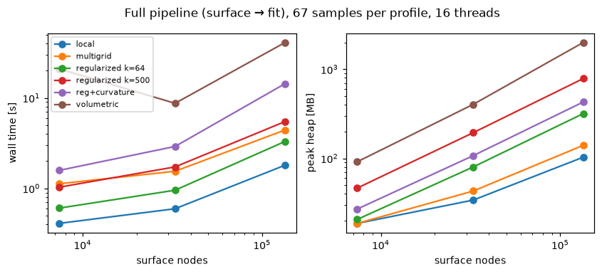

# Performance

This page reports the run time and memory of each method, explains where
they go, and compares the crate with the original Python implementation
(Bonelab) and with SciPy on the same objective.

## Setup

Windows 11, 16 hardware threads, release build. The phantoms are cylinders
with an HR-pQCT-like geometry: 60.7 µm voxels, outer radius 8 mm, cortex
1.2 ± 0.5 mm, PSF 0.1 mm, noise σ = 60, and 8, 32 or 128 slices. Profiles run
from 1 mm outside to 3 mm inside (67 samples) with normals in the transverse
plane. RMSE is the thickness error against the phantom truth.

`cargo run --release --example benchmark -p cortical-bone-mapping` times the
full pipeline (surface extraction and smoothing, sampling, global
initialisation and fit). Peak heap is the most memory allocated during the
call above the input image and mask, measured with a counting global
allocator. `reg+curvature` is `λ = 1`, k = 64, plus the default `"change"`
curvature penalty (scale 0.25 mm, `μ = 1`); `volumetric` is the
[volumetric model](method.md#volumetric-model) with its defaults (curvature
weight 0.3, density fields smoothed by the paper's operator over 500
neighbours) and its axial blur tied to the in-plane one.

## Results

| method | nodes | time [s] | peak heap [MB] | bytes/node | RMSE [µm] | outer it. | CG it. |
|---|---:|---:|---:|---:|---:|---:|---:|
| local | 7392 | 0.41 | 19 | 2524 | 19.8 | 12 | 0 |
| multigrid | 7392 | 1.13 | 19 | 2524 | 8.9 | 32 | 425 |
| regularized k=64 | 7392 | 0.61 | 21 | 2797 | 15.2 | 7 | 50 |
| regularized k=500 | 7392 | 1.03 | 46 | 6285 | 13.9 | 7 | 51 |
| reg+curvature | 7392 | 1.58 | 27 | 3657 | 7.8 | 7 | 330 |
| volumetric | 7392 | 21.01 | 92 | 12401 | 27.4 | 34 | 1909 |
| local | 32736 | 0.60 | 34 | 1041 | 19.3 | 13 | 0 |
| multigrid | 32736 | 1.55 | 43 | 1316 | 11.8 | 30 | 443 |
| regularized k=64 | 32736 | 0.96 | 80 | 2449 | 15.3 | 7 | 53 |
| regularized k=500 | 32736 | 1.73 | 194 | 5937 | 14.2 | 7 | 50 |
| reg+curvature | 32736 | 2.91 | 107 | 3281 | 7.8 | 7 | 268 |
| volumetric | 32736 | 8.73 | 404 | 12340 | 8.2 | 30 | 202 |
| local | 134112 | 1.80 | 103 | 768 | 19.1 | 13 | 0 |
| multigrid | 134112 | 4.42 | 140 | 1044 | 12.6 | 32 | 454 |
| regularized k=64 | 134112 | 3.30 | 318 | 2370 | 15.2 | 7 | 55 |
| regularized k=500 | 134112 | 5.48 | 786 | 5858 | 14.1 | 7 | 50 |
| reg+curvature | 134112 | 14.38 | 429 | 3197 | 7.6 | 7 | 272 |
| volumetric | 134112 | 40.99 | 1996 | 14880 | 6.7 | 31 | 221 |

The 1D methods scale close to linearly in the number of nodes. Their memory
at 134k nodes goes to the profiles (`N × 67 × 4 B` = 36 MB), the
Gauss–Newton blocks and work vectors (about 25 doubles per node), the
transposed sparse products (16 buffers of N doubles, 17 MB) and, above all,
the smoothing operator `ω` at 8 B per neighbour: 536 MB at the paper's
k = 500 and 69 MB at k = 64.

The volumetric model is the most accurate on the two longer slabs (8.2 and
6.7 µm), at 4–7 times the time and 2.5 times the memory of the regularised
fit with the same smoothing. On the 8-slice slab (0.49 mm long) it is the
least accurate and uses most of its CG budget: in a slab only a few voxels
long, most band voxels have their closest surface point on the rim where the
image cuts the bone and are dropped (16 slices: 9.2 µm; 32: 8.4 µm). Real
scans are far longer (168 slices for a standard HR-pQCT stack).

### Where the volumetric model's cost goes

`--volumetric` runs the volumetric model at 134k nodes with its density
fields smoothed over 64 neighbours instead of 500, with one global density
each instead of fields, and without the curvature penalty:

| variant | time [s] | peak heap [MB] | RMSE [µm] | CG it. | band [s] | Gauss–Newton products [s] |
|---|---:|---:|---:|---:|---:|---:|
| volumetric | 41.5 | 1996 | 6.7 | 221 | 7.9 | 22.6 |
| volumetric k=64 | 30.1 | 1528 | 6.7 | 193 | 7.7 | 12.4 |
| volumetric, global densities | 26.1 | 924 | 6.6 | 159 | 8.0 | 8.0 |
| volumetric, no curvature | 70.3 | 1882 | 501.5 | 387 | 8.0 | 36.0 |

The density fields cost a third of the time and half the memory: the
500-neighbour operator (about 540 MB) and larger per-face Gauss–Newton
blocks (four field parameters per vertex instead of two). On this phantom,
whose densities are uniform, they buy nothing; on real bone, whose
trabecular density varies, they matter, and `reg_neighbours=64` or
`vol_global_densities=True` are the cheaper settings where they do not. The
curvature penalty is the only regulariser of the edge positions: without it
the fit is noise and twice as slow. Building the band (the closest surface
point of about 8 million voxels) costs 8 s regardless of the fit; voxels
farther from the voxelised surface than the sampling range plus two voxels
are skipped before the search, which leaves the band unchanged and saved
about 1 s here. Most of the fit is Gauss–Newton products, as for the other
global fits; the curvature penalty needs about four times the CG iterations
of the smoothing penalty alone.

### Design changes driven by profiling

- The curvature Laplacian first used the `k` nearest neighbours, which at
  60 µm spacing span only about 0.27 mm, so the operator was stiff at the
  node scale (1447 CG iterations, 65 s at 134k nodes). Sampling `k`
  neighbours from the Gaussian at the requested scale gives the same
  accuracy with a third of the CG work.
- Solving each Gauss–Newton step only as accurately as the gradient warrants
  (inexact Newton, forcing term `min(0.1, √g)`) halved the CG work (k = 500:
  90 → 50 iterations; curvature: 440 → 271) with identical RMSEs.
- Building `ω` in place (fixed stride, then compaction) brought the k = 500
  peak down from 1166 MB to 751 MB.
- Every trial step counts against `max_iterations` and every CG iteration
  against `cg_max_total` (2000), so a badly posed problem (a segmentation
  that has leaked into the marrow) stops in bounded time, flagged, instead
  of running for hours.
- All parallel sums use fixed chunks in a fixed order, so results are
  bitwise identical for any thread count, at no measurable cost.

## Comparison with Bonelab

`python docs/scripts/compare_bonelab.py /path/to/Bonelab` runs Bonelab's
`LocalTreeceMinimization`, `GlobalControlPointTreeceMinimization` and
`GlobalRegularizationTreeceMinimization` on the same profiles, sampled once by
this crate; Bonelab's surface and sampling stages are not timed. "This crate
fit" is the global initialisation plus the method fit. Bonelab's local fit
is timed on 400 nodes and extrapolated (*). Its memory is the Python-heap
peak during the fit (tracemalloc). Options follow Table 1 of our 2025 paper
(k = 500 only at the smaller size). The volumetric model has no counterpart
in Bonelab.

| method | nodes | Bonelab fit [s] | this crate fit [s] | speed-up | Bonelab heap [MB] | RMSE Bonelab [µm] | RMSE this crate [µm] |
|---|---:|---:|---:|---:|---:|---:|---:|
| local* | 7392 | 47.4 | 0.26 | 180× | 0.4 | 20.1 | 19.8 |
| multigrid | 7392 | 11.8 | 1.03 | 11× | 52 | 14.1 | 8.9 |
| regularized k=64 | 7392 | 4.2 | 0.54 | 8× | 62 | 18.6 | 15.2 |
| regularized k=500 | 7392 | 4.3 | 0.80 | 5× | 83 | 17.7 | 13.9 |
| local* | 32736 | 204.4 | 0.48 | 424× | 0.1 | 18.5 | 19.3 |
| multigrid | 32736 | 63.1 | 1.39 | 46× | 229 | 16.3 | 11.8 |
| regularized k=64 | 32736 | 10.0 | 0.83 | 12× | 275 | 18.7 | 15.3 |

The whole Rust pipeline peaks at 81 MB for regularised k = 64 at 32 736
nodes, against Bonelab's 275 MB for the fit alone.

Both local fits find the same per-node optima (the RMSEs agree, and so does
the SciPy check below, to a median of 4e-8 mm). The speed-up comes from
analytic Jacobians and 5×5 normal equations instead of SciPy's TRF with
finite differences, compiled code, and all cores.

The global methods are both faster and more accurate here, because
Bonelab's L-BFGS-B runs stop before convergence. At 7392 nodes (regularised,
k = 64):

| Bonelab configuration | RMSE | time |
|---|---|---|
| default tolerances (1e-6) | 18.65 µm | 2.6 s |
| tight tolerances (`f_tol = 1e-14`, `g_tol = 1e-12`) | 16.30 µm | 4.4 s |
| tight tolerances + consistent loss | 15.70 µm | 10.7 s |
| this crate | 15.18 µm | 0.47 s |

Bonelab's regularised loss and gradient also disagree (the loss scales the
m/t penalty by `ρc²/t0` and the gradient by `ρc²/t0²`, and the σ penalty is
missing from the loss), which matters only once the solve runs to
convergence. The regularised speed-ups above are therefore against
unconverged solves; against converged ones the factor is about 10–20
(Bonelab, tight tolerances) and about 70 (SciPy, below).

Bonelab's initial one-model fit stalls on the bounds when the trabecular
initial guess is 0 (`m = 6`, `σ = 2`, `t ≈ 11 mm`), and every global method
inherits that (RMSE ≈ 8–9 mm), so the comparison uses its CLI default of
200. This crate's Gauss–Newton initial fit converges from 0.

## Comparison with SciPy on the same objective

`python docs/scripts/compare_scipy.py` implements this crate's objective in
NumPy/SciPy: `least_squares` (bounded TRF, analytic Jacobian, the same
weighting) for the local fit, and L-BFGS-B (analytic gradient, sparse `ω`
from `cKDTree`, variables scaled to O(1), run to convergence) for the
regularised fit. This crate's times are the full pipeline; SciPy's local fit
is extrapolated from 1000 nodes.

| method | nodes | SciPy [s] | this crate [s] | speed-up | SciPy heap [MB] | final cost SciPy / this crate | RMSE [µm] SciPy / this crate |
|---|---:|---:|---:|---:|---:|---|---|
| local* | 7392 | 10.0 | 0.42 | 24× | | same optima (median Δt 4e-08 mm) | 20.1 / 19.8 |
| regularized k=64 | 7392 | 9.9 | 0.67 | 15× | 108 | 2920.54528 / 2920.54527 | 15.18 / 15.18 |
| local* | 32736 | 30.2 | 0.58 | 52× | | same optima (median Δt 4e-08 mm) | 20.1 / 19.3 |
| regularized k=64 | 32736 | 65.2 | 0.89 | 73× | 502 | 2842.38576 / 2842.38571 | 15.32 / 15.32 |

The regularised fits reach the same optimum: the costs agree to 7–8
significant digits (this crate's slightly lower) and the RMSEs to 0.001 µm.
The Gauss–Newton/PCG engine needs 7 outer iterations (about 50 CG products)
where L-BFGS-B needs 214–330, and the gap widens with N.
