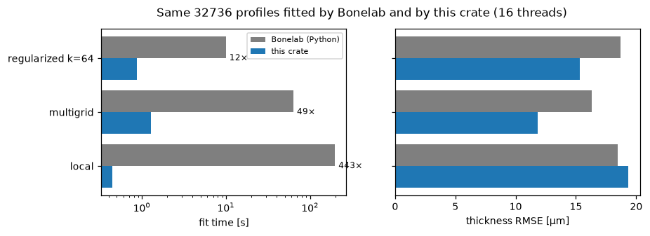

# Performance

All timings: Windows 11, 16 hardware threads, release build. Phantoms are
cylinders with an HR-pQCT-like geometry: 60.7 µm voxels, outer radius 8 mm,
cortex 1.2 ± 0.5 mm, PSF 0.1 mm, noise σ = 60, with 8, 32 and 128 slices.
Profiles run from 1 mm outside to 3 mm inside (67 samples), normals in the
transverse plane. RMSE is thickness error against the phantom truth.

## This crate: time and peak memory

`cargo run --release --example benchmark -p cortical-bone-mapping`.

Times cover the full pipeline: surface extraction and smoothing, sampling,
global initialisation and the fit. Peak heap is the most memory allocated
*during* the call, above the input image and mask, measured with a counting
global allocator.

| method | nodes | time [s] | peak heap [MB] | bytes/node | RMSE [µm] | outer it. | CG it. |
|---|---:|---:|---:|---:|---:|---:|---:|
| local | 7392 | 0.31 | 19 | 2524 | 19.8 | 12 | 0 |
| multigrid | 7392 | 0.98 | 19 | 2598 | 8.9 | 29 | 585 |
| regularized k=64 | 7392 | 0.53 | 26 | 3570 | 15.2 | 7 | 95 |
| regularized k=500 | 7392 | 0.93 | 52 | 7058 | 13.9 | 7 | 90 |
| reg+curvature | 7392 | 2.13 | 33 | 4495 | 7.7 | 7 | 579 |
| local | 32736 | 0.57 | 42 | 1290 | 19.3 | 13 | 0 |
| multigrid | 32736 | 1.42 | 47 | 1447 | 11.8 | 27 | 584 |
| regularized k=64 | 32736 | 0.97 | 81 | 2469 | 15.3 | 7 | 95 |
| regularized k=500 | 32736 | 2.39 | 195 | 5957 | 14.2 | 7 | 90 |
| reg+curvature | 32736 | 3.59 | 113 | 3460 | 7.8 | 7 | 444 |
| local | 134112 | 1.71 | 117 | 872 | 19.1 | 13 | 0 |
| multigrid | 134112 | 4.69 | 138 | 1030 | 12.6 | 26 | 714 |
| regularized k=64 | 134112 | 3.78 | 284 | 2115 | 15.2 | 7 | 95 |
| regularized k=500 | 134112 | 10.01 | 751 | 5603 | 14.1 | 7 | 90 |
| reg+curvature | 134112 | 21.60 | 418 | 3118 | 7.6 | 7 | 440 |

(`reg+curvature`: `λ = 1`, k = 64, plus the default `"change"` curvature
penalty, scale 0.25 mm, `μ = 1`.)

Where the memory goes at 134k nodes:

* profiles: `N × 67 × 4 B` = 36 MB;
* Gauss–Newton blocks and work vectors: about 25 doubles per node;
* the Neeteson operator `ω`: 8 B per neighbour, so 536 MB for k = 500 and
  69 MB for k = 64. It is the dominant cost at the paper's k = 500. Building
  it in place (fixed stride, then compaction) brought the k = 500 peak down
  from 1166 MB to 751 MB;
* transposed sparse products: 16 fixed buffers of N doubles (17 MB).

Two design changes made during development were driven by profiling:

* **The curvature Laplacian.** With the `k` *nearest* neighbours, 64
  neighbours at 60 µm spacing span only ~0.27 mm, so the operator was stiff at
  the node scale: 1447 CG iterations and 65 s at 134k nodes. Importance
  sampling `k` neighbours from the Gaussian at the requested scale gives the
  same accuracy in 440 iterations and 21 s.
* **Deterministic reductions.** All parallel sums use fixed chunks in a fixed
  order, so results are bitwise identical for any thread count. This costs
  nothing measurable.

## Against Bonelab (the reference implementation)

`python docs/scripts/compare_bonelab.py /path/to/Bonelab`. Bonelab's
`LocalTreeceMinimization`, `GlobalControlPointTreeceMinimization` and
`GlobalRegularizationTreeceMinimization` fit **the same profiles**, sampled
once by this crate. Bonelab's PyVista surface and sampling stages are not
timed. "This crate fit" is the global initialisation plus the method fit.
Bonelab's local fit is timed on 400 nodes and extrapolated (marked *).
Bonelab's memory is its Python-heap peak during the fit (tracemalloc).
Options follow Table 6.1 of the paper (k = 500 only at the smaller size).

| method | nodes | Bonelab fit [s] | this crate fit [s] | speed-up | Bonelab heap [MB] | RMSE Bonelab [µm] | RMSE this crate [µm] |
|---|---:|---:|---:|---:|---:|---:|---:|
| local* | 7392 | 47.1 | 0.27 | 175× | 0.4 | 20.1 | 19.8 |
| multigrid | 7392 | 12.7 | 0.85 | 15× | 52 | 14.0 | 8.9 |
| regularized k=64 | 7392 | 2.8 | 0.47 | 6× | 62 | 18.7 | 15.2 |
| regularized k=500 | 7392 | 5.8 | 0.87 | 7× | 83 | 17.7 | 13.9 |
| local* | 32736 | 197.5 | 0.45 | 443× | 0.1 | 18.5 | 19.3 |
| multigrid | 32736 | 63.3 | 1.29 | 49× | 229 | 16.3 | 11.8 |
| regularized k=64 | 32736 | 10.0 | 0.87 | 12× | 275 | 18.7 | 15.3 |

For comparison, the whole Rust pipeline peaks at 81 MB for regularised k=64
at 32736 nodes, against Bonelab's 275 MB for the fit alone.

Notes:

* **Local.** Both find the same per-node optima: the RMSEs agree, and so does
  the SciPy check below, to a median of 4e-8 mm. The speed-up comes from
  analytic Jacobians, 5×5 normal equations instead of SciPy's TRF machinery
  with finite-difference Jacobians, compiled code, and all cores.
* **Global methods.** This crate is both faster and more accurate. Bonelab's
  L-BFGS-B runs stop early. A likely contributor is that the regularised loss
  and its gradient disagree (the loss scales the m/t penalty by `ρc²/t0`, the
  gradient by `ρc²/t0²`, and the σ penalty is missing from the loss). The
  speed-ups for the regularised method are therefore *against an
  unconverged solve*. Against a converged L-BFGS-B solve of the same
  objective (SciPy, below) the factor is ~70×.
* **Robustness.** With the trabecular initial guess at 0, Bonelab's initial
  one-model L-BFGS-B fit stalls on the bounds (`m = 6`, `σ = 2`, `t ≈ 11 mm`)
  on these phantoms, and every global method inherits that (RMSE ≈ 8–9 mm).
  The comparison therefore uses Bonelab's CLI default of 200. The
  Gauss–Newton initial fit in this crate converges from 0.

## Against SciPy on the same objective

`python docs/scripts/compare_scipy.py` implements this crate's objective in
NumPy/SciPy:

* local: `least_squares` (bounded TRF, analytic Jacobian, same `√γ`
  weighting);
* regularised: L-BFGS-B, analytic gradient, sparse `ω` from `cKDTree`, all
  variables scaled to O(1), run to convergence.

| method | nodes | SciPy [s] | this crate [s] | speed-up | SciPy heap [MB] | final cost SciPy / this crate | RMSE [µm] SciPy / this crate |
|---|---:|---:|---:|---:|---:|---|---|
| local* | 7392 | 6.6 | 0.31 | 21× | | same optima (median Δt 4e-8 mm) | 20.1 / 19.8 |
| regularized k=64 | 7392 | 9.6 | 0.52 | 18× | 108 | 2920.54333 / 2920.54332 | 15.18 / 15.18 |
| local* | 32736 | 29.2 | 0.55 | 54× | | same optima (median Δt 4e-8 mm) | 20.1 / 19.3 |
| regularized k=64 | 32736 | 65.6 | 0.97 | 68× | 502 | 2842.38433 / 2842.38428 | 15.32 / 15.32 |

(This crate's times here are the full pipeline. SciPy's local fit is
extrapolated from 1000 nodes.)

The regularised fits reach the same optimum: the costs agree to 8
significant digits and the thickness RMSEs agree to 0.1 µm. The
Gauss–Newton/PCG engine needs 7 outer iterations (95 CG products) where
L-BFGS-B needs 234–340. The gap widens with N.
