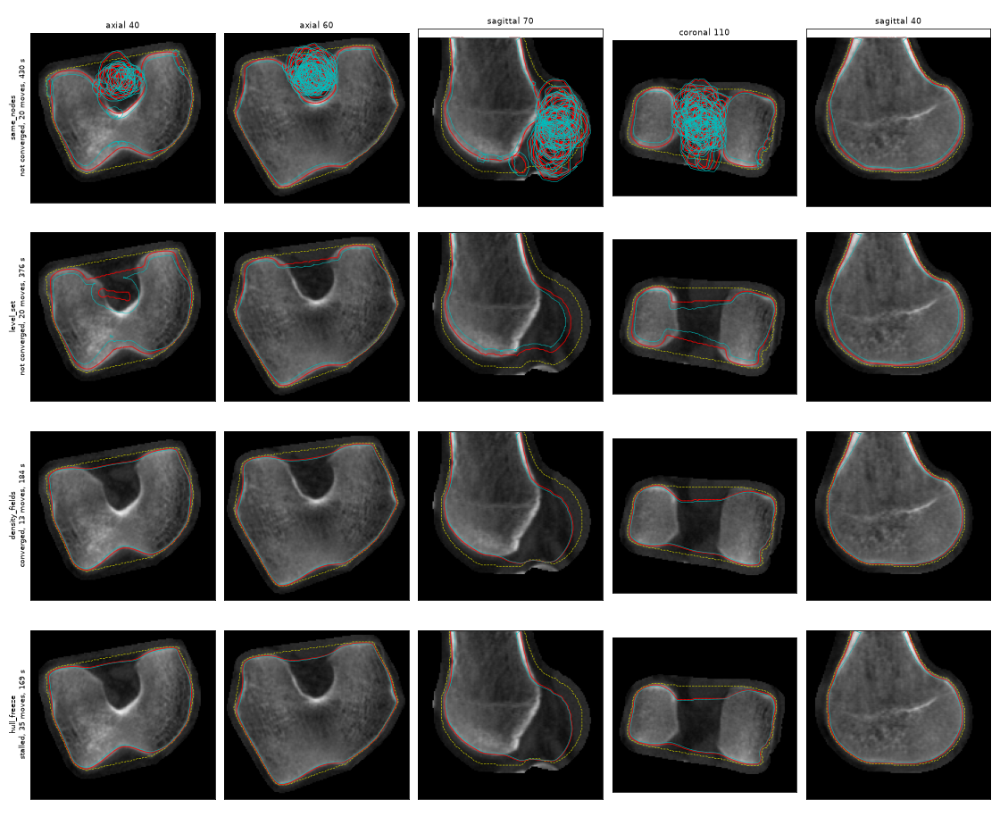
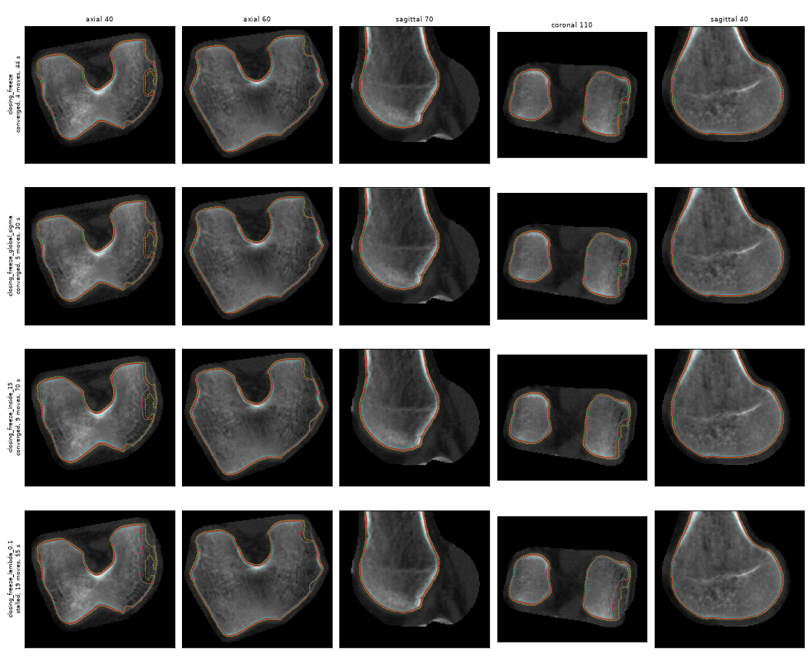

# Refinement on real data: the femoral notch

*A record of what the clinical knee CT taught us about refinement, and the
changes it led to. The image is real data, used with the subject's
permission, and is not part of the repository. Figures show only the bone
and its immediate surroundings: everything more than 4 mm outside the
starting segmentation is blanked.*

On the knee CT ([clinical_ct.md](clinical_ct.md)), the patella, fibula and
tibia converged but the femur did not. These experiments isolate the
femur's distal end, which contains the intercondylar notch, and work out
why. They lead to six changes in the library:

* remeshing through a level set;
* per-node densities;
* inexact inner fits with a stricter stopping rule;
* a faster smoothing operator;
* a "local convex hull" start;
* regional convergence.

* [The test region and how runs are judged](#the-test-region-and-how-runs-are-judged)
* [Results at a glance](#results-at-a-glance)
* [1. The mesh tangled: remeshing with a level set](#1-the-mesh-tangled-remeshing-with-a-level-set)
* [2. The surface sank into the bone: per-node densities](#2-the-surface-sank-into-the-bone-per-node-densities)
* [3. Inexact inner fits and a stricter stopping rule](#3-inexact-inner-fits-and-a-stricter-stopping-rule)
* [4. Where the time goes](#4-where-the-time-goes)
* [5. The hull bridges the notch](#5-the-hull-bridges-the-notch)
* [6. A local convex hull and regional convergence](#6-a-local-convex-hull-and-regional-convergence)
* [7. Pitfalls met along the way](#7-pitfalls-met-along-the-way)
* [Open questions](#open-questions)
* [Reproducing](#reproducing)

## The test region and how runs are judged

[notch_experiment.py](scripts/notch_experiment.py) crops the distal femur
from the cache written by [ct_example.py](scripts/ct_example.py). The crop
covers image slices 120–249, rows 170–311 and columns 45–199. That is
130 × 142 × 155 voxels, or 81 × 92 × 101 mm, about 7% of the image, and it
holds the whole cross-section of both condyles. Only the shaft is cut, at
the top; cut faces become caps that are not fitted. A smaller box that cut
through the lateral condyle gave misleading results (section 7). Every
run uses the clinical-CT options of `ct_example.py`:

* profiles 4 mm outside and 8 mm inside, at 0.25 mm;
* the regularised fit (`λ = 1`, `σ_reg` = 3 mm, 500 neighbours);
* `ρc` estimated from the image (about 1200–1260 HU);
* relaxation 0.5;
* a tolerance of 0.1 voxel (0.062 mm).

There is no ground truth, so each run is judged on:

* **The outcome.** Did it converge, stall, or run out of moves? How many
  moves did it take, and how long?
* **The notch.** The convex hull bridges a region of 25.2 cm³ that a 4 mm
  closing leaves open: essentially the notch. The measure is how much of
  that region is still inside the refined surface. The ideal is 0.
* **Bone left outside.** The volume of the thresholded femur, more than 2 mm
  from its edge, that lies outside the refined surface. The ideal is 0.
* **Where the start was already right.** For nodes within 1.5 mm of the
  starting surface, the depth of the refined node below the 267 HU
  isosurface. It is measured along the node's normal, interpolated to sub-voxel
  precision. For these nodes the start lay on the threshold surface.
* **Edge agreement.** The fitted periosteal edge `m − t/2` against the
  steepest rise of each profile, a model-free edge, over profiles with a
  clear rise (`+` = the fitted edge lies inside the rise).

## Results at a glance

| variant | start | result | moves | time | notch still inside (cm³) | bone outside (cm³) | node depth below 267 HU surface (mm) | edge − steepest rise (mm) | \|·\| > 0.5 mm | σ (mm) | t (mm) |
|---|---|---|---:|---:|---:|---:|---:|---:|---:|---:|---:|
| `same_nodes` | hull | not converged | 20 | 430 s | 8.6 of 25.2 | 0.21 | +0.50 | +0.50 | 52% | 1.39 | 0.94 |
| `level_set` | hull | not converged | 20 | 376 s | 8.5 of 25.2 | 0.25 | +0.49 | +0.49 | 45% | 1.39 | 1.00 |
| `level_set_adaptive` | hull | stalled | 13 | 97 s | 8.6 of 25.2 | 0.10 | +0.49 | +0.49 | 46% | 1.38 | 1.00 |
| `density_fields` | hull | converged¹ | 13 | 184 s | 12.9 of 25.2 | 0.00 | +0.47 | +0.27 | 34% | 0.82 | 0.47 |
| `hull_freeze` | hull | stalled | 35 | 169 s | 12.6 of 25.2 | 0.00 | +0.47 | +0.31 | 38% | 0.82 | 0.49 |
| `closing` | closing 4 mm | converged | 4 | 48 s | 0.0 of 25.2 | 0.00 | +0.46 | +0.29 | 39% | 0.79 | 0.57 |
| **`closing_freeze`** | closing 4 mm | **converged** | 4 | **44 s** | **0.0** of 25.2 | 0.00 | +0.46 | +0.29 | 39% | 0.79 | 0.57 |
| `closing_freeze_global_sigma` | closing 4 mm | converged | 5 | 30 s | 0.0 of 25.2 | 0.00 | +0.46 | +0.28 | 35% | 0.72 | 0.51 |
| `closing_freeze_inside_15` | closing 4 mm | converged | 9 | 70 s | 0.0 of 25.2 | 0.00 | +0.51 | +0.47 | 35% | 0.83 | 0.63 |
| `closing_freeze_neighbours_250` | closing 4 mm | converged | 5 | 38 s | 0.0 of 25.2 | 0.00 | +0.47 | +0.28 | 35% | 0.80 | 0.58 |
| `closing_freeze_lambda_0.1` | closing 4 mm | stalled | 19 | 55 s | 0.0 of 25.2 | 0.20 | +0.47 | +0.27 | 24% | 0.80 | 0.57 |

How the variants differ:

* **The first three** use global densities (the regularised method of the
  paper).
* **From `density_fields` on**, the densities are per-node fields.
* **`same_nodes` and `level_set`** use full inner solves.
* **All the others** use adaptive inner solves.

¹ `density_fields` was run without the regional convergence test, as the
loop was then. Its "convergence" left a region still moving by 0.3 mm
(section 3).

The configuration that works is **`closing_freeze`**: a 4 mm closing start,
the level set, adaptive inner fits, per-node densities and regional
convergence.
* **Speed:** it converges in 4 moves and 44 s, against 430 s without
  converging for the original method.
* **The notch** is fully open.
* **No thresholded bone** is left outside.
* **Its edges** are 0.29 mm from the steepest rise, against 0.50 mm.



*The earlier stages, from the convex hull: the start (yellow, dashed), and
the refined periosteal (red) and fitted endosteal (cyan) surfaces, cut from
the meshes themselves.*



*The 4 mm closing start, with regional convergence: per-node σ, global σ,
15 mm inside profiles, and λ = 0.1.*

## 1. The mesh tangled: remeshing with a level set

Refinement originally moved the same mesh vertices every iteration. Over
the notch, the hull's bridge vertices are pulled in different directions by
neighbours on different walls. The triangles stretch, and the mesh folds
through itself (`same_nodes`, top row of the first figure). A folded mesh
has meaningless normals, so its profiles miss the cortex, and the
voxelised masks become noise.

Refinement can now carry the surface as the zero level of a signed
distance on the image grid
([levelset.rs](../crates/cortical-bone-mapping/src/levelset.rs),
`RefineOptions(level_set=True)`). Each iteration:

1. spreads the nodes' displacements onto the grid (Gaussian-weighted over
   the 8 nearest nodes) and adds them to `φ`;
2. extracts a new mesh from `φ` (surface nets);
3. resets `φ` to the distance from that mesh wherever it changed.

The node spacing stays at the grid spacing however far the surface
travels, and the surface cannot fold (`level_set`, second row).
* **Carried to the new mesh** from the nearest moved node: each node's warm
  start, thickness and convergence state.
* **Rebuilt every iteration from the new nodes:** normals, sampling
  directions, smoothing neighbourhoods and the curvature Laplacian.

The level set alone did not make the femur converge. The densities did.

## 2. The surface sank into the bone: per-node densities

Even where the start lay on the periosteum, the refined surface sank into
the bone. The profiles show why:


*Three profiles on the anterior surface, starting from the threshold
surface (x = 0). Each model's fit is shown with its periosteal edge, blur
and trabecular density.*

The regularised method of Neeteson & Boyd (2025) fits `m`, `t` and `σ` per
node, but `ρs` and `ρb` are **one value for the whole surface**. In a
clinical CT of the knee, the trabecular density ranges from dense
epiphyseal bone (≈ 450–570 HU in these profiles) to fatty marrow. With one
`ρb` for the whole crop (243 HU), the model cannot represent a 500 HU
plateau. It compensates:

* with the largest blur it may (σ is at its 2 mm bound on a quarter of the
  nodes);
* with a thick, smeared cortex;
* and the fitted edge lands 1.1–1.5 mm inside the rise.

`ModelOptions.global` (Python: `global_params`) now chooses for each
parameter whether it is one global value or a regularised per-node field
([pipeline.rs](../crates/cortical-bone-mapping/src/pipeline.rs)).
Density fields have their own smoothing weight (`density_smoothing`), with
variations measured relative to `ρc`. The default stays as in the paper,
`("rho_s", "rho_b")`, which suits small-field, high-resolution HR-pQCT.
Large-field clinical CT needs `global_params=()`. A single fit on the
thresholded femur surface (outer nodes):

| model | edge − steepest rise (mm) | \|·\| > 0.5 mm | edge inside the node (mm) | σ (mm) | σ at bound | t (mm) | ρb 5–50–95% (HU) | time |
|---|---:|---:|---:|---:|---:|---:|---|---:|
| global densities (paper) | +0.64 | 61% | 0.64 | 0.99 | 25% | 0.88 | 243 (one value) | 123 s |
| density fields | +0.41 | 38% | 0.47 | 0.74 | 0% | 0.53 | 66–285–483 | 130 s |
| density fields, global σ | +0.40 | 34% | 0.45 | 0.71 | 0% | 0.48 | 74–287–491 | 50 s |

With density fields the model fits the rise (the dashed curves), σ falls to
0.7–1.0 mm, and no node is at a bound. A global σ (one value for the scanner)
gives the same edges and is 2.6× faster here. The per-node σ stays the
default.

## 3. Inexact inner fits and a stricter stopping rule

Each refinement iteration used to solve the global fit fully (1e-8), although
the next iteration resamples every profile anyway
([refine.rs](../crates/cortical-bone-mapping/src/refine.rs)). The loop now
works as follows:

* **Adaptive inner fits** (`edge_ratio`, default 0.1). While the surface
  moves, the global solve stops once a step changes the fitted edges by less
  than 0.1 × the last displacement (RMS). Densities, and a global σ, carry
  over between fits as warm starts. The initial fit is a full solve.
* **A full solve finishes the run.** Refinement converges only when a full,
  converged solve moves the surface by less than the tolerance. An
  apparently settled surface gets such a fit. If it still moves,
  iterating resumes. A capped solve does not stop the loop, but cannot end
  it as converged.
* **A regional test** (`region_radius`, default 5 voxels; `region_tolerance`,
  default 2 × the tolerance). A narrow band still moving barely changes the
  RMS over the whole surface. A rim of a few hundred nodes zipping into the
  notch at 0.3 mm/iteration hardly registers among 66,000 nodes, so
  `density_fields` was declared converged with exactly such a band. The RMS
  within 5 voxels of every node must now also be small.
* **Stall detection** (`stall_iterations`, default 5). If the displacement
  makes no new low (below 95% of its best) and no region converges for 5
  fits, the run stops as stalled. Its message counts the profiles that do
  not locate an edge, by reason:
  - edge at the inner end;
  - edge at the outer end;
  - `m` at a bound;
  - `t` at its upper bound;
  - densities out of order;
  - a large residual.

  It suggests longer profiles when the edges sit at an end. A surface that
  has already settled goes to its full fit instead of stalling.
* **A thin cortex is not a failed fit.** A thickness at its lower bound
  means a cortex thinner than can be resolved. The profile is then a
  blurred step, and its position still locates the edge, so such nodes are
  now trusted. They were 5% of the surface here.

The adaptive fits cut the time of a move by about 2.5× (`level_set`: 376 s
for 20 moves, 18.8 s each; `level_set_adaptive`: 97 s for 13, 7.5 s each).

## 4. Where the time goes

Every refinement reports its time per stage (`RefineResult.timings`, and
the solver's split in `info["timings"]`). The global solve takes 90–95%
of it, and within that the Gauss–Newton products take 60–85%:

| variant | total | sampling | smoothing operator | evaluation | Gauss–Newton products | preconditioner | level set |
|---|---:|---:|---:|---:|---:|---:|---:|
| `same_nodes` | 430 s | 4% | 1% | 4% | 85% | 3% | – |
| `density_fields` | 184 s | 6% | 2% | 4% | 78% | 2% | 2% |
| `closing_freeze` | 44 s | 3% | 3% | 6% | 74% | 2% | 2% |
| `closing_freeze_global_sigma` | 30 s | 4% | 5% | 9% | 61% | 2% | 5% |

Most of the product time is the 500-neighbour smoothing operator, applied
once per field per CG iteration. It is now applied to all fields in one pass
([operators.rs](../crates/cortical-bone-mapping/src/operators.rs)). The
results are bitwise identical to one field at a time, and it was about
25% faster overall. Fewer neighbours is a further saving. The paper's
sensitivity analysis (Fig. 5) found the precision insensitive between 250
and 2000. Here 250 neighbours gave the same surface in 38 s instead of 44 s.
`λ` = 0.1 was best in that analysis but is too weak here: the edges stay
too noisy for the surface to settle, and it stalls.

## 5. The hull bridges the notch

From the convex hull, no variant opens the notch. The hull's bridge over
the notch is about 27 mm from the notch roof, more than three times the
inside sampling range. The bridge nodes' profiles never reach bone, so
their fits fail, and they move only with their neighbours. Only the rim can
zip the notch shut, as its normals turn into the notch and find the walls.
On this crop that zipping stalls with half the notch still bridged
(`density_fields`, `hull_freeze`: 12.6–12.9 of 25.2 cm³).

The global-density runs fill more of it (8.5 of 25.2 cm³), but not for a
good reason. Their inward bias (section 2) pulls the bridge in along with
everything else.

How each option fares:

* **More iterations, less relaxation, other regularisation:** none of these
  gives the bridge a force.
* **Longer inside profiles** (`closing_freeze_inside_15`, run from the
  closing start): reach deeper concavities only where they are shallower
  than the profile. They cost time (70 s against 44 s) and move the edges by
  0.2 mm (+0.47 against +0.29), because longer profiles weigh more of the
  trabecular bone.
* **A start that does not bridge the notch:** section 6. It works.
* **Making a profile that sees only soft tissue push the node inward:** a
  region force, discussed in the design note
  [volumetric_model.md](volumetric_model.md). Not tried yet.

## 6. A local convex hull and regional convergence

**Closing instead of a convex hull.** `bone_hulls(..., closing_radius=r)`
starts each bone from a closing by a ball of radius `r` with its holes filled
([segmentation.rs](../crates/cortical-bone-mapping/src/segmentation.rs)):

1. dilate by `r`;
2. fill every background region not connected to the outside;
3. fill the holes of every slice in all three orientations (axial,
   coronal, sagittal);
4. erode by `r`.

Concavities narrower than about `2r` are filled and wider ones are kept, so
the start follows the bone's shape at large scales. With `r` = 4 mm the
notch (about 20 mm wide) stays open, and the start has no voids.

* **Step 3 is needed.** In the lateral condyle, low-density trabecular bone
  and fat below the threshold form a void. It reaches the notch through a
  stretch of notch-roof cortex below 267 HU, wider than the closing. A 3D
  fill therefore sees it as outside. It is still enclosed in most slices
  through it, which step 3 exploits.
* **Each bone is closed on its own,** so a closing can never join two bones.
  Where two closings overlap, each voxel goes to the nearer bone and contact
  voxels are cleared, as for the hulls. Pieces cut off by that are dropped,
  so every start is one piece containing its bone.

**Regional convergence** (`RefineOptions(freeze=True)`).
* **When a node freezes:**
  - it has been still (moving and changing thickness by less than the
    tolerance) for `freeze_patience` (3) iterations;
  - its whole neighbourhood within `freeze_radius` (3 voxels) is still too;
  - its fit has not failed. A node whose fit fails (it cannot locate an
    edge) is never still, so a bridged notch never freezes.
* **What freezing does:** frozen nodes are no longer moved or refitted.
  Those within the regularisation's reach of moving nodes are refitted as
  fixed values, which serve as boundary conditions for the regularisation.
  `ρc` and the densities stay at their whole-surface values.
* **Thawing:** a frozen node thaws when the moving nodes near it have moved
  `freeze_thaw` (1 voxel) in total. The verifying full fit covers the whole
  surface and thaws whatever still moves.

From the closing start, every variant converges in 4–9 moves with the notch
open, except λ = 0.1. Freezing saves little here (44 s against 48 s),
because so few moves are needed. By the last fits it had frozen about half
the surface (39,500 of 69,300 nodes still moving), or five-sixths with a
global σ (11,700 nodes). It will matter more for slower cases, and for the
whole knee.

## 7. Pitfalls met along the way

* **The masks were not the meshes.** With a tangled mesh, masks voxelised by
  the even-odd rule are noise. The figures here therefore cut the meshes
  themselves.
* **A crop through the bone.** An earlier, smaller crop cut through the
  lateral condyle and exposed its low-density interior at the cut face. Next
  to it, the surface crept into the fatty marrow at about 0.1 mm per
  iteration, for as long as it ran. The same could happen wherever a cortical
  gap exposes low-density marrow. Nothing in the method prevents it; only
  the convergence and stall tests catch it.
* **Measuring against voxels.** Distances to a thresholded mask measured
  from voxel centres put a surface lying exactly on the isosurface about
  0.2 mm inside it. The threshold surface is now measured along each node's
  normal, by interpolation.
* **A void the threshold does not enclose,** see step 3 of the closing.

## Open questions

* **The surface sits 0.46 mm (0.7 voxel) inside the 267 HU isosurface where
  the start was already right.** The fitted edges are 0.29 mm inside the
  steepest rise of the profiles, and the 267 HU surface lies about 0.2 mm
  outside that rise. For a cortex thinner than the blur, the model places
  the periosteum inside a threshold surface, by up to `σ − t/2` (≈ 0.5 mm
  here). That is the thresholding bias of Treece et al. (2010). How far
  inside depends directly on `ρc`. The estimate here is 1200–1260 HU,
  while these subchondral shells peak at 600–700 HU. A lower true density
  would mean a thicker cortex, with its edge further out. Real data cannot
  settle this.
* **The whole knee** ([clinical_ct.md](clinical_ct.md)) has been redone with
  the closing start, per-node densities, the level set and regional
  convergence. All four bones converge, in 4–6 moves and 141 s in all. The
  first version of the pipeline took about 19 minutes, and its femur never
  converged. Whether the remaining inward offset is right is the question
  above.
* **A region force for the 1D method,** and the volumetric model itself:
  see [volumetric_model.md](volumetric_model.md).

## Reproducing

```bash
python docs/scripts/ct_example.py /path/to/DICOM --crop :,:,0:256 \
    --landmark femur=250,240,123 --landmark tibia=60,250,110 \
    --landmark patella=211,167,114 --landmark fibula=60,296,43 --cache knee.pkl
python docs/scripts/notch_experiment.py knee.pkl --out results run          # every variant
python docs/scripts/notch_experiment.py knee.pkl --out results profiles     # section 2
python docs/scripts/notch_experiment.py knee.pkl --out results table
python docs/scripts/notch_experiment.py knee.pkl --out results figures \
    same_nodes level_set density_fields hull_freeze --figure notch_stages.png
python docs/scripts/notch_experiment.py knee.pkl --out results figures \
    closing_freeze closing_freeze_global_sigma closing_freeze_inside_15 \
    closing_freeze_lambda_0.1 --figure notch_variants.png
```
