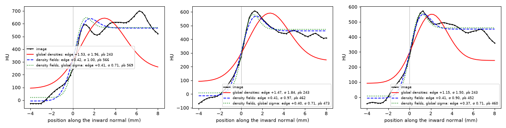
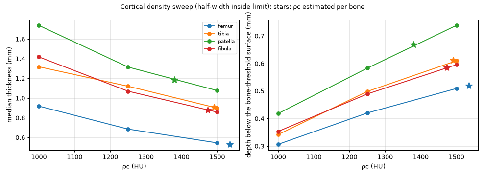
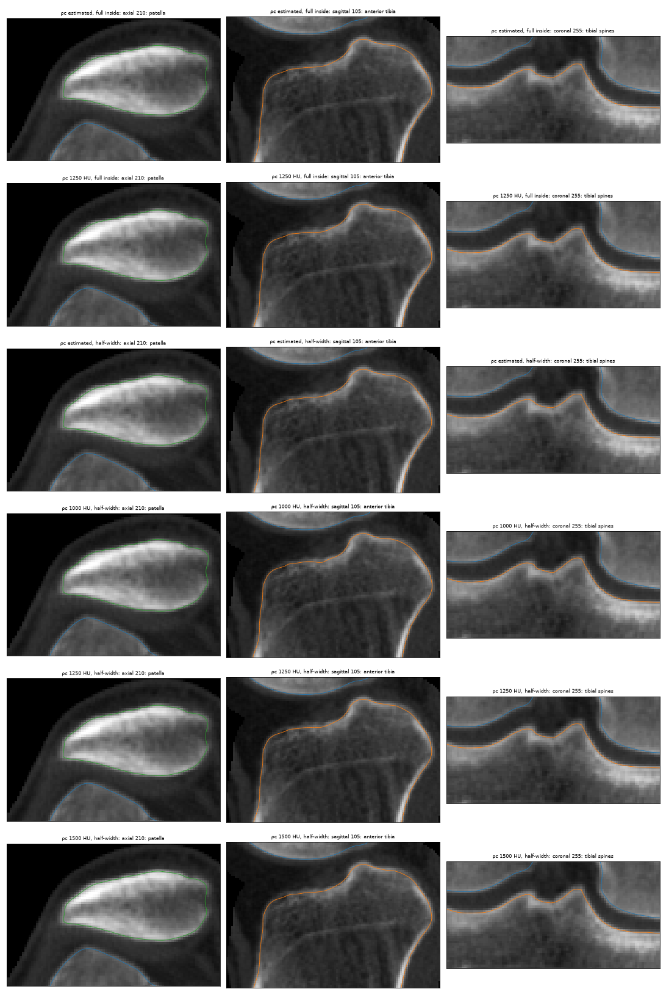

# Refinement on real data: the femoral notch

On the clinical knee CT ([clinical_ct.md](clinical_ct.md)), the first version
of the refinement converged on the patella, fibula and tibia but not on the
femur, whose distal end contains the intercondylar notch. These experiments
isolate that region to find out why. They led to six changes in the library:
remeshing through a level set, per-node densities, inexact inner fits with a
stricter stopping rule, a faster smoothing operator, a "local convex hull"
start, and regional convergence. The image is real data, used with the
subject's permission, and is not part of the repository; the figures blank
everything more than 10 mm outside the starting segmentation, for display
only.

## Methods

[notch_experiment.py](scripts/notch_experiment.py) crops the distal femur
from the cache written by [ct_example.py](scripts/ct_example.py): image slices
120–249, rows 170–311 and columns 45–199, that is 130 × 142 × 155 voxels or
81 × 92 × 101 mm, holding the whole cross-section of both condyles. Only the
shaft is cut, at the top, and the cut face becomes a cap that is not fitted.
Every run uses the clinical-CT options of `ct_example.py`: profiles 4 mm
outside and 8 mm inside at 0.25 mm, the regularised fit (`λ = 1`,
`σ_reg` = 3 mm, 500 neighbours), `ρc` estimated from the image (about
1200–1260 HU on this crop), relaxation 0.5 and a tolerance of 0.1 voxel
(0.062 mm).

There is no ground truth, so each run is judged by five measures:

- the outcome: converged, stalled or out of moves, with the number of moves
  and the time;
- the notch: the convex hull bridges a region of 25.2 cm³ that a 4 mm
  closing leaves open, essentially the notch, and the measure is how much of
  it is still inside the refined surface (ideally 0);
- bone left outside: the volume of the thresholded femur more than 2 mm from
  its edge that lies outside the refined surface (ideally 0);
- where the start was already right (nodes within 1.5 mm of a start that lay
  on the threshold surface): the depth of the refined node below the 267 HU
  isosurface, measured along the node's normal by interpolation;
- edge agreement: the fitted periosteal edge `m − t/2` against the steepest
  rise of each profile, a model-free edge, over profiles with a clear rise
  (positive: the fitted edge lies inside the rise).

The variants change one thing at a time. The first three use global
densities, as the regularised method of our 2025 paper does; from
`density_fields` on, the densities are per-node fields. `same_nodes` and
`level_set` use full inner solves, all others adaptive ones. The
`closing_freeze` variants vary the σ model, the inside profile length, the
number of neighbours, `λ` and, finally, the inner fit itself (the volumetric
model).

## Results

| variant | start | result | moves | time | notch still inside (cm³) | bone outside (cm³) | node depth below 267 HU surface (mm) | edge − steepest rise (mm) | \|·\| > 0.5 mm | σ (mm) | t (mm) |
|---|---|---|---:|---:|---:|---:|---:|---:|---:|---:|---:|
| `same_nodes` | hull | not converged | 20 | 430 s | 8.6 of 25.2 | 0.21 | +0.50 | +0.50 | 52% | 1.39 | 0.94 |
| `level_set` | hull | not converged | 20 | 376 s | 8.5 of 25.2 | 0.25 | +0.49 | +0.49 | 45% | 1.39 | 1.00 |
| `level_set_adaptive` | hull | stalled | 13 | 97 s | 8.6 of 25.2 | 0.10 | +0.49 | +0.49 | 46% | 1.38 | 1.00 |
| `density_fields` | hull | converged¹ | 13 | 184 s | 12.9 of 25.2 | 0.00 | +0.47 | +0.27 | 34% | 0.82 | 0.47 |
| `hull_freeze` | hull | stalled | 35 | 169 s | 12.6 of 25.2 | 0.00 | +0.47 | +0.31 | 38% | 0.82 | 0.49 |
| `closing` | closing 4 mm | converged | 4 | 48 s | 0.0 of 25.2 | 0.00 | +0.46 | +0.29 | 39% | 0.79 | 0.57 |
| `closing_freeze` | closing 4 mm | converged | 4 | 44 s | 0.0 of 25.2 | 0.00 | +0.46 | +0.29 | 39% | 0.79 | 0.57 |
| `closing_freeze_global_sigma` | closing 4 mm | converged | 5 | 30 s | 0.0 of 25.2 | 0.00 | +0.46 | +0.28 | 35% | 0.72 | 0.51 |
| `closing_freeze_inside_15` | closing 4 mm | converged | 9 | 70 s | 0.0 of 25.2 | 0.00 | +0.51 | +0.47 | 35% | 0.83 | 0.63 |
| `closing_freeze_neighbours_250` | closing 4 mm | converged | 5 | 38 s | 0.0 of 25.2 | 0.00 | +0.47 | +0.28 | 35% | 0.80 | 0.58 |
| `closing_freeze_lambda_0.1` | closing 4 mm | stalled | 19 | 55 s | 0.0 of 25.2 | 0.20 | +0.47 | +0.27 | 24% | 0.80 | 0.57 |
| `closing_freeze_volumetric` | closing 4 mm | stalled | 44 | 1158 s | 0.36 of 29.9 | 2.58 | +0.27 | +0.23 | 6.5% | 0.53² | 0.71 |

¹ Run without the regional convergence test (section 3); its "convergence"
left a region still moving by 0.3 mm.
² The scanner's PSF along each node's normal, not a fitted per-node σ.

The configuration that works is `closing_freeze`: a 4 mm closing start, the
level set, adaptive inner fits, per-node densities and regional
convergence. It converges in 4 moves and 44 s (the original method ran 430 s
without converging), opens the notch fully, leaves no thresholded bone
outside, and places its edges 0.29 mm from the steepest rise against
0.50 mm.


*The earlier stages, from the convex hull: the start (yellow, dashed), and
the refined periosteal (red) and fitted endosteal (cyan) surfaces, cut from
the meshes themselves.*


*The 4 mm closing start, with regional convergence: per-node σ, global σ,
15 mm inside profiles, and λ = 0.1.*

### 1. The mesh tangled: remeshing with a level set

Refinement originally moved the same mesh vertices every iteration. Over the
notch, the hull's bridge vertices are pulled in different directions by
neighbours on different walls, the triangles stretch, and the mesh folds
through itself (`same_nodes`, top row of the first figure). A folded mesh has
meaningless normals, so its profiles miss the cortex, and masks voxelised
from it by the even–odd rule are noise (the figures therefore cut the
meshes themselves).

Refinement can now carry the surface as the zero level of a signed distance
`φ` on the image grid
([surface/levelset.rs](../crates/cortical-bone-mapping/src/surface/levelset.rs),
`RefineOptions(level_set=True)`). Each iteration spreads the nodes'
displacements onto the grid (Gaussian-weighted over the 8 nearest nodes),
adds them to `φ`, extracts a new mesh with surface nets, and resets `φ` to
the distance from that mesh wherever it changed. The node spacing stays at
the grid spacing however far the surface travels, and the surface cannot
fold (`level_set`, second row). Each node's warm start, thickness and
convergence state are carried to the new mesh from the nearest moved node;
normals, sampling directions, smoothing neighbourhoods and the curvature
Laplacian are rebuilt. The level set alone did not make the femur converge;
the densities did.

### 2. The surface sank into the bone: per-node densities

Even where the start lay on the periosteum, the refined surface sank into
the bone. The profiles show why:



*Three profiles on the anterior surface, starting from the threshold
surface (x = 0), with each model's fit, periosteal edge, blur and
trabecular density.*

The regularised method of our 2025 paper fits `m`, `t` and `σ` per node but
one `ρs` and one `ρb` for the whole surface. In a clinical CT of the knee
the trabecular density ranges from dense epiphyseal bone (about
450–570 HU in these profiles) to fatty marrow. With one `ρb` for the whole
crop (243 HU) the model cannot represent a 500 HU plateau, and it
compensates with the largest blur it may (σ at its 2 mm bound on a quarter
of the nodes) and a thick, smeared cortex, so the fitted edge lands 1.1–1.5
mm inside the rise.

`ModelOptions.global` (Python: `global_params`) now chooses for each
parameter whether it is one global value or a regularised per-node field
([options.rs](../crates/cortical-bone-mapping/src/options.rs)); density
fields have their own smoothing weight (`density_smoothing`), with
variations measured relative to `ρc`. The default stays as in the paper,
`("rho_s", "rho_b")`, which suits small-field HR-pQCT; large-field clinical
CT needs `global_params=()`. A single fit on the thresholded femur surface
(outer nodes):

| model | edge − steepest rise (mm) | \|·\| > 0.5 mm | edge inside the node (mm) | σ (mm) | σ at bound | t (mm) | ρb 5–50–95% (HU) | time |
|---|---:|---:|---:|---:|---:|---:|---|---:|
| global densities (paper) | +0.64 | 61% | 0.64 | 0.99 | 25% | 0.88 | 243 (one value) | 123 s |
| density fields | +0.41 | 38% | 0.47 | 0.74 | 0% | 0.53 | 66–285–483 | 130 s |
| density fields, global σ | +0.40 | 34% | 0.45 | 0.71 | 0% | 0.48 | 74–287–491 | 50 s |

With density fields the model fits the rise, σ falls to 0.7–1.0 mm, and no
node is at a bound. A global σ (one value for the scanner) gives the same
edges 2.6 times faster; the per-node σ stays the default.

### 3. Inexact inner fits and a stricter stopping rule

Each iteration used to solve the global fit fully (to 1e-8), although the
next iteration resamples every profile anyway. The loop
([refine/](../crates/cortical-bone-mapping/src/refine/mod.rs)) now stops
the inner solve once a step changes the fitted edges by less than
`edge_ratio` (0.1) times the last displacement (RMS), with densities and a
global σ carried over as warm starts; the initial fit is a full solve. This
cut the time of a move by about 2.5 times (`level_set`: 18.8 s per move;
`level_set_adaptive`: 7.5 s).

Inexact fits need a stricter stopping rule. Refinement now converges only
when a full, converged solve moves the surface by less than the tolerance:
an apparently settled surface gets such a fit, and iterating resumes if it
still moves. A narrow band still moving barely changes the RMS over the
whole surface (a rim of a few hundred nodes zipping into the notch at
0.3 mm per iteration hardly registers among 66 000 nodes, which is how
`density_fields` was declared converged), so the RMS within `region_radius`
(5 voxels) of every node must also be below `region_tolerance` (twice the
tolerance). If the displacement makes no new low (below 95% of its best) and
no region converges for `stall_iterations` (5) fits, the run stops as
stalled, and its message counts the profiles that do not locate an edge by
reason (edge at either end of the profile, `m` at a bound, `t` at its upper
bound, densities out of order, a large residual), suggesting longer profiles
when the edges sit at an end. A thickness at its lower bound is not a failed
fit: it means a cortex thinner than can be resolved, whose blurred step still
locates the edge, so such nodes (5% of the surface here) are trusted.

### 4. Where the time goes

Every refinement reports its time per stage (`RefineResult.timings`, and the
solver's split in `info["timings"]`). The global solve takes 90–95% of it,
and within that the Gauss–Newton products take 60–85%:

| variant | total | sampling | smoothing operator | evaluation | Gauss–Newton products | preconditioner | level set |
|---|---:|---:|---:|---:|---:|---:|---:|
| `same_nodes` | 430 s | 4% | 1% | 4% | 85% | 3% | – |
| `density_fields` | 184 s | 6% | 2% | 4% | 78% | 2% | 2% |
| `closing_freeze` | 44 s | 3% | 3% | 6% | 74% | 2% | 2% |
| `closing_freeze_global_sigma` | 30 s | 4% | 5% | 9% | 61% | 2% | 5% |

Most of the product time is the 500-neighbour smoothing operator, applied
once per field per CG iteration. Applying it to all fields in one pass
([operators/smoothing.rs](../crates/cortical-bone-mapping/src/operators/smoothing.rs))
gives bitwise identical results about 25% faster overall. Fewer neighbours
save more: the paper's sensitivity analysis (Fig. 5) found precision
insensitive between 250 and 2000, and 250 neighbours gave the same surface
here in 38 s instead of 44 s. `λ` = 0.1, best in that analysis, is too weak
here: the edges stay too noisy for the surface to settle, and the run
stalls.

### 5. The hull bridges the notch

From the convex hull no variant opens the notch. The hull's bridge is about
27 mm from the notch roof, more than three times the inside sampling range,
so the bridge nodes' profiles never reach bone, their fits fail, and they
move only with their neighbours. Only the rim can zip the notch shut, as its
normals turn into the notch and find the walls, and on this crop that
zipping stalls with half the notch still bridged (`density_fields`,
`hull_freeze`: 12.6–12.9 of 25.2 cm³). The global-density runs fill more of
it (8.5 of 25.2 cm³) only because their inward bias (section 2) pulls the
bridge in with everything else.

More iterations, less relaxation or other regularisation give the bridge no
force. Longer inside profiles (`closing_freeze_inside_15`) reach deeper
concavities only where they are shallower than the profile, cost time (70 s
against 44 s) and move the edges by 0.2 mm (+0.47 against +0.29 mm), because
they weigh more of the trabecular bone. A force that pushes a node inward
when its profile sees only soft tissue is discussed in
[volumetric_model.md](volumetric_model.md) and has not been tried. A start
that does not bridge the notch works (section 6).

### 6. A local convex hull and regional convergence

`bone_hulls(..., closing_radius=r)` starts each bone from a closing by a ball
of radius `r` with its holes filled
([segmentation/bones.rs](../crates/cortical-bone-mapping/src/segmentation/bones.rs)):
dilate by `r`, fill every background region not connected to the outside,
fill the holes of every slice in all three orientations, and erode by `r`.
Concavities narrower than about `2r` are filled and wider ones kept, so with
`r` = 4 mm the notch (about 20 mm wide) stays open and the start has no
voids. The per-slice filling is needed because in the lateral condyle
low-density trabecular bone and fat below the threshold form a void that
reaches the notch through a stretch of notch-roof cortex below 267 HU, wider
than the closing; a 3D fill sees it as outside, but it is enclosed in most
of its slices. Each bone is closed on its own, so a closing can never join
two bones; where two closings overlap, each voxel goes to the nearer bone,
contact voxels are cleared, and pieces cut off by that are dropped.

Regional convergence (`RefineOptions(freeze=True)`) freezes a node when it
has been still (moving and changing thickness by less than the tolerance)
for `freeze_patience` (3) iterations, its whole neighbourhood within
`freeze_radius` (3 voxels) is still too, and its fit has not failed (so a
bridged notch never freezes). Frozen nodes are no longer moved or refitted;
those within the regularisation's reach of moving nodes are refitted as
fixed values, as boundary conditions, and `ρc` and the densities keep their
whole-surface values. A frozen node thaws when the moving nodes near it have
moved `freeze_thaw` (1 voxel) in total, and the verifying full fit covers
the whole surface.

From the closing start every variant converges in 4–9 moves with the notch
open, except λ = 0.1. Freezing saves little here (44 s against 48 s), because
so few moves are needed: by the last fits it had frozen about half the
surface (39 500 of 69 300 nodes still moving), or five-sixths with a global
σ (11 700 nodes).

### 7. The whole knee: missed bone, other bones, cortical density

These runs cover the whole knee, all four bones, with the setup above.

At the Otsu threshold (267 HU), partial volume pushes thin cortices below
the threshold: the anterior proximal tibia, the lateral femoral condylar rim
and parts of the tibial plateau. Where such a gap is longer than the 4 mm
closing can bridge, the start cuts through the bone, and refinement cannot
move the surface out to bone up to a centimetre away. `grow_bones` therefore
grows each bone, seeded at 267 HU, into the voxels connected to it above a
low threshold set by `soft_tissue_threshold` (the soft-tissue peak plus four
standard deviations, 146 HU); a voxel several bones reach goes to the
nearest along the connected path. This halves the missed bone, while longer
(8 mm) outside profiles hardly help; the comparison is in
[clinical_ct.md](clinical_ct.md). The tibial spines are not lost: the
refined tibia follows both, about a voxel lower at their very tips, which is
the inward offset discussed below.

While a bone is refined (`refine_bones(exclude_others=True)`, the default)
the other bones' regions are excluded: profile samples inside them get zero
weight, so a femoral profile crossing the joint does not fit the tibia, and
no surface moves into another bone (the level set keeps those voxels
outside; in the same-nodes mode a move into one is shortened). `rounds`
repeats the pass over all bones, each excluding the others' refined regions;
a second round changed no bone by more than 0.7% of its voxels, and a third
by at most 0.2%.

`Options(half_width_inside=True)` stops each profile's inside part at half
the distance to where its line leaves the bone (but not below one voxel), so
that at thin tips and plates it stops at the middle instead of running out
through the far side. On this knee that touches no node of the femur or
tibia, 1.6% of the patella's and 0.8% of the fibula's, and changes no
result, so it is off by default.

`ρc` is estimated per bone (1380–1535 HU). Fixing it at 1000, 1250 and
1500 HU instead, all with the half-width limit:

| ρc | bone | median thickness (5–95%) (mm) | depth below the 267 HU surface (mm) | edge − steepest rise (mm) | missed bone (cm³) | moves | time |
|---|---|---|---:|---:|---:|---:|---:|
| 1000 HU | femur | 0.92 (0.30–3.33) | +0.31 | +0.16 | 1.04 | 6 | 48 s |
| | tibia | 1.32 (0.21–3.98) | +0.34 | +0.03 | 1.83 | 11 | 102 s |
| | patella | 1.74 (0.31–4.93) | +0.42 | +0.01 | 0.69 | 6 | 12 s |
| | fibula | 1.42 (0.47–3.58) | +0.35 | +0.12 | 0.21 | 6 | 14 s |
| 1250 HU | femur | 0.69 (0.25–2.95) | +0.42 | +0.27 | 1.62 | 5 | 46 s |
| | tibia | 1.12 (0.18–3.98) | +0.50 | +0.21 | 3.08 | 8 | 66 s |
| | patella | 1.32 (0.33–3.92) | +0.58 | +0.23 | 1.10 | 5 | 11 s |
| | fibula | 1.07 (0.37–3.12) | +0.49 | +0.26 | 0.31 | 5 | 10 s |
| 1500 HU | femur | 0.55 (0.21–2.60) | +0.51 | +0.33 | 2.29 | 5 | 51 s |
| | tibia | 0.90 (0.15–3.17) | +0.61 | +0.27 | 3.88 | 6 | 69 s |
| | patella | 1.08 (0.29–3.10) | +0.74 | +0.37 | 1.62 | 5 | 12 s |
| | fibula | 0.86 (0.31–2.73) | +0.60 | +0.38 | 0.55 | 5 | 12 s |
| estimated | femur | 0.53 (0.21–2.55), ρc 1535 | +0.52 | +0.36 | 2.41 | 5 | 54 s |
| | tibia | 0.91 (0.15–3.19), ρc 1492 | +0.61 | +0.26 | 4.06 | 7 | 76 s |
| | patella | 1.19 (0.30–3.47), ρc 1380 | +0.67 | +0.28 | 1.38 | 5 | 13 s |
| | fibula | 0.88 (0.31–2.77), ρc 1473 | +0.59 | +0.37 | 0.52 | 5 | 12 s |



*Median thickness, and depth of the refined surface below the 267 HU
surface, against `ρc` (stars: `ρc` estimated per bone).*



*The patella, the anterior tibia and the tibial spines for each run.*

Every bone converges at every `ρc`, in 5–11 moves. `ρc` sets the balance
between thickness and where the periosteum is: from 1500 to 1000 HU the
median thickness rises by 50–70% (femur 0.55 → 0.92 mm, patella
1.08 → 1.74 mm), the periosteum moves out by 0.2–0.3 mm towards the
threshold surface, and the missed bone halves. The cortex's mass in the
image is fixed, and a lower assumed density explains it as a thicker cortex
whose outer edge lies further out. At 1000 HU the fitted edge lies on the
steepest rise of the profiles (+0.01 to +0.16 mm); at the estimated `ρc`
(about 1500 HU) it lies 0.3 mm inside. The estimate comes from the thick
diaphyseal cortex, while the subchondral shells peak at only 600–700 HU
through partial volume.

### 8. The volumetric model as the inner fit

`closing_freeze_volumetric` replaces the regularised fit with the
[volumetric model](method.md#volumetric-model), otherwise as
`closing_freeze`. Where it fits, its surface agrees far better with the
image: its edges are within 0.5 mm of the steepest rise on all but 6.5% of
the profiles (39% for `closing_freeze`), and the nodes sit 0.27 mm below the
267 HU surface instead of 0.46 mm. But the refinement does not finish. It
stalls after 44 moves and 19 minutes, with 13% of the moving nodes flagged
as not locating an edge and 2.6 cm³ of thresholded bone left outside the
surface, where the surface has moved into the bone. On phantoms,
refinement with the volumetric model also stops shrinking its moves at about
a tenth of a voxel ([examples.md](examples.md#segmentation-refinement)), and
on the whole knee its full fits exhaust their CG budget, so the loop can
never declare convergence ([clinical_ct.md](clinical_ct.md)). A single
volumetric fit on a refined surface works
([volumetric_validation.md](volumetric_validation.md#clinical-knee)).

## Discussion

Three lessons carry beyond this knee. Masks voxelised from a tangled mesh
are noise, so the meshes themselves should be inspected. An earlier,
smaller crop cut through the lateral condyle and exposed its low-density
interior at the cut face, and next to it the surface crept into the fatty
marrow at about 0.1 mm per iteration for as long as it ran; the same could
happen wherever a cortical gap exposes low-density marrow, and only the
convergence and stall tests catch it. And distances to a thresholded mask
measured from voxel centres put a surface lying exactly on the isosurface
about 0.2 mm inside it, so the threshold surface is now measured along each
node's normal by interpolation.

The main open question is where the periosteum should be. Where the start
was already right, the surface sits 0.46 mm (0.7 voxel) inside the 267 HU
isosurface: the fitted edges are 0.29 mm inside the steepest rise of the
profiles, and the 267 HU surface lies about 0.2 mm outside that rise. For a
cortex thinner than the blur the model places the periosteum inside a
threshold surface by up to `σ − t/2` (about 0.5 mm here), the thresholding
bias of Treece et al. (2010), and how far inside depends directly on `ρc`
(from 0.3 mm at 1000 HU to 0.6 mm at 1500 HU). Which `ρc` is right cannot be
settled from one image: it needs a density reference in the scan, or repeat
scans of more subjects, against which the reproducibility of thickness can
be compared across `ρc` modes. Refinement with the volumetric model, and a
region force for the 1D methods, also remain open.

## Reproducing

```bash
python docs/scripts/ct_example.py /path/to/DICOM --crop :,:,0:256 \
    --landmark femur=250,240,123 --landmark tibia=60,250,110 \
    --landmark patella=211,167,114 --landmark fibula=60,296,43 --cache knee.pkl
python docs/scripts/notch_experiment.py knee.pkl --out results run          # every variant
python docs/scripts/notch_experiment.py knee.pkl --out results profiles     # section 2
python docs/scripts/notch_experiment.py knee.pkl --out results table
python docs/scripts/notch_experiment.py knee.pkl --out results figures \
    same_nodes level_set density_fields hull_freeze --figure notch_stages.png
python docs/scripts/notch_experiment.py knee.pkl --out results figures \
    closing_freeze closing_freeze_global_sigma closing_freeze_inside_15 \
    closing_freeze_lambda_0.1 --figure notch_variants.png
# section 7: whole-knee runs, then their comparison
python docs/scripts/ct_example.py /path/to/DICOM ... --cache runs/base.pkl
python docs/scripts/ct_example.py /path/to/DICOM ... --half-width --cache runs/half_width.pkl
python docs/scripts/ct_example.py /path/to/DICOM ... --half-width --rho-c 1000 --cache runs/half_width_rc1000.pkl
python docs/scripts/ct_example.py /path/to/DICOM ... --half-width --rho-c 1250 --cache runs/half_width_rc1250.pkl
python docs/scripts/ct_example.py /path/to/DICOM ... --half-width --rho-c 1500 --cache runs/half_width_rc1500.pkl
python docs/scripts/knee_sweep.py runs/*.pkl --figures docs/images/knee_sweep
# section 8, and the whole knee with the volumetric model
python docs/scripts/notch_experiment.py knee.pkl --out results run closing_freeze_volumetric
python docs/scripts/ct_example.py /path/to/DICOM ... --method volumetric --cache runs/volumetric.pkl
```
