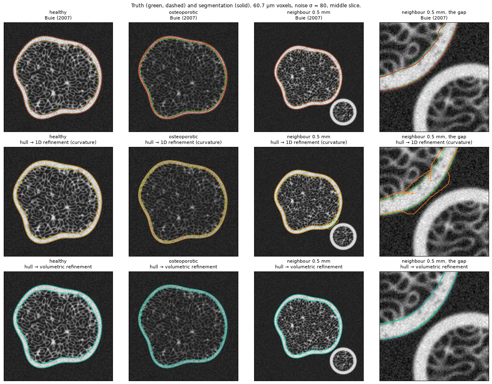
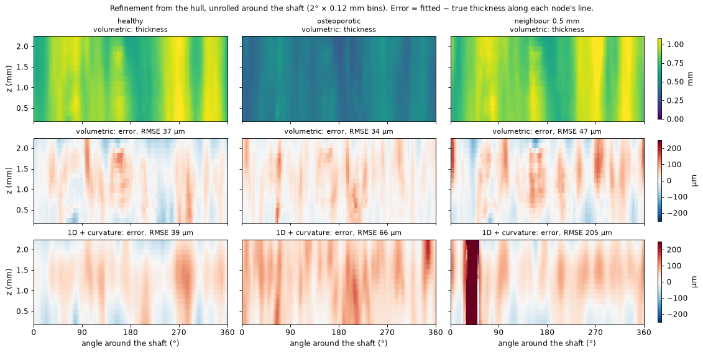

# Automatic segmentation

Standard HR-pQCT analysis segments the periosteal and endosteal surfaces with
the dual-threshold method of Buie et al. (2007), or the Burghardt et al.
(2010) variant, after which an operator inspects and corrects the result
slice by slice. This page asks whether cortical bone mapping can take over
that correction, starting from the image alone. It describes the pipeline
and the two starting segmentations (including how Buie's method is
implemented from the paper), then a check on phantoms built from published
HR-pQCT values, with a nearby ulna. Phantoms only show that the pipeline
works as intended; how well it does is a question for real scans.

## Pipeline

```python
import cortical_bone_mapping_rs as cbm

start = cbm.hull_segmentation(image)                 # threshold 320, per-slice convex hull
options = cbm.Options.preset("radius_tibia", rho_c="estimate")
rr = cbm.refine_segmentation(image, start, options=options,
                             curvature="change", curvature_weight=1.0)
rr.periosteal_mask, rr.endosteal_mask, rr.cortical_mask   # the segmentation
rr.result.thickness                                       # and the thickness map
```

The starting segmentation only has to be topologically right (one closed
surface around the bone) and close enough for the profiles to cross the
cortex; a convex hull of the thresholded bone has both properties by
construction. Buie's method is usually closer, but when it fails it fails
topologically (its marrow mask can leak through a gap in the cortex, and
without its pre-processing it merges a nearby ulna or fibula), and refinement
cannot repair topology. One CBM fit on the hull's surface gives both the periosteal
and endosteal surfaces; refinement then moves the surface to the fitted
periosteum and refits until it stops moving. The cortical density is
estimated from the image (`rho_c="estimate"`, see
[method.md](method.md#cortical-density)).

## Starting segmentations

### Threshold hull

`cbm.hull_segmentation(image, threshold=320)` (Rust:
`segmentation::hull_segmentation`) thresholds the image at 320 (the usual
bone threshold for density-calibrated HR-pQCT), applies a binary median with
kernel (3,3,1) as in Buie's step 3, keeps the largest 3D component (dropping
a separate fibula or ulna and stray voxels), and takes the convex hull of
every slice along axis 0.

The hull always contains the thresholded bone. Its errors are outward
bulges over concave parts of the periosteum, which refinement pulls in. It
fails when a concavity is deeper than the inward sampling range, and when
two bones are joined at the threshold (by blur, noise or motion across a
thin soft-tissue gap), since they then become one component and one hull
per slice. For several bones in one scan, `bone_hulls` closes each bone with
a ball instead, which keeps wide concavities open
([clinical_ct.md](clinical_ct.md)).

### Buie et al. (2007)

`cbm.buie_segmentation(image)` (Rust: `segmentation::buie`) follows Fig. 1
and the Methods of Buie et al. (2007):

| Fig. 1 step | paper | here |
|---|---|---|
| 2 threshold | user input 1 | `image ≥ periosteal_threshold` |
| 3 median | kernel (3,3,1) | binary majority, `[1, 3, 3]` (array order z, y, x) |
| 4 dilate | kernel (15,15,1) | ellipsoidal footprint (as `vtkImageDilateErode3D`), exact distance transform |
| 5 connectivity | select non-bone black region | background components touching the in-plane image border; bone = the rest |
| 6 erode | (15,15,1) | → periosteal mask |
| 7 threshold | user input 2 | `image < endosteal_threshold` |
| 8 mask | with step 1 region → marrow cavities | marrow = below T2 inside the periosteal mask |
| 9 dilate | (10,10,1) | dilate the marrow |
| 10 connectivity | select outer white region | non-marrow components touching the in-plane border |
| 11 erode | (10,10,1) | erode the marrow |
| 12 Gaussian smooth | σ = 3, support (3,3,1) | σ = 3 voxels, kernel radius ⌊σ·support⌋ = 9 in-plane, 3 along z (VTK semantics) |
| 13 threshold | by lower = 100 | marrow where the smoothed 0/127 mask ≤ 100 |
| 14 mask | combine | cortex = periosteal ∧ ¬marrow, trabecular = periosteal ∧ marrow |

Also from the paper: only the largest bone is kept (`largest_bone_only`),
on the thresholded image before the step-4 dilation (after it, a neighbour
closer than twice the dilation radius, about 1.8 mm, would already be
merged); the data are padded in-plane by the dilation radius so that
dilation cannot clip at the image edge; and connectivity can be computed per
slice (`connectivity_2d`), which the paper reports is usually identical and
faster.

Where the paper is silent, the mask values for step 13 are taken as 0/127
(Scanco). This matters: smoothing with σ = 3 and re-thresholding at 100/127
moves the endosteal boundary into the cortex by about
Φ⁻¹(100/127)·σ ≈ 0.8σ ≈ 2.4 voxels on a straight edge (2.1 voxels on a test
ring); with 0/255 masks it would move about 0.8 voxels the other way. The
footprints are ellipsoidal, as in VTK, and the thresholds are in image units:
the paper used native scanner units (3000 / 5000 on human XtremeCT), and the
default 450 / 320 mg HA/cm³ is the common choice for density-calibrated
HR-pQCT (Burghardt et al. 2010).

Bonelab's `autocontour.py` differs from the paper in its Gaussian (σ = 0.8
instead of 3, which reduces the step-13 shift to about 0.6 voxels and changes
Ct.Th by roughly 1.8 voxels), in taking the largest rather than the outer
component in steps 5 and 10, and in having no largest-bone pre-processing,
padding or 2D option.

## Experiment

### Phantoms

`python docs/scripts/segmentation_experiment.py` (results in
[`segmentation_experiment.json`](results/segmentation_experiment.json)) uses
60.7 µm voxels (XtremeCT II), a 0.08 mm PSF and noise σ = 80 on a 0–1000 mg
HA/cm³ scale, with parameters from published HR-pQCT values (listed at the
end). The long-bone shafts (`cbm.BonePhantom`, 40 slices, 360² in-plane,
470–500² with a neighbour) are distal-radius sized: periosteal radius
8.5 mm, cross-section 228 mm². They have an irregular, axially varying
periosteum and thickness, a trabecular network, cortical pores (about
0.17 mm), and an endocortical transition zone in which porosity rises and
trabeculae thicken towards the smooth true endosteum:

| scenario | thickness (min) | tissue density | trabecular BV/TV deep / at endosteum | porosity bulk / extra at endosteum | other |
|---|---|---:|---|---|---|
| healthy | 0.9 mm (0.15) | 1050 | 0.20 / 0.40 | 0.03 / 0.15 | |
| osteoporotic | 0.45 mm (0.2) | 850 | 0.12 / 0.35 | 0.06 / 0.35 | |
| thick | 1.5 mm (0.15) | 1100 | 0.28 / 0.50 | 0.02 / 0.10 | |
| neighbour 2.0 / 1.0 / 0.5 mm | as healthy | 1050 | | | an ulna-like bone (radius 3.5 mm, cortex 0.8 mm) at that gap |

### Pipelines and metrics

Buie is the reference, also without the largest-bone step
(`buie (no prepro.)`, as in Bonelab's autocontour) for the neighbours. From
the hull, CBM runs one fit with each method (`local`, `multigrid`,
`regularized`, `reg+curvature`, `curvature` alone with `λ = 0`, and the
[volumetric model](method.md#volumetric-model)), and refinement with
`regularized` (`refine`), `reg+curvature` (`refine+curvature`) and the
volumetric model (`refine volumetric`), each with the default level set and
regional freezing. CBM uses the parameters of Table 1 of our 2025 paper
except for the sampling, scaled to the phantoms (1 mm outside and 3 mm
inside instead of 5 and 15 mm), and estimates `ρc` from the image. The
volumetric model's axial blur is tied to the in-plane one (every normal is
in-plane).

Along each sampling line, the fitted edges (for Buie, the crossings of its
masks along the regularised fit's lines) are compared with the exact
crossings of the true surfaces: mean absolute error of each edge, and bias
and RMSE of the thickness. The masks are also compared: Dice of the cortex,
mean symmetric 3D distance of the periosteal and endosteal boundaries, and
semi-derived Ct.Th (cortical area over periosteal perimeter per slice).

## Results



Rows: Buie; refinement from the hull with the regularised fit and the
curvature penalty (`refine+curvature`); refinement with the volumetric model
(`refine volumetric`). The last column zooms on the 0.5 mm gap: the 1D
refinement's periosteum bulges into the gap, where the outside profiles reach
the ulna's cortex, while the volumetric surfaces follow the truth.



The same refinements over the whole shaft, unrolled around its axis: the
volumetric thickness (top), its error against the truth (middle) and the 1D
refinement's error (bottom). The volumetric error is mostly within ±100 µm,
with no pattern tied to the neighbour; the 1D error is biased thick, most on the porous osteoporotic
cortex, and next to the neighbour (around 45°) it is off the scale over the
whole height of the shaft.

Thickness RMSE along the lines (µm; bias in brackets):

| pipeline | healthy | osteoporotic | thick | neighbour 2.0 mm | neighbour 1.0 mm | neighbour 0.5 mm |
|---|---:|---:|---:|---:|---:|---:|
| buie | 70 (−13) | 147 (−133) | 148 (+81) | 79 (−14) | 78 (−3) | 75 (−2) |
| local | 154 (+41) | 144 (+71) | 260 (+123) | 159 (+42) | 155 (+50) | 149 (+43) |
| multigrid | 51 (+17) | 69 (+56) | 97 (+56) | 61 (+20) | 62 (+30) | 159 (+61) |
| regularized | 72 (+27) | 73 (+58) | 154 (+88) | 80 (+31) | 84 (+40) | 165 (+67) |
| reg+curvature | 42 (+18) | 63 (+56) | 87 (+50) | 46 (+20) | 49 (+30) | 96 (+47) |
| curvature | 43 (+20) | 72 (+63) | 88 (+51) | 48 (+23) | 50 (+31) | 103 (+50) |
| volumetric | 35 (+2) | 36 (+18) | 85 (+48) | 38 (+4) | 41 (+13) | 45 (+12) |
| refine | 55 (−1) | 56 (+40) | 128 (+59) | 63 (+5) | 65 (+15) | 162 (+43) |
| refine+curvature | 39 (+19) | 66 (+58) | 86 (+54) | 45 (+22) | 48 (+31) | 205 (+74) |
| refine volumetric | 37 (+8) | 34 (+21) | 93 (+61) | 36 (+10) | 42 (+20) | 47 (+19) |

Cortex Dice, and the mean distance of the periosteal / endosteal boundary
from the truth (µm):

| pipeline | healthy | osteoporotic | thick | neighbour 2.0 mm | neighbour 1.0 mm | neighbour 0.5 mm |
|---|---|---|---|---|---|---|
| buie | 0.954 · 21 / 59 | 0.808 · 17 / 116 | 0.961 · 26 / 104 | 0.951 · 21 / 64 | 0.953 · 22 / 61 | 0.953 · 22 / 61 |
| hull (start) | – · 97 / – | – · 80 / – | – · 101 / – | – · 98 / – | – · 98 / – | – · 98 / – |
| local | 0.941 · 14 / 89 | 0.878 · 23 / 83 | 0.949 · 12 / 146 | 0.941 · 13 / 91 | 0.939 · 14 / 89 | 0.938 · 17 / 88 |
| multigrid | 0.972 · 11 / 40 | 0.929 · 15 / 51 | 0.973 · 10 / 69 | 0.968 · 12 / 47 | 0.968 · 11 / 48 | 0.950 · 39 / 48 |
| regularized | 0.963 · 14 / 52 | 0.926 · 17 / 52 | 0.963 · 13 / 94 | 0.961 · 14 / 56 | 0.959 · 14 / 59 | 0.942 · 39 / 60 |
| reg+curvature | 0.972 · 12 / 40 | 0.934 · 14 / 48 | 0.969 · 17 / 76 | 0.971 · 12 / 42 | 0.969 · 12 / 47 | 0.959 · 26 / 47 |
| curvature | 0.972 · 12 / 40 | 0.928 · 15 / 53 | 0.969 · 17 / 77 | 0.970 · 12 / 43 | 0.968 · 12 / 47 | 0.958 · 26 / 48 |
| volumetric | 0.979 · 8 / 31 | 0.957 · 14 / 27 | 0.975 · 9 / 65 | 0.978 · 8 / 33 | 0.977 · 8 / 35 | 0.975 · 10 / 36 |
| refine | 0.966 · 14 / 47 | 0.929 · 22 / 44 | 0.965 · 13 / 87 | 0.963 · 14 / 52 | 0.961 · 15 / 54 | 0.959 · 17 / 55 |
| refine+curvature | 0.977 · 10 / 34 | 0.932 · 16 / 48 | 0.974 · 11 / 67 | 0.974 · 11 / 38 | 0.972 · 10 / 42 | 0.954 · 26 / 53 |
| refine volumetric | 0.981 · 7 / 30 | 0.961 · 14 / 23 | 0.976 · 6 / 65 | 0.981 · 7 / 30 | 0.978 · 7 / 35 | 0.976 · 8 / 37 |

**Neighbours.** Buie leaves the ulna out at every gap. Without its
largest-bone pre-processing (as in Bonelab's autocontour) it takes the whole
ulna into the mask at every gap, two bones in one mask. The hull never
includes it, and no CBM pipeline includes more than 2% of it.

**Refinement.** Every refinement converges, in 11–12 moves with the
regularised fit, 9–16 with the curvature penalty and 9–11 with the
volumetric model.

**Cortical density** (regularised fit on the hull; thickness bias / RMSE in
µm, and the estimated value):

| scenario (tissue density) | oracle | fixed 1000 (Table 1) | estimate | profile max (Bonelab's default) |
|---|---|---|---|---|
| healthy (1050) | −10 / 62 | +32 / 75 | 1005: +27 / 72 | 966: +66 / 95 |
| osteoporotic (850) | −20 / 41 | −88 / 94 | 729: +58 / 73 | 574: +203 / 213 |
| thick (1100) | +50 / 129 | +147 / 202 | 1062: +88 / 154 | 1078: +77 / 146 |

**Run time.** On a radius-sized 40-slice shaft (about 45 000 nodes) one
regularised fit takes 3–8 s, 10–45 s with the curvature penalty and 19–62 s
with the volumetric model; refinement takes 52–101 s, 89–155 s with the
curvature penalty (553 s next to the 0.5 mm neighbour) and 140–286 s with the
volumetric model.

## Discussion

The hull is a safe start: in every scenario it contained the bone and never
took in the neighbour. On every shaft, refinement from it matched or beat
Buie on the periosteum (`refine volumetric` 6–14 µm, `refine+curvature`
10–26 µm, Buie 17–26 µm).

The volumetric model is the best pipeline on these shafts. One fit from the
hull, or refinement with it, gives the lowest or nearly the lowest thickness
RMSE on every shaft but the thick one (34–47 µm, against 39–205 µm for
`refine+curvature`), with the best cortex Dice on each (0.957–0.981). On the
thick shaft it is level with the curvature penalty (85–93 against 86–88 µm).
Its endosteum is also the most accurate (23–37 µm from the truth on all but
the thick shaft), because it fits all voxels around a node rather than one
profile through the porous transition. It is the only CBM pipeline
unaffected by an ulna 0.5 mm away (45–47 µm, against 96–205 µm for the 1D
pipelines, whose outside profiles reach into the ulna's cortex): each voxel
belongs to its nearest surface, and the ulna's voxels are nearer the ulna's.

Where Buie is biased, CBM corrects it. On the thin porous cortex Buie calls
the porous inner cortex marrow (cortex Dice 0.81, thickness −133 µm), which
is the error usually corrected by hand; the 1D CBM pipelines reach Dice
0.93 and an RMSE of 56–73 µm, the volumetric ones Dice 0.96 and 34–36 µm.
Where Buie is right (healthy, thick and neighbour shafts), CBM is still
better: RMSEs of 36–93 µm (`refine volumetric`) against 70–148 µm, and
cortex Dice of 0.976–0.981 against 0.95–0.96. The local fit is never
competitive (RMSE about 150 µm).

The cortical density should not be assumed. Table 1's fixed 1000 is off by
up to 15% on these phantoms and biases thickness by −88 to +147 µm, and
Bonelab's per-node profile maximum is worst on thin cortices (+203 µm),
because a thin, blurred cortex never reaches its density. The estimate is
robust but measures the apparent density of the porous cortex (3–14% below
the tissue density), which leaves a positive bias of 30–90 µm.

Phantoms are not bone: the true endosteum of real trabecularised cortex is
itself a definition, real neighbours differ from these geometric models, and
motion is not simulated. These results only show that the pipeline behaves
as intended; its accuracy on real HR-pQCT is to be measured on real scans.

## Phantom parameters

The phantoms are meant to stay within what HR-pQCT shows in vivo:

- Cortex: distal radius Ct.Th is 0.77–0.93 mm on average (XtremeCT,
  Burghardt et al. 2010) and up to about 1.2 mm in young adults on XtremeCT
  II, the distal tibia 1.0–1.7 mm; an osteoporotic cortex can be 0.2–0.3 mm
  at the distal end of the radius region, hence the osteoporotic minimum of
  0.2 mm. Ct.Po is 1.5–2.5% at the radius and 3.5–6.6% at the tibia, with
  resolved pores of 0.16–0.19 mm mean diameter (Burghardt et al. 2010).
  Ct.vBMD is about 800–975 mg HA/cm³ including porosity, hence tissue
  densities of 850–1100.
- Trabecular bone: BV/TV 0.12–0.33, Tb.Th 0.22–0.29 mm, Tb.Sp 0.6–1.0 mm
  (XtremeCT II normative data,
  [PMC9719438](https://pmc.ncbi.nlm.nih.gov/articles/PMC9719438)).
- Size: distal radius Tt.Ar is 220–360 mm² and distal tibia 590–850 mm²;
  the shafts here are a small radius (the default `BonePhantom`, radius
  4.5 mm, is scaled down further for tests).
- Neighbouring bones: the ulna and fibula are always separated from the
  radius and tibia by soft tissue (the interosseous membrane, the
  syndesmosis with a tibiofibular clear space of about 2–6 mm on CT, or joint
  cartilage) and never touch in a normal scan. The realistic failure is a
  threshold segmentation that bridges a thin gap through blur, noise or
  motion; that is the 0.5 mm case.
- Motion is the commonest artefact (about 23% of exams are repeated, with a
  typical visual grade of 2–3 of 5; Pialat et al. 2012), with streaks and
  cortical discontinuities from grade 4. It is not simulated.

## References

* H. R. Buie, G. M. Campbell, R. J. Klinck, J. A. MacNeil, S. K. Boyd,
  *Automatic segmentation of cortical and trabecular compartments based on a
  dual threshold technique for in vivo micro-CT bone analysis*, Bone
  41:505–515, 2007, doi:10.1016/j.bone.2007.07.007.
* A. J. Burghardt et al., *Reproducibility of direct quantitative measures
  of cortical bone microarchitecture of the distal radius and tibia by
  HR-pQCT*, Bone 47(3):519–528, 2010
  ([PMC2926164](https://pmc.ncbi.nlm.nih.gov/articles/PMC2926164)).
* XtremeCT II normative data, 863 adults
  ([PMC9719438](https://pmc.ncbi.nlm.nih.gov/articles/PMC9719438)).
* J. B. Pialat et al., *Visual grading of motion induced image degradation
  in high resolution peripheral computed tomography: impact of image quality
  on measures of bone density and micro-architecture*, Bone 50:111–118,
  2012.
