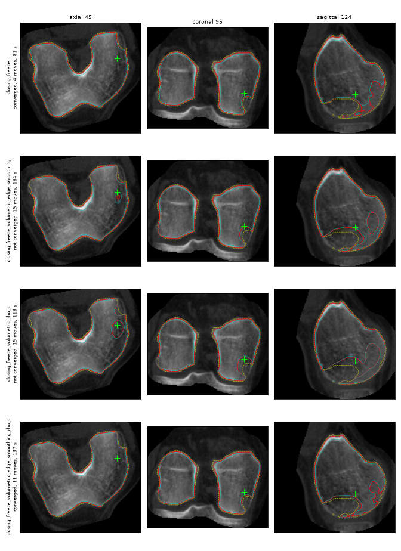

# Making volumetric refinement converge

Refinement moves the surface to the edges that each fit locates, so it is
what lets cortical bone mapping start from a poor segmentation. With the
[volumetric model](method.md#volumetric-model) as the inner fit it did not
work. On the clinical knee CT it never converged: after 150 moves, 9.2 hours
against 138 s for the regularised fit, the surfaces still moved by about
0.005 mm per move. On the femoral notch it stalled after 44 moves with
2.6 cm³ of bone outside the surface.

This page follows the work in phases, each committed separately, and records
what each phase changed, how it was tested and what it did. Whether a change
helps is judged on the clinical knee CT; phantoms serve only as tests, and
the choices will be revisited on real HR-pQCT data. In short:
the volumetric model's edges needed the regularised method's smoothing, and
its `ρc` the 1D estimate (section 6); with them, and with the level set and
regional freezing as defaults, it converges on the whole clinical knee
(section 7).

## Suspected causes

At the start, six causes were suspected:

* **The curvature penalty ratchets.** The default `"change"` penalty resists
  curvature *added* to the surface being fitted. During refinement that
  surface is the previous fit's, so curvature added in one fit is free in the
  next and a dent can deepen move after move. The old loop stopped early on a
  global RMS; the regional convergence test added for the knee keeps it
  iterating while a region moves.
* **The PSF was re-fitted on every full fit**, so the edges the surface moved
  toward changed with it.
* **Parameters taken from HR-pQCT.** The curvature was measured at 0.25 mm,
  below the 0.65 mm node spacing of clinical CT, and the density fields were
  smoothed over 500 neighbours. Both make the solves stiff: the full fits on
  the knee used up their conjugate-gradient budget.
* **Voxels go to the nearest surface point.** In a concavity, voxels beside
  one wall might be assigned to the other.
* **Untrusted regions lagged.** Nodes whose fits cannot be trusted move with
  their trusted neighbours by harmonic interpolation, done with 50 Jacobi
  sweeps; that reaches about 7 rings, about 4.5 mm on the knee, against a
  notch about 20 mm wide.
* **The trust tests were tuned for profiles**, not for the volumetric fit.

The cause turned out to be none of these but the volumetric model's
regularisation and cortical density (section 6).

## Phases

| phase | change | status |
|---|---|---|
| 1 | absolute and curvature-variation penalties | done; none beat `"change"`, which stays the default |
| 2 | untrusted regions moved by an exact harmonic fill | done; the volumetric knee still does not converge |
| 3 | PSF and `ρc` in an outer loop, held during each refinement | done; no effect on the knee, whose volumetric run never settles |
| 4 | parameters scaled to the scanner and the node spacing | done; 40% less time per move, no change in convergence |
| 5 | adaptive band | done; no effect: the surface sinks into a dark region inside the condyle |
| 6 | edge smoothing of `m`, `t` for the volumetric model; `ρc` | done; with both, the volumetric knee notch converges (11 moves) |
| 7 | the working setup as the default; every comparison re-run | done |

## 1. Curvature penalties

### Methods

Two penalties that depend only on the fitted surface, not on the surface the
fit starts from, were added beside `"change"`
([curvature.rs](../crates/cortical-bone-mapping/src/operators/curvature.rs)):

* **absolute** (`curvature="absolute"`): `w · max(0, K − κ)²`, the curvature
  `K` of the fitted surface above a threshold `κ`. `K` is `|κ₁ + κ₂|`
  (`curvature_measure="mean"`) or `√(κ₁² + κ₂²)` (`"total"`, from a local
  quadric fit, [hessian.rs](../crates/cortical-bone-mapping/src/operators/hessian.rs)),
  which unlike the mean curvature is not zero at a saddle. Both equal the
  contour curvature `1/R` on a shaft, so `κ` means what it meant in our
  segmentation network (Neeteson et al. 2023), which penalised contour
  curvature above 5 mm⁻¹, set from real radius and tibia segmentations. The
  squared excess has a continuous slope at `κ`, which a Gauss–Newton solver
  needs; the network's `ReLU((κ/κ_thresh)² − 1)` does not.
* **variation** (`curvature="variation"`): `w · ½ ∫ |∇(κ₁ + κ₂)|²`, how fast
  the curvature changes along the surface
  ([variation.rs](../crates/cortical-bone-mapping/src/operators/variation.rs);
  after the minimum-variation surfaces of Moreton & Séquin 1992). Spheres,
  cylinders, their parallel surfaces and slowly varying curvature cost
  nothing; bumps and dents do. It is exactly quadratic in `(m, t)`.

The endosteal surface can be weighted separately
(`curvature_endosteal_weight`), and `cbm.mesh_curvature` returns the
curvature the penalties measure at every vertex of a mesh.

Tests: the curvature of a sphere and of a saddle against their exact values;
the variation penalty is zero on a sphere and its parallel surfaces and not
on a bump; the gradients of every mode against finite differences; each mode
fits a noisy cylinder within 0.02 mm.

### Results

With `κ = 5 mm⁻¹` the volumetric fit is effectively unregularised (on the
noisy cylinder of the tests its thickness error is larger than the local
fit's), so `"change"` remains the default for both methods.

**Femoral notch of the knee CT** (regularised refinement from the 4 mm
closing, curvature at 1 mm, the nodes being about 0.65 mm apart;
[notch_experiment.py](scripts/notch_experiment.py), variants
`closing_freeze_*`):

| penalty | moves | time | notch left (cm³) | bone outside (cm³) |
|---|---:|---:|---:|---:|
| none | 4 | 81 s | 0.00 | 1.12 |
| change, weight 1 | 4 | 101 s | 0.00 | 1.12 |
| absolute, κ = 0.3, weight 0.3 | 14 | 142 s | 0.00 | 2.37 |
| absolute, κ = 1, weight 0.3 | 4 | 87 s | 0.00 | 1.12 |
| variation, weight 0.1 | 5 | 103 s | 0.00 | 1.23 |
| variation, weight 1 | 18 | 364 s | 0.00 | 3.65 |

"Bone outside" is thresholded bone more than 2 mm outside the refined
surface. The regularised refinement already empties the notch without a
penalty. `"change"` at weight 1 and the absolute penalty above 1 mm⁻¹ change
nothing measurable; the absolute penalty above 0.3 mm⁻¹ and the variation
penalty at weight 1 do act, and they hold the surface off curved bone
(twice to three times the bone outside) and take four times as many moves.
On this knee, with the regularised fit, no penalty improved on none.

## 2. Untrusted regions

### Methods

The displacement of every node without a trusted fit is now the exact
harmonic extension of the trusted displacements around it: the discrete
Laplace equation is solved by conjugate gradients over each connected region
of untrusted nodes, with the trusted nodes around it as boundary values
([fill.rs](../crates/cortical-bone-mapping/src/refine/fill.rs)). A region
moves as a membrane, and by the maximum principle no node moves further than
its boundary. A region with no trusted node around it stays put.

A seventh trust test was tried and dropped: a volumetric node whose data's
share of the curvature of the cost in `m` was below ½. The share as computed
divides the node's data curvature by the diagonal of the penalty, which is
large even for a penalty that only resists bumps; the median share was
0.002–0.03 with every penalty, so every node failed and the surface did not
move.

Tests: a band 61 nodes wide follows its moved boundary completely (the 50
Jacobi sweeps left its middle behind); linear boundary values are
interpolated linearly; a region without a boundary stays put.

### Results

On the notch the regularised refinement converges in 4 moves as before.
The volumetric refinement, curvature at 1 mm, capped at 15 moves (a run that
has not converged by then does not count as solved):

| penalty | time | converged | notch left (cm³) | bone outside (cm³) | last RMS / regional RMS (mm) | untrusted nodes |
|---|---:|---|---:|---:|---|---:|
| change, weight 0.3 | 303 s | no | 0.26 | 2.04 | 0.044 / 0.25 | 2446 |
| absolute, κ = 0.3, weight 0.3 | 509 s | no | 0.30 | 0.99 | 0.032 / 0.13 | 5975 |
| variation, weight 0.1 | 951 s | no | 2.44 | 0.01 | 0.046 / 0.41 | 1372 |

None converged. In each, the surface as a whole settled below the tolerance
(0.062 mm RMS) within a few moves, but some region kept moving faster than
the regional tolerance (0.125 mm RMS) to the end. The variation penalty left
most of the notch filled. Of the six causes, the penalty and the slow fill
are therefore not what keeps the volumetric refinement from converging;
the PSF re-fit (phase 3) and the stiff, budget-limited full fits (phase 4)
are next.

## 3. PSF and cortical density

### Methods

The scanner's parameters (the volumetric model's PSF, a global `σ`, an
estimated `ρc`) are now held through a refinement *pass*, in full fits as
well as partial ones, instead of being re-fitted in every full fit
([scanner.rs](../crates/cortical-bone-mapping/src/refine/scanner.rs)).
After a pass they are re-fitted on the refined surface and moved part of the
way, `p ← p + β (p_fit − p)` with `β = ½`, and another pass follows while a
re-fit changes them by more than 1%, up to 3 passes
(`scanner_passes`, `scanner_relaxation`, `scanner_tolerance`), as segregated
flow solvers alternate between their unknowns (Patankar & Spalding 1972).
A PSF or `ρc` given in the options re-fits to itself, so refinement then
stops after one pass. `RefineResult.scanner` lists the values held in each
pass.

While looking at why the volumetric notch did not converge, a second option
was added: one global soft-tissue density with a per-node trabecular field
(`vol_global_soft_tissue`).

### Results

On the notch the regularised refinement converges in 4 moves as before; the
re-fit after its pass changed `ρc` by 0.2% (1269 → 1270 HU), so one pass
sufficed.

The volumetric refinement (curvature `"change"`, 1 mm) behaved exactly as
before: it never reached a second full fit, because the surface never
settled. The region that keeps moving does not oscillate. About 1000 nodes,
13 × 18 × 10 mm, move inward by 0.24 mm every move: the surface there lies
3.4 mm inside the regularised one, inside the femur, in trabecular bone
(about 260 HU). The fits there have `t` at its lower bound, a soft-tissue
density of 219 HU and a trabecular density of 310 HU: once the band lies
inside the bone, the per-node soft-tissue density takes the value of bone,
the fit sees no edge, yet passes every trust test, and its `m` keeps pulling
the surface inward. This is the case where bone is out of reach of the band,
but the node is not recognised as untrusted.

With one global soft-tissue density the sinking stops (bone outside 0.02
cm³, against 2.04), but the notch no longer empties (2.12 cm³ left, against
0.26): below a surface bridging the notch, the per-node trabecular density
takes the value of the soft tissue in the notch (median 130 HU), and the fit
again sees no edge. Neither run converged in 15 moves.

| volumetric, 15 moves | converged | notch left (cm³) | bone outside (cm³) | last RMS / regional RMS (mm) |
|---|---|---:|---:|---|
| per-node densities | no | 0.26 | 2.04 | 0.044 / 0.25 |
| global soft tissue | no | 2.12 | 0.02 | 0.034 / 0.22 |

Both failures looked like a band that does not reach the tissue on the other
side of the edge, with a density field free to absorb what it sees instead:
the target of phase 5.

## 4. Parameters for the scanner

### Methods

* **Curvature scale.** The curvature penalties now measure curvature at a
  multiple of the mean node spacing by default (`LaplacianScale::NodeSpacing`,
  `curvature_scale_spacings` = 4), instead of a fixed 0.25 mm. At HR-pQCT
  resolution that is about 0.25 mm, so those results do not change; on the
  knee CT (nodes about 0.65 mm apart) it is about 2.6 mm instead of a scale
  finer than the mesh. A physical scale (`curvature_scale`, mm) or the
  cotangent Laplacian (`"cotangent"`) can still be given.
* **Inexact inner fits skip the reliability outputs.** The noise estimate,
  standard errors and data shares cost about a tenth of a volumetric fit and
  nothing in a refinement uses them before the last fit; the inexact inner
  fits now compute only the per-node residuals.

The density fields' smoothing was left as it is: its neighbourhood is cut at
`3 σ_reg`, which already makes its reach physical.

### Results

Volumetric notch refinement, 15 moves (`"change"`, weight 0.3):

| | time in fits | time per move | reliability |
|---|---:|---:|---:|
| curvature at 1 mm (phase 2) | 303 s | 20 s | |
| curvature at 4 node spacings (2.6 mm) | 220 s | 14 s | 19 s |
| and residuals only in inner fits | 184 s | 12 s | 8 s |

The inner fits take about 70–80 conjugate-gradient iterations each. The
surface moves exactly as before, and still does not converge.

## 5. The band

### Methods

Each node's band can now reach further than the sampling range, along its
normal, until it has crossed a bone edge (`vol_adaptive_band`, a cap as a
multiple of the sampling range;
[reach.rs](../crates/cortical-bone-mapping/src/fit/volumetric/reach.rs)):
outward past bright bone into soft tissue, where the surface lies inside the
bone, and inward through soft tissue to the next bone, where it bridges a
concavity. The levels come from the profiles: soft tissue `s` is the median
of the outer half of the outside range, bone `c` the 90th percentile inside,
`low = s + ¼ (c − s)` and `high = s + ½ (c − s)`. The trust tests use each
node's actual reach (`volumetric["reach"]`).

Assigning voxels along the normals (shell maps) was not implemented. The
closest-point assignment already splits a concavity at its medial axis (a
voxel between two walls belongs to the nearer one), which is what capping
each side at half the distance to the facing surface would do; the two
differ only around convex corners, where neither failure occurred.

### Results

| volumetric, 15 moves | converged | notch left (cm³) | bone outside (cm³) | last regional RMS (mm) |
|---|---|---:|---:|---:|
| fixed band | no | 0.38 | 2.23 | 0.27 |
| adaptive band (up to 2×) | no | 0.42 | 2.13 | 0.32 |
| adaptive band, global soft tissue | no | 2.20 | 0.09 | 0.37 |

The adaptive band changed nothing. At the sinking nodes it was rarely
extended (27% of them, against 84% of all nodes), and the sections show
why: the region the surface sinks into is not trabecular bone behind a
cortex but a dark area inside the lateral femoral condyle, next to the
notch, at 100–170 HU. Along the regularised surface's normal there, the
profile stays at 100–170 HU from 6 mm outside to the surface and rises
slowly to 340 HU 9 mm inside, with no cortex to cross; the regularised
refinement also cuts into it, less deeply. Neither the levels nor the model
can tell this region from soft tissue, so the surface keeps growing a pocket
into it. Whether it belongs inside the bone is an anatomical question about
this region, not one the band can settle.

*Axial, coronal and sagittal sections through the centre of the sinking
region (green cross) of the femur crop: the 4 mm closing start (yellow,
dashed), the refined periosteal surface (red) and the fitted endosteal
surface (cyan). Top: regularised refinement, converged in 4 moves. Bottom:
volumetric refinement with the adaptive band after 15 moves, not converged.
Everything more than 10 mm outside the start is blanked (display only).
`python docs/scripts/notch_experiment.py knee.pkl --out results figures
closing_freeze closing_freeze_volumetric_adaptive --centre 45,95,124
--figure volumetric_refinement_pocket.png`.*

The region is inside the bone (low-density marrow in the condyle, not the
notch), so the periosteal surface should not enter it: this is what the
regularisation is meant to prevent, and the regularised 1D refinement
prevents it. Section 6 finds why the volumetric one does not.

## 6. Edge smoothing and cortical density

### Methods

The two refinements differed in more than the data model. The regularised
1D fit smooths the edge fields `m` and `t` with the spatial penalty of our
2025 paper (`λ ‖ω m‖²`, `λ ‖ω t‖²`; on the knee λ = 1, σ_reg = 3 mm, 500
neighbours) and has no curvature penalty; the volumetric fit smoothed only
its density fields, and its edges only through the curvature penalty. The
volumetric model now has the same smoothing of `m` and `t`
(`vol_edge_lambda`, same operator and weighting `λ ρc² / (N t0²)`; off at
first, the default since section 7). The two fits also estimated different cortical densities on this
knee: 1270 HU (1D) and 860–884 HU (volumetric).

Each variant below changes one thing from the one above it or from the
regularised refinement, all from the 4 mm closing with the level set and
regional convergence, capped at 15 moves.

### Results

| refinement | edge smoothing | curvature penalty | `ρc` | moves | converged | notch left (cm³) | bone outside (cm³) | convex distance (mm) | median thickness (mm) |
|---|---|---|---|---:|---|---:|---:|---:|---:|
| regularised (1D) | λ = 1 | none | estimated, 1270 | 4 | yes | 0.00 | 1.12 | 1.03 | 0.57 |
| volumetric | none | change, 0.3 | estimated, ≈ 880 | 15 | no | 0.38 | 2.23 | 0.84 | 0.73 |
| volumetric | λ = 1 | none | estimated, 884 | 15 | no | 0.01 | 1.66 | 0.88 | 0.72 |
| volumetric | λ = 1 | change, 0.3 | estimated | 15 | no | 0.01 | 1.54 | 0.88 | 0.72 |
| volumetric | none | change, 0.3 | fixed, 1270 | 15 | no | 0.22 | 2.22 | 0.99 | 0.50 |
| volumetric | λ = 1 | none | fixed, 1270 | 11 | **yes** | 0.00 | 1.26 | 1.02 | 0.50 |

"Convex distance" is the median distance from the refined surface to the
thresholded surface where the start already lay on it.

Neither change alone was enough; together they made the volumetric
refinement converge on the knee for the first time, in 11 moves (137 s),
with the notch emptied and no pocket in the condyle. The edge smoothing
holds a node's edge near its neighbours', as in the 1D fit; the curvature
penalty at weight 0.3 did not. With `ρc` estimated at about 880 HU the faint
transition into the dark marrow fits as a thin cortex, and the surface
follows it in; at 1270 HU it does not. The low estimate is the known
weakness of the volumetric `ρc` estimate, which needs cortex thicker than
about four times the blur in view ([volumetric_validation.md](volumetric_validation.md)):
this crop of the femur has little of it, while the 1D estimate comes from
the whole femur's profiles.

*Sections through the region of section 5 (green cross): the regularised
refinement, then the volumetric refinement with edge smoothing, with `ρc`
fixed, and with both (bottom). Start yellow and dashed, refined periosteal
surface red, endosteal cyan; everything more than 10 mm outside the start
is blanked (display only). `python docs/scripts/notch_experiment.py knee.pkl
--out results figures closing_freeze closing_freeze_volumetric_edge_smoothing
closing_freeze_volumetric_rho_c closing_freeze_volumetric_edge_smoothing_rho_c
--centre 45,95,124 --figure volumetric_refinement_regularisation.png`.*

A `ρc` given in the options is held fixed, as it should be in any
quantitative work. Otherwise the volumetric model now takes the 1D plateau
estimate from its nodes' profiles, which looks for cortex thick enough to
show its density, instead of estimating it from its own voxels, and the
bones of one scan share one estimate (`cbm.shared_scanner`, used by
`map_bones` and `refine_bones`). On the notch that estimate is 1269 HU, and
the volumetric refinement converges in 11 moves with no other change. Adding
the curvature penalty (weight 0.3) to the edge smoothing also converges in 11
moves, with the same notch, bone outside (1.23 cm³) and convex distance.

## 7. Defaults and comparison

### Methods

The working setup became the default. The volumetric model smooths `m`, `t`
and its density fields with the regularised method's operator (`λ = 1`), adds
the curvature penalty (`"change"`, weight 0.3, at four node spacings), and
takes an estimated `ρc` from the 1D estimate, shared by the bones of a scan.
Refinement carries the surface as a level set and freezes regions that have
stopped moving (`level_set`, `freeze`, both now on by default, as on the
knee), and holds the scanner parameters per pass. The curvature penalties of
phase 1, the adaptive band and the global soft-tissue density remain options.
A bug found on the way kept some refinements from ever converging: a full fit
counted as full only if it returned every candidate node, and fits drop the
few nodes without a valid sampling direction.

Every comparison was then re-run: the benchmark
([performance.md](performance.md)), the test phantoms
([examples.md](examples.md), [volumetric_validation.md](volumetric_validation.md),
[segmentation.md](segmentation.md)), the volumetric fits on the clinical knee
([volumetric_validation.md](volumetric_validation.md#clinical-knee)) and the
whole clinical knee ([clinical_ct.md](clinical_ct.md)).

### Results

**Accuracy.** On the site phantoms (thickness RMSE, mm, five noise
realisations, `ρc` estimated) the volumetric model has the smallest error:

| site | local | regularised | volumetric |
|---|---:|---:|---:|
| distal radius (HR-pQCT) | 0.154 | 0.082 | 0.028 |
| distal tibia (HR-pQCT) | 0.183 | 0.114 | 0.034 |
| proximal femur (clinical) | 0.219 | 0.174 | 0.145 |

On the clinical knee there is no truth; the volumetric cortex is thinner than
the regularised one by 0.05–0.26 mm in median, with the periosteum 0.02–0.05
mm further out ([volumetric_validation.md](volumetric_validation.md#clinical-knee)).

**Cost.** At 134k nodes on an HR-pQCT-like cylinder the volumetric fit takes
51 s and 2.0 GB, against 5.7 s and 0.8 GB for the regularised fit with the
same smoothing and 16 s and 0.4 GB with the curvature penalty; the density
fields take a third of its time and half its memory and can be made global
(28 s, 0.9 GB) where the densities do not vary. On the whole clinical knee,
refinement took 252 s with the volumetric model against 166 s with the
regularised one, every bone converging in 4–7 moves.

**Refinement.** The volumetric refinement converges on the notch (11 moves)
and on every bone of the knee, where the earlier default ran for 9.2 hours
without converging on three of the four bones.

## References

* H. P. Moreton, C. H. Séquin, *Functional optimization for fair surface
  design*, Computer Graphics (Proceedings of SIGGRAPH 92) 26(2):167–176,
  1992.
* N. J. Neeteson, B. A. Besler, D. E. Whittier, S. K. Boyd, *Automatic
  segmentation of trabecular and cortical compartments in HR-pQCT images
  using an embedding-predicting U-Net and morphological post-processing*,
  Scientific Reports 13:252, 2023, doi:10.1038/s41598-022-27350-0.
* S. V. Patankar, D. B. Spalding, *A calculation procedure for heat, mass
  and momentum transfer in three-dimensional parabolic flows*,
  International Journal of Heat and Mass Transfer 15(10):1787–1806, 1972.
* S. D. Porumbescu, B. Budge, L. Feng, K. I. Joy, *Shell maps*, ACM
  Transactions on Graphics 24(3):626–633, 2005.
