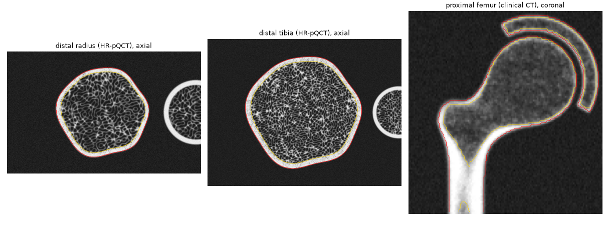

# Validation of the volumetric model

The [volumetric model](method.md#volumetric-model) fits the voxels of a band
around the surface instead of one profile per node (the reasoning is in
[volumetric_model.md](volumetric_model.md)). This page asks whether it
measures cortical thickness and the periosteal surface more accurately and
more precisely than the 1D methods, on phantoms of the sites CBM is used at,
at their scanners' resolution, and how it compares on our clinical knee CT.
Run time and memory are in [performance.md](performance.md).

## Methods

### Site phantoms

`cbm.site_phantom(site, seed)` (Rust: `phantoms::sites`) builds each site at
its scanner's resolution with parameters from the literature; the module
documentation lists the sources, and values without one are typical rather
than measured.

| site | phantom | voxels (mm) | PSF σ (mm) | noise | cortex |
|---|---|---|---|---|---|
| distal radius | shaft + ulna, 32 slices | 0.0607 | 0.08 | 40 mg HA/cm³ | 0.85 mm, Tt.Ar ≈ 254 mm² |
| distal tibia | shaft + fibula, 32 slices | 0.0607 | 0.08 | 40 mg HA/cm³ | 1.3 mm, Tt.Ar ≈ 707 mm² |
| proximal femur | head, neck, trochanter, shaft + acetabulum | 1.0 × 0.75 × 0.75 | 0.6 axial, 0.5 in-plane | 30 HU | neck 0.86 superior to 2.79 inferior, head and trochanter 0.8, shaft 3.5 mm |

All have a porous cortex, trabeculae, and an endocortical transition zone in
which porosity and trabecular density rise towards the endosteum. The true
endosteum is the smooth surface behind that zone, so the image is ambiguous
there, as in real bone.

To check that the HR-pQCT phantoms are realistic,
`docs/scripts/site_microarchitecture.py` measures them with the
second-generation HR-pQCT definitions (Whittier et al. 2020): Tb.Th and Tb.Sp
are the mean local thickness of the trabecular bone and of the marrow space
in the trabecular compartment, and Ct.Th the mean local thickness of the
cortical compartment (Hildebrand & Rüegsegger 1997, computed with
[local-thickness-rs](https://github.com/njneeteson/local-thickness-rs));
BV/TV and Ct.Po are volume fractions. They are measured on the phantom's
exact structure ("truth") and on the rendered image segmented as the
standard analysis does ("scan": Gaussian filter σ 0.8 voxels with support 1,
320 mg HA/cm³ for trabecular bone, 450 mg HA/cm³ for the cortex, within the
true compartments). The same script compares Ct.Th by local thickness with
the mean CBM thickness.

### Accuracy and precision

`docs/scripts/volumetric_validation.py` renders each site's geometry once
without noise and makes five scans by adding independent noise (exactly how
the phantoms add noise), so that all fits share the surface and the nodes.
Every method fits from the true periosteal mask with the same sampling range
(HR-pQCT 1 mm outside and 2.5 mm inside, femur 2.5 and 7 mm) and
`rho_c="estimate"`. The regularised method uses the smoothing of
our 2025 paper (σ 1.94 mm; 500 neighbours at HR-pQCT, 128 at clinical
resolution, where the nodes are about ten times sparser), and the volumetric
model its defaults: the same operator on `m`, `t` and its density fields
(`λ = 1`) plus the curvature penalty (weight 0.3). With `rho_c="estimate"`
both take `ρc` from the 1D estimate on their own profiles. On the HR-pQCT
shafts, all methods report along in-plane normals. For each node, thickness and periosteal position are compared with
the truth along the reported direction. Bias and RMSE are over nodes and
scans; SD, the precision, is the RMS over nodes of the standard deviation
over the five scans. On the femur every method is also run with `ρc` fixed
at the phantom's true cortical density, to separate the error of the
estimated `ρc` from that of the method.

### Clinical knee

`docs/scripts/knee_volumetric.py` fits the knee of
[clinical_ct.md](clinical_ct.md) (used with the subject's permission) from
each bone's refined periosteal surface, with the options of `ct_example.py`.
There is no truth, so the methods are compared with each other through three
fits: the regularised method on each bone with the other bones excluded and
its own estimated `ρc`; the volumetric model on all four bones together, so
that they share one PSF (they share the scanner) and one estimated `ρc`; and
the volumetric model on each bone with the PSF held at the joint fit's and
`ρc` at the regularised fit's ("matched"), so that the difference is that of
the methods alone. The surfaces are those of the regularised refinement.

## Results

### Realism of the HR-pQCT phantoms

Mean of three phantoms each:

| | radius truth | radius scan | tibia truth | tibia scan | in vivo (HR-pQCT) |
|---|---|---|---|---|---|
| BV/TV | 0.21 | 0.27 | 0.26 | 0.38 | 0.12–0.33 |
| Tb.Th (mm) | 0.17 | 0.30 | 0.19 | 0.33 | 0.22–0.29 |
| Tb.Sp (mm) | 0.56 | 0.74 | 0.55 | 0.61 | 0.6–1.0 |
| Ct.Th (mm) | 0.867 | | 1.294 | | 0.77–0.93 / 1.0–1.7 |
| Ct.Po | 5.4% | 0.3% | 8.6% | 0.4% | 1.5–2.5% / 3.5–6.6% |

The cortex and the trabecular spacing are in the in vivo range. The scanned
trabeculae are slightly thicker than in vivo, and the pores are too small to
be resolved, so the scanned porosity is far below in vivo. Both concern the
phantoms' fine structure, not the cortex that CBM measures.

### Ct.Th by local thickness and by CBM

| mean thickness (mm) | radius | tibia |
|---|---|---|
| local thickness of the true cortex (Whittier Ct.Th) | 0.867 | 1.294 |
| true thickness along the in-plane normals (CBM's definition) | 0.827 | 1.264 |
| CBM, local (RMSE) | 0.874 (0.147) | 1.307 (0.176) |
| CBM, regularised, 64 neighbours (RMSE) | 0.876 (0.131) | 1.311 (0.158) |
| CBM, volumetric (RMSE) | 0.835 (0.037) | 1.261 (0.057) |

The two definitions differ. Local thickness is the diameter of the largest
sphere in the cortex, averaged over its volume; CBM's thickness is the
distance between the fitted surfaces along the normal, averaged over the
surface. Volume weighting counts thick regions more (by about
`t̄ + var(t)/t̄`), and for this phantom's ±35% thickness variation it puts
local thickness 2–5% above the true mean along the normals. The 1D fits land
close to local thickness only because they overestimate thickness by about
0.05 mm here (the endocortical transition reads as cortex). The volumetric
model's mean agrees with the truth (+0.008 and −0.003 mm), and its per-node
error is about a third of theirs.

### HR-pQCT

| | t bias | t RMSE | t SD | edge RMSE | edge SD |
|---|---|---|---|---|---|
| radius: local | +0.048 | 0.154 | 0.0206 | 0.010 | 0.0039 |
| radius: local, estimated PSF | +0.042 | 0.145 | 0.0203 | 0.010 | 0.0038 |
| radius: regularised | +0.030 | 0.082 | 0.0044 | 0.010 | 0.0031 |
| radius: volumetric | +0.002 | 0.028 | 0.0007 | 0.006 | 0.0005 |
| tibia: local | +0.046 | 0.183 | 0.0272 | 0.015 | 0.0041 |
| tibia: local, estimated PSF | +0.041 | 0.177 | 0.0272 | 0.014 | 0.0040 |
| tibia: regularised | +0.031 | 0.114 | 0.0076 | 0.013 | 0.0036 |
| tibia: volumetric | −0.011 | 0.034 | 0.0006 | 0.006 | 0.0004 |

(mm.) The volumetric model is nearly unbiased, its thickness error is a
third of the regularised fit's and a fifth of the local fit's, its precision
is 6–13 times better, and its periosteal position is about twice as
accurate. The 1D error is almost all structural, the same in every scan (SD
0.02 against RMSE 0.15 for the local fit), and sits at the endosteum, where
the porous, trabecularised transition makes a single profile ambiguous. The
volumetric model fits all voxels around a node, with its edges smoothed as
the regularised fit's are and the endosteal surface also regularised by its
curvature. Its fitted PSF, 0.089 mm, is close to the
effective blur (PSF and voxel integration, `√(0.08² + 0.0607²/12)` =
0.082 mm).

### Clinical CT

With `ρc` estimated / fixed at the truth (mm):

| | t bias | t RMSE | t SD | edge RMSE | edge SD |
|---|---|---|---|---|---|
| femur: local | +0.166 / +0.155 | 0.219 / 0.211 | 0.035 | 0.060 / 0.062 | 0.024 |
| femur: local, estimated PSF | +0.138 / +0.132 | 0.173 / 0.169 | 0.028 | 0.066 / 0.067 | 0.023 |
| femur: regularised | +0.157 / +0.147 | 0.174 / 0.165 | 0.010 | 0.048 / 0.050 | 0.010 |
| femur: volumetric | +0.128 / +0.119 | 0.145 / 0.137 | 0.016 | 0.047 / 0.048 | 0.020 |

The volumetric model is the most accurate method on the femur, with `ρc`
estimated (thickness RMSE 0.145 mm against 0.174 mm for the regularised fit)
and with the true `ρc` (0.137 against 0.165 mm), with a precision between the
regularised and local fits' (thickness SD 0.016 against 0.010 and 0.035 mm).
Its fitted PSF, 0.565 / 0.688 mm (in-plane / axial) with the true `ρc`, is
close to the effective blur, 0.545 / 0.666 mm. The femur's shaft cortex is
thick, so the estimated `ρc` is close to the truth (about 1540 HU) and fixing
it changes little. Where no cortex in view is thicker than about four times
the blur, the estimate is low and every method makes the cortex thicker:
since the data fix the blurred mass `(ρc − ρb) t`, thickness scales roughly
as `1/ρc`.

A bias of about +0.1 mm remains for every method, from the endocortical
transition: the dense trabecular bone the
phantoms put against the endosteum (BV/TV rising to 0.35 within 2–3 mm) is
indistinguishable from cortex at clinical resolution. Without the transition
(the femur with `endo_bvtv = bvtv`, noise-free, true `ρc`), the regularised
and volumetric fits are both unbiased (+0.000 and −0.009 mm), with RMSE 0.048
and 0.059 mm; removing the pores changes nothing. The volumetric error left
there is in the thick shaft cortex (RMSE 0.08 against 0.06 mm), where the
curvature penalty resists the real variation of the endosteal surface
(±0.5 mm over 25 mm), and in the bottom 2 mm of the image, where the band is
cut off.

### Regularisation weights

The volumetric model's edges are smoothed with the regularised method's
penalty (`λ = 1`) and penalised for curvature (weight 0.3). On the clinical
CT of the knee the smoothing was what made refinement converge
([volumetric_refinement.md](volumetric_refinement.md#6-edge-smoothing-and-cortical-density)).
The weights have not been tuned at the anatomical sites; that waits for real
HR-pQCT data.

### Clinical knee

Fitted to all four bones together, the PSF is 0.65 mm in-plane and 0.81 mm
along the scanner axis, and the joint `ρc` 1504 HU, against 1384–1534 HU for
the bones' own 1D estimates. Fitted bone by bone, the PSF scattered
(0.53–0.80 mm in-plane, 0.57–0.88 mm axially, the patella's anisotropy
reversed): a single bone constrains it poorly.

Volumetric minus regularised, mean ± SD over nodes (mm); a negative
periosteum difference puts the volumetric periosteum further out:

| | nodes | regularised `ρc` (HU) | regularised median thickness | joint: thickness | joint: periosteum | matched: thickness | matched: periosteum |
|---|---|---|---|---|---|---|---|
| femur | 82339 | 1534 | 0.54 | −0.02 ± 0.11 | −0.04 ± 0.05 | −0.05 ± 0.11 | −0.02 ± 0.04 |
| tibia | 65346 | 1494 | 0.90 | −0.15 ± 0.34 | −0.05 ± 0.09 | −0.14 ± 0.34 | −0.05 ± 0.08 |
| patella | 13266 | 1384 | 1.17 | −0.42 ± 0.31 | −0.02 ± 0.13 | −0.26 ± 0.24 | −0.05 ± 0.08 |
| fibula | 16638 | 1486 | 0.87 | −0.09 ± 0.11 | −0.05 ± 0.05 | −0.07 ± 0.11 | −0.05 ± 0.04 |

With the same PSF and `ρc`, the volumetric cortex is thinner on every bone,
by 0.05–0.26 mm, and its periosteum lies 0.02–0.05 mm further out, so its
endosteum lies 0.07–0.31 mm further out: the 1D fit counts more of the
endocortical bone as cortex, which is the direction of its error on the
phantoms. The differences are smaller than with the earlier volumetric
default (0.07–0.25 mm in thickness, 0.06–0.20 mm at the periosteum), whose
edges were regularised by the curvature penalty alone.

The soft-tissue noise has a standard deviation of 34 HU and a lag-one
correlation of 0.71–0.86 along the axes, because the pixels (0.65 mm) are
smaller than the blur. The median local standard error of the thickness is
0.12–0.16 mm (95th percentile 0.2–0.6 mm, more on the fibula's thinnest
nodes), and the median misfit is 1.1–1.8, so the model accounts for the
noise level at most nodes; the 95th percentile, 2.1–3.8, marks where it does
not. The data's share of the curvature of the cost in `t` is small (median
0.13–0.16): at clinical resolution the regularisation carries much of each
node's value.

## Discussion

At HR-pQCT the volumetric model is clearly better than the 1D methods: an
almost unbiased thickness with a third of the regularised fit's error and
5–11 times its precision, and a periosteal position twice as accurate,
because it reads the porous, trabecularised endosteum that single profiles
cannot. The same holds on the realistic shafts of
[segmentation.md](segmentation.md).

At clinical resolution it is slightly more accurate than the best 1D fit,
with `ρc` estimated or right. Both are limited by `ρc`, which cannot be estimated
without some cortex thicker than about `4σ` in view, and by the dense
endocortical bone, which reads as cortex at that resolution. This is the
identifiability problem that led Treece et al. (2010) to constrain the
cortical density. In a field of view without thick cortex, `ρc` should be
fixed (from a calibration, or from a scan that includes a shaft); on the
clinical knee, whose field of view includes the shafts, the estimate was
1504 HU for the four bones together.

The PSF is recovered globally with its anisotropy, within 3–17% of the
effective blur (mostly under 10%) when `ρc` is right. It is a property of
the scan, so it should be fitted to all bones at once and held for per-bone
fits; bone by bone it scatters and takes thickness with it.

Refinement with the volumetric model now converges, on the whole clinical
knee ([clinical_ct.md](clinical_ct.md),
[volumetric_refinement.md](volumetric_refinement.md)).

Open questions: an estimate of `ρc` that is robust when all of the cortex is
thin (or a flag when it is not identifiable); a regulariser that lets the
endosteum of thick cortices vary more freely; and the regularisation weights
at each site, to be chosen on real data.

## References

* D. E. Whittier, S. K. Boyd, A. J. Burghardt, J. Paccou, A. Ghasem-Zadeh,
  R. Chapurlat, K. Engelke, M. L. Bouxsein, *Guidelines for the assessment
  of bone density and microarchitecture in vivo using high-resolution
  peripheral quantitative computed tomography*, Osteoporosis International
  31(9):1607–1627, 2020, doi:10.1007/s00198-020-05438-5.
* T. Hildebrand, P. Rüegsegger, *A new method for the model-independent
  assessment of thickness in three-dimensional images*, Journal of
  Microscopy 185(1):67–75, 1997.
* G. M. Treece, A. H. Gee, P. M. Mayhew, K. E. S. Poole, *High resolution
  cortical bone thickness measurement from clinical CT data*, Medical Image
  Analysis 14(3):276–290, 2010.
* N. J. Neeteson, S. K. Boyd, *Advancing Cortical Bone Mapping with global
  optimization*, Computers in Biology and Medicine, 2025,
  doi:10.1016/j.compbiomed.2025.110636.
